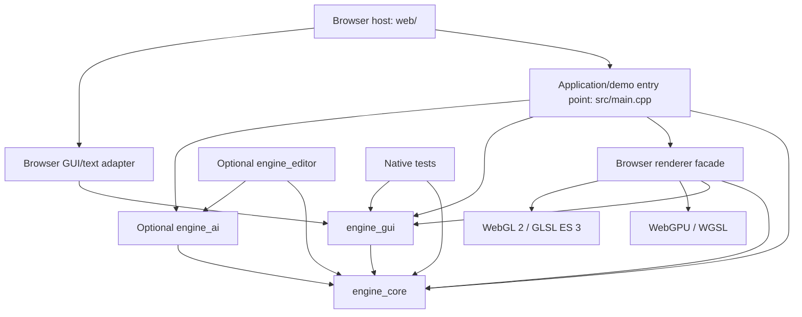

# WebEngine architecture

## Purpose and scope

WebEngine is a C++20 engine for games running in desktop and mobile browsers through WebAssembly with WebGPU and a WebGL 2 fallback. Its reusable systems should support multiple game types. A cat puzzle game is one application of the engine, not the model for its public API.

This document describes the implementation inspected on 2026-10-10 and the architectural boundaries for future work. The current architecture sections describe existing code. The evolution table describes intended additions and extensions, not delivered functionality. Keep these sections current when implementations change; source code and focused validation establish actual capability.

## Current architecture

### Build and dependency structure

[CMakeLists.txt](CMakeLists.txt) defines the following targets:

| Target | Responsibility and dependencies |
| --- | --- |
| `engine_core` | Portable application runtime/clocks, scene hierarchy, lifecycle, prefabs/factories, input state, camera controllers, assets/importers, audio, animation, physics, effects, scene/application archives, render preparation and performance data. Privately links ufbx, cgltf, meshoptimizer, Jolt and the image decoder. |
| `engine_gui` | Portable retained widget tree, wrapping/scaled/scroll layout, input handling, accessibility descriptions and font/draw-list generation; publicly depends on `engine_core`. |
| `engine_ai` | Optional portable waypoint/static-navmesh A* search, explicit versioned surface invalidation/publication, immutable state-machine definitions, typed actor controllers and per-agent runtime, private Recast/Detour 1.6.0 dependencies, application-owned path follower/navigator with capsule clearance and bounded obstacle recovery, explicit-candidate sight queries and bounded-frequency decision clock; publicly depends on `engine_core`. No renderer/browser dependency or scene owner. |
| `engine_editor` | Optional portable authoring: independent AI graph asset documents/history, typed properties, structural/component and grouped transform commands, imports/materials, selection, duplication, placement/snapping, bounded history and isolated `EditorPlaySession`; publicly depends on `engine_core` and `engine_ai`. |
| `engine_gui_browser` | Emscripten-only GUI input/text and accessibility adapter; depends on `engine_gui`. |
| `engine_assets_browser` | Optional Emscripten HTTP and bounded isolated decode-worker adapters; links `engine_core` and propagates Fetch linkage. |
| `asset_decode_worker` | Isolated browser Wasm importer/decoder; returns validated resource transport, with no scene/GPU ownership. |
| `texture_tool` | Native offline semantic mip export and validated KTX2/fallback bundle packaging. |
| `asset_browser_tests` | Explicit Emscripten HTTP/resource acceptance runner, excluded from normal builds; uses a self-hosted smoke server without a GPU. |
| `engine_audio_browser` | Emscripten-only Web Audio device adapter; publicly depends on `engine_core`. |
| `webengine` | Browser executable: application/demo entry point, renderer facade, WebGPU and WebGL 2 backends, GUI rendering and demos; links the libraries above. |
| Native test executables | Exercise portable systems without the browser renderer. The current native configuration is a core/test build, not a native game rendering backend. |
| `persistence_wasm_tests` | Optional Node/Wasm persistence regression runner, enabled with `WEBENGINE_BUILD_PERSISTENCE_WASM_TESTS`; exercises the portable contracts on the 32-bit Wasm ABI. |
| `spatial_query_tests` | Explicit Emscripten test target, excluded from normal builds; executes physics/query/sensor assertions in browser Wasm without publishing the playground. |
| `physics_joint_wasm_tests` | Explicit Emscripten test target, excluded from normal builds; executes the portable joint solver/lifetime suite in browser Wasm without publishing the playground. |
| `animation_control_wasm_tests` | Explicit Emscripten test target, excluded from normal builds; executes portable animation controller/event/output assertions in Node Wasm without publishing the playground. |

Emscripten is pinned by [.emscripten-version](.emscripten-version), currently to 6.0.11. The browser executable links the Emdawnwebgpu port and Emscripten GLES3/WebGL 2 support. WGSL source in `shaders/` is embedded through generated headers during CMake configuration. The browser host and selected build outputs publish into `dist/`; generated site files copy first, then current `web/` adapters override any stale host files retained in reused build directories.

The scene/application/render runtime is single-threaded. Optional asset workers use isolated Wasm heaps for source parsing and image decoding. JavaScript handles browser APIs and forwards data to Wasm; C++ updates the scene and submits rendering through the browser renderer facade. Its public header contains no WebGPU/GLES/Emscripten types; backend resource types are private in `src/webgpu_renderer.hpp` and `src/webgl_renderer.hpp`. The facade remains linked in the browser executable; native builds provide portable core/tests, not native rendering.

This is a responsibility diagram, not a claim that these responsibilities already have fully independent build targets. In particular, physics/ship demos and the material showcase currently compile into `engine_core`; the renderer compiles into `webengine`. Future extraction should preserve behaviour while moving application examples away from reusable libraries.

### Scene model, ownership and lifecycle

[Application](include/engine/application.hpp) uniquely owns loaded scenes through
application-scoped `SceneId` handles. It implements start, pause, resume, terminal
shutdown, host suspension and scene load/unload/transitions at frame boundaries.
Scene hooks cover load, activation, pause/resume, deactivation and unload. Failed
loading or presentation binding preserves the active scene. Inactive scenes can
be retained for return; unload destroys their actor/physics/resource ownership.
A presentation binding releases borrowed scene/camera references before shutdown
destruction. The browser archive workflow stages decode separately and transfers
validated scenes into the runtime. See
[application lifecycle contracts](docs/application-lifecycle.md).

`Scene::synchronize()` reconciles lifecycle, physics registration and skeletal
resources without variable or fixed ticks. Application uses it while paused;
passing zero to `Scene::update()` remains a real tick for standalone callers.

The engine uses an owned scene graph rather than an ECS. [Node](include/engine/node.hpp) supplies a name, local transform, enabled state and children owned with `unique_ptr`. `Scene`, `Actor` and `Component` derive from it. Actors and components can be nested; a component's owner is its nearest actor ancestor. Disabling a node makes its subtree inactive.

[Scene](include/engine/scene.hpp) registers actors and components with scene-scoped, generation-checked `ActorId` and `ComponentId` handles. Lookups reject stale or foreign handles and objects pending removal. Direct references and query pointers are non-owning and require the object to remain alive.

`Scene::update(deltaSeconds)` reconciles lifecycle state and runs enabled variable ticks, including animation. `Scene::fixedUpdate(stepSeconds)` reconciles lifecycle state, runs enabled fixed ticks and steps physics. It does not advance animation clocks. Both flush deferred destruction after guarded traversal. `updateAnimations()` is a compatibility alias for `update()`, not an additional animation pass.

Destroying an object during a tick safely queues removal and immediately excludes it from relevant lookup/traversal. Detachment and reparenting require an idle hierarchy. Lifecycle cleanup hooks must not throw. Protected implementation children, such as those within skeletal components, cannot be independently removed or reparented. `KeepWorld` reparenting rejects transforms requiring unrepresentable shear.

Transforms and normal matrices are cached. Public transform writes remain supported and are observed by cache evaluation; future APIs must preserve invalidation and inherited-transform behaviour.

### Reusable object definitions and factories

[Prefab](include/engine/prefab.hpp) is an optional portable `engine_core` module.
It owns a configured actor-root hierarchy with stable definition-local keys;
applications own a versioned `ComponentFactoryRegistry` and register executable
component construction. Explicit [built-in factories](include/engine/prefab_components.hpp)
reuse mesh/material/texture/skeleton, collision-shape and effect resource types.
Each instance owns independent nodes, transforms, overrides and component state.

Instantiation validates key-based overrides, snapshots factory callables, builds
and validates a detached subtree, then publishes through one `Node::adoptChild`.
Failed construction leaves the destination hierarchy intact. Scene handles and
nearest-actor ownership use the existing registration path; attach/spawn/tick and
scene-dependent physics constraints reconcile normally. Guarded tick-time additions
begin on the next update. A traversal guard protects the destination from callback
detachment/flush, while destruction requests are rechecked before publication.

`PrefabInstance` contains non-owning scene-scoped actor/component handles, not
borrowed raw references or a separate instance registry. Definition-local keys
are unrelated to runtime or saved identities. Factories are synchronous trusted
application code with explicit capture lifetimes; external callback side effects
are outside construction rollback. Definitions are in-memory data, with no
serialization of arbitrary configuration or executable factories. Existing scene
archives serialize supported built-in instances and shared assets; custom archive
codecs, asynchronous loading and definition-file formats remain separate concerns.
See [prefab contracts and usage](docs/prefabs.md).

### Frame execution and input

The portable frame scheduler lives in [Application](src/application.cpp), with
browser callbacks in [src/main.cpp](src/main.cpp) and hosting in
[web/app.js](web/app.js). Its main sequence is:

1. The browser submits input records and a RAF timestamp converted to seconds.
2. Application commits pending lifecycle controls, updates its asset manager, prepares ready transition candidates and commits scene transitions, then starts one `InputSystem` snapshot and invokes the input callback. Pending dependencies keep the outgoing scene active; publication also runs before start and while paused/suspended, without advancing suspended clocks.
3. While running, invoke application simulation policy and call the active scene's variable update once. While paused, reconcile without ticking.
4. While running, advance the application-owned `FixedStepClock` for bounded fixed updates and physics interpolation.
5. Invoke `afterSimulation` and presentation callbacks. The application-owned audio example updates fades and scene emitters using presentation delta after simulation; the browser renders, synchronizes GUI text state and refreshes diagnostics.

Application owns separate input, variable simulation and presentation clocks plus
fixed simulation scheduling. Pause freezes simulation while camera/menu input and
rendering continue. Host suspension freezes every clock and rejects input.
Lifecycle boundaries clear queued/held input, fixed remainder and timestamp
baselines, preserving elapsed totals and avoiding hidden-time catch-up. Game
motion, level flow and camera policy live in host callbacks. Standalone scene
users can continue supplying their own scheduler.

[web/input.js](web/input.js) maps mouse, keyboard, pen, touch gestures and virtual controls to portable actions. [InputSystem](include/engine/input.hpp) maintains action edges, held axes, deltas and ordered pointer/event records. Input ownership prevents GUI, scene gestures and virtual controls from competing for the same contact. Text entry uses the browser text service rather than physical key codes. Pointer conversion distinguishes CSS coordinates from canvas backing pixels. Blur, hidden-page and context changes cancel held input; visibility changes suspend/resume the application while preserving explicit pause state.

See [input validation and device scope](docs/input-validation.md).

Portable `InputBindings` maps application-defined control IDs to the same queued
actions through an ordered context stack. It borrows `InputSystem` or owns a
submission callback to `Application::submitInput`, preserving the runtime's
input gate. It owns a reserved source range and releases only those sources on reconfiguration,
cancellation or destruction. The browser adapter provides named stacked contexts
and disposable virtual controls with validated stick configuration; physical key
and DOM semantics remain outside portable controllers. See
[UI/input integration](docs/ui-input-integration.md).

### Assets, animation and effects

Mesh components share geometry through `shared_ptr<const Mesh>`; textures, materials, skeletons, clips and effect definitions also have shared resource representations. Per-instance transforms, material overrides, morph weights and playback state remain separate from shared assets. Treat published geometry as immutable; deliberate geometry changes must follow the existing bounds/cache invalidation contracts.

FBX and GLB importers convert source assets into engine representations, validate input and report unsupported arrangements. Texture decoding uses stb_image; mesh optimization uses meshoptimizer. The material system supplies PBR maps/factors, material overrides and environment lighting. The material graph authoring tool bakes output into material data; editable graph source has its own JSON persistence.

[AssetManager](include/engine/assets.hpp) supplies a portable owner-thread registry
of logical typed asset IDs, shared in-flight operations and immutable resource caches.
Loader completion endpoints accept synchronized worker reports and publish only at
`update()`. Move-only request interests separate per-consumer cancellation from IO
abort; weak completion endpoints reject stale generations and survive owner teardown.
Explicit eviction/collection drops cache ownership while live shared resources remain
valid. Importers remain synchronous decoders; sources own IO and validation policy.
The optional `engine_assets_browser` target supplies HTTP fetch/progress/timeout/abort
with no browser types in the portable manager. Custom byte callbacks remain
synchronous; `browserDecodedAssetLoader` owns a bounded queue of isolated workers
for FBX/GLB/images/texture bundles, including timeout and cancellation. Owner-side
archive hydration remains validated copying. Native hosts supply their own
IO/executors, with no implicit thread pool. [Mobile asset contracts](docs/mobile-assets.md)
cover worker ownership, budgets and restricted KTX2 delivery tooling.

Application owns one manager and optional per-scene `AssetPreparation` batches.
Transition dependencies and an idle preparation callback complete before binding or
activation; failure retains the active scene. Scene unload releases batch ownership;
shutdown clears scenes/preparations/cache. Preparation does not add GPU prewarming:
renderer caches and GPU creation remain backend-owned. Runtime IDs/registrations and
callbacks are not archived. See [asset contracts and validation](docs/assets.md).

Skeletal components coordinate skeleton state and animation playback. Animation supports clip playback, blending, crossfades and opt-in root-motion extraction. An optional shared immutable controller definition supplies typed parameters, ordered state transitions and parameter-driven two-clip blends; instance control evaluates in the player's variable tick. Shared clips carry validated event markers. The player queues owned marker events and accumulated movement for explicit consumption, with no callbacks or scene subscriptions. Controller transitions preserve pending output; skeleton replacement cancels control/output. Extracted root motion does not automatically move an actor; its consumer owns movement/collision policy. Scene archives retain controller data, markers and pending output. Morph targets and particle/flipbook effects have their own instance state and rendering preparation. See [animation control contracts](docs/animation-control.md).

See [material graph](docs/material-graph.md) and the detailed feature contracts in [README.md](README.md).

### Physics and spatial queries

The optional portable [terrain module](docs/terrain.md) in `engine_core` owns
validated immutable heightfield source data and derived chunk LOD chains.
`TerrainAsset` shares source/material/meshes; `TerrainComponent` extends ordinary
mesh components with source/chunk identity. `makeTerrainActor` prepares a detached
actor with chunk components and optional full-resolution static triangle collision.
Existing scene ownership, handles, rendering caches, culling and backend recovery
remain authoritative. Ground/ray helpers visit active terrain triangles independently
of camera visibility/interpolation and never initialize physics. Physical instances
retain the root-actor/unit-scale/body ownership contract.

Optional `MaterialLayers` blends four tiled albedos/roughness values using a linear
RGBA weight map on ordinary PBR/unlit materials. Optional packed linear RGB normal /
alpha height maps add per-layer relief and height-based weight transitions. Signed
world-axis triplanar projection blends color, height and reoriented normal samples;
weight maps remain mesh-UV based. Defaults preserve old linear/mesh-UV shading.
Nine material texture bindings fit alongside the seven existing frame textures;
backend shaders, semantic upload caches and material keys own rendering, with no
GPU types in portable contracts. WebGL 2 retains basic lighting and no shadow maps.
Terrain LOD generation preserves every source perimeter vertex/segment and fans
coarse interiors into that boundary, so neighboring levels need no negotiation or
skirts. Existing `RenderFrame` selection/history chooses camera pixels and shadow
texels independently; optional generic `MeshLodPolicy` adds per-instance scales and
fixed levels. Presentation selection never changes source meshes, picking or physics.

`TerrainAsset::edit` stages immutable raise/lower, flatten, smooth and RGBA paint
versions. Height edits rebuild intersecting chunk chains plus a two-sample normal
halo, sharing every unaffected mesh; painting shares all geometry. Explicit idle
`applyTerrainEdit` publication preserves component handles and prepares collision
before replacement. The existing whole-instance collider recooks for height edits;
paint changes no collision. Source-local brush semantics and game undo policy are
separate from renderer selection.
`TerrainAsset::withLayers` stages a validated immutable material-layer replacement
sharing all geometry/LOD chains and retaining patch metadata. The resulting
appearance-only `TerrainEdit` uses the same publication path, retaining height
data and collision. Stream owners can publish it through their existing apply path.

Optional `TerrainStream` borrows a longer-lived Scene and retains a source-only
asset (`create(data,false)`). Application-selected focus, radius, resident count
and per-update admission budgets own derived CPU geometry and optional per-chunk
static bodies. Eviction uses existing actor destruction and backend weak caches;
it does not hide an eagerly retained terrain. Source samples remain resident and
bounded by terrain limits. World queries/physics cover resident chunks, whereas
asset ground queries cover the full source. Stream edits rebuild resident dirty
chunks; absent chunks build from the latest source on admission. Update/apply/clear
and owner destruction require an idle scene boundary. No camera/render setting
implicitly changes residency or simulation.

Optional `terrain_paging.hpp` separates bounded source IO from that full-source
editing path. `TerrainPageLayout` describes a large grid without allocating it;
each immutable revision/page supplies one chunk and a clipped two-sample halo.
`generateTerrainPage` performs portable CPU base/LOD/raw-collider generation with
global positions/UVs and page-local weights. `TerrainPagedStream` borrows Scene,
owns per-job AssetManagers and resident actor handles, and bounds resident source
bytes/count, pending jobs and per-update admissions. Asset completion contexts
permit worker reports without capturing Scene; idle `update` validates identity,
revision, payloads and neighboring halos before publication. Focus changes,
clear/destruction cancel obsolete requests; late reports are harmless. Failure
records are bounded to the desired set and require explicit retry. Queries and
collision cover resident pages only. Dataset revisions are immutable; WETP v2
adds per-page generations while the decoder retains v1 base-page compatibility.

Opt-in `TerrainPagedStream::enableEditing` takes a portable atomic batch writer.
One queued brush pins/loads its required source pages, including all copies of
shared two-sample halos, within existing resident/source caps. The idle owner
evaluates frozen global samples and prepares every changed page before publishing
the stamp. Height edits regenerate affected base/LOD/collision; paint shares mesh
and collision pointers. Component/actor handles and instance policy survive.
Brush evaluation and edit rebuilding are bounded synchronous owner work; worker
generation remains the page-load path. There is no hard edit-latency guarantee.

Dirty pages are pinned within the same residency budget until their exact snapshot
is acknowledged by the writer. One bounded batch can be pending while newer edits
continue; generation-aware acknowledgements leave newer versions dirty. Writers
must compare expected generations and atomically commit all page/halo replacements.
Conflicts/failures retain local data and stop automatic retries. `flush` retries
explicitly; default `clear` rejects unsaved data, whereas `clear(true)` and owner
destruction cancel pending interests and discard unsaved state. Applications own
safe shutdown/history and any conflict merge policy. Aborting a write cannot undo
an already committed transaction.

`engine_assets_browser` supplies `browserTerrainPageLoader`: isolated workers own
bounded HTTP, page decoding and chunk generation, using `terrain-worker.js` with
the matching `asset_decode.js/.wasm`. No shared memory/pthreads are required.
The owner validates/copies prepared mesh transport without regenerating chunk
topology, then registers/cooks optional Jolt bodies; backend uploads remain on the
renderer path. Pending count and admission limits are not a hard time budget.
Native applications supply their executor/IO through ordinary AssetLoader loader
and writer factories. Browser `browserTerrainPageWriter` uses `terrain-storage.js`
for an origin-bound IndexedDB overlay. Workers read that namespace before HTTP;
the owner writer compares generations and commits the complete batch in one strict
readwrite transaction, acknowledging only transaction completion. Dataset layout/
revision identifies compatible records. Portable paging introduces no implicit
thread pool, database dependency or frame scheduler.

Format-15 scene/application and asset archives retain source sharing, layer data,
LOD generation/policies, instance state, optional physics and eager/source-only
generation mode. Only saved resident components regenerate for source-only assets,
with each reconstruction charged to allocation budgets. Runtime streaming owners,
focus/budgets and undo history belong to the application and are not serialized.
Format 15 adds optional patch interior/global-offset metadata, so resident paged
snapshots save their bounded source halos and rebuild independently of providers.
URLs, revisions, per-page generations/dirty state, pending jobs and provider
configuration remain application state. Saved patch geometry/weights include
current edits but do not flush page storage or restore a writer.
Older terrain defaults to eager generation (format 10/11 also defaults to full detail).
Terrain adds no alternate graph or simulation scheduler. Browser-owned
`src/terrain_demo.*` and `web/terrain.js` compose terrain with shared pointer input,
exclusive brush/camera gestures, a 16-stamp undo/redo history, explicit streaming
controls, physics and staged archives. A separate editable 1025² paged sample world
releases the editable source and loads static page fixtures generated by
`tools/terrain_demo_pages.py`; controls expose IO/source budgets, dirty/write state,
save/retry and explicit discard. Reset/return retain unsaved pages until writeback
completes or the user discards them. Its IndexedDB overlay persists edits across
eviction and reload; clearing it is an explicit action outside the paged world.
Geomorphing remains a future extension.

[PhysicsWorld](include/engine/physics.hpp) wraps one single-threaded Jolt system per scene, created lazily. Public physics headers keep Jolt implementation types private. Rigid bodies support static, dynamic and kinematic motion; collider components supply shapes. `FixedStepClock` caps catch-up work and discards excess elapsed time rather than replaying an unlimited backlog after interruption.

Simulation transforms are authoritative. Rendering can interpolate body poses without changing those transforms. Raycasts, convex-shape overlaps and linear sweeps use simulation poses and return scene-safe actor/body handles. A shared query filter supplies layer masks, motion/sensor categories and actor/body exclusions independently of the simulation layer-pair matrix. Overlaps return one deepest hit per body; sweeps report closest contact and initial penetration. Triangle meshes are supported targets, while query geometry is convex and unit scale.

Collision layers are separate from rendering visibility masks. Begin/stay/end contact-manifold events are delivered after solver locks are released, under scene traversal protection. `RigidBodySettings::isSensor` enables convex trigger volumes without collision response. Sensors use post-step narrow-phase overlap sets to emit one Enter/Exit per directed sensor/body pair, including sleeping and stationary bodies. Trigger pairs obey the simulation layer matrix and exclude self. Exit retains original handles after removal or transfer and arrives on the next fixed step; callbacks must resolve handles before using objects. Detection samples final fixed-step poses and does not guarantee detection of a body crossing completely between samples. The world owns bounded pair history and callbacks; scene archives retain sensor settings but recreate history/subscriptions. Version-1 body archives load as solids; version 2 and later retain sensor settings.

See [physics ownership, queries and validation](docs/physics.md).

The same world optionally owns hinge, slider, distance-spring and movable point-grab
constraints through portable settings and non-owning world-scoped `PhysicsJointId`
handles. Endpoints reuse scene component handles; world-space creation anchors
become body-attached simulation points. Connected-body collision suppression is
independent of query filtering. Constraints are released before either solver body
is removed or rebuilt, and never resurrect after disable/transfer/reconfiguration.
Creation and retargeting occur outside solver locks, including guarded gameplay
callbacks. Joint definitions/IDs are runtime state and have no built-in archive or
prefab codec. Input mapping, grab cancellation and puzzle rules remain application
policy. See [joint contracts and validation](docs/physics-joints.md).

### Movement controllers

[CharacterMotorComponent](include/engine/character_motor_component.hpp) is an
optional portable movement component. Gameplay submits persistent world-space
velocity and latched jump commands; input, AI and network adapters remain outside
the motor. Its last fixed-step result reports requested/actual displacement,
velocity, ground state/handles and jump, landing and obstruction flags.

The scene hierarchy owns the component. Collision-aware mode lazily initializes
the existing `PhysicsWorld`, whose private implementation owns Jolt virtual
characters through scene-scoped component/actor handles. Gameplay fixed ticks run
before rigid-body simulation; collision-aware motors solve after bodies and before
contact delivery. Free XYZ motors run in their own fixed tick without initializing
physics. One active motor controls a scene-root actor with unit world scale; a
rigid body on that actor is rejected. Disable/detach/transfer/destruction removes
the old character and clears transient state and commands.

Grounding, slopes, steps, snapping, jumps and moving-ground velocity use authoritative
simulation poses. Physics render interpolation affects visuals only. Archives
retain settings and persistent velocity commands, rebuilding support and clearing
jump edges/vertical solver velocity on load. Virtual characters collide with
rigid-body geometry, have no broad-phase bodies, and do not currently collide
with each other. Additional movement modes and root-motion policy remain
application/extension concerns. See [movement contracts and validation](docs/movement.md).

### Game AI

Optional `engine_ai` owns immutable authored waypoint graphs and bounded
synchronous A* searches, application-owned `PathFollower` state, explicit-candidate
`observeActor` sight queries and `DecisionClock`. It depends publicly on
`engine_core`, with no browser/render/worker dependency and no new scene registry
or implicit frame phase. Games call the follower from actor fixed ticks before
child motors, and advance decision time only during simulation. One command
producer owns a motor; the application cancels on disable, detach, target loss
and handoff. The follower retains points, not borrowed actors/components. Sight
resolves existing generation-checked handles and uses authoritative poses plus
optional existing-world filtered rays, never presentation visibility.

`Navigator` (`WaypointNavigator` compatibility alias) additionally owns a shared
immutable `NavigationSurface` (waypoint graph or static navmesh), optional shared
`NavigationSource` publication slot, current goal,
follower route, a cached engine capsule probe and finite retry/deadline state. It
binds a scene-scoped motor handle, retains no borrowed scene/motor pointers, and
checks the next pending segment before movement. Search augments the graph with
bounded explicit source/goal connectors and a synchronous non-retained traversal
predicate. Clearance uses existing-world sweeps/overlaps, motor collision layers,
agent exclusions and authoritative poses. Blockage stops commands immediately;
simulation-time-delayed searches can choose alternate routes or fail explicitly.
Only one bounded search is allowed per eligible step, with per-step query limits
and a total request deadline/replan count. Ground support, access and terrain
residency remain application guarantees; clearance does not emulate motor steps
or rebuild topology. Custom navigator state has no built-in archive codec.

`src/ai_demo.cpp` implements patrol/follow/investigate/return/blocked policy outside
reusable libraries and compiles into the browser executable/native AI tests.
Application owns pause/suspension/transitions; debug geometry only presents state.
Returning destroys its custom actors and restores source nodes/orbit. Its custom
actor has no archive codec and active-demo saves reject explicitly; applications
reconstruct executable behavior through existing custom persistence contracts.
`NavMesh` bakes registered static collision through an owned `PhysicsGeometry`
snapshot; solver leaf traversal preserves collider transforms. Scene bakes remove
solid-occupied voxel spans before polygonization; raw triangle bakes describe
surfaces and require caller-defined interiors. Baking is synchronous owner/idle
preparation work bounded by cell/raster/occupancy/polygon limits, with atomic
resource publication. Recast/Detour stay private to `engine_ai`; no scene, solver
or browser objects survive in the immutable resource. Per-query scratch, endpoint
projection, bounded polygon A*, checked funnel paths and engine debug geometry
compose the existing navigator/motor lifecycle. Main application input performs
click ray mapping; debug rendering never advances navigation. Moving baked static
geometry requires explicit replacement. See [navmesh contracts](docs/navmesh.md).

`NavigationSource` adds explicit owner-thread invalidation and revision-checked
atomic publication, retaining an old surface for diagnostics while dirty. It owns
no scene, callback or worker. Applications invalidate before collision changes,
synchronize and explicitly prepare a complete replacement. Active navigators stop
stale follower commands before child motor ticks, wait without spending search
queries/retries, then replan the original goal against the new revision. The total
deadline and finite search budget survive replacement; terminal requests do not
resurrect. Stale/duplicate bake completions reject. There is no automatic physics
subscription or affected-region tracking. See [update validation](docs/navigation-updates-validation.md).

`StateMachineDefinition` owns validated immutable flat-state graphs with named
behavior/condition keys. Per-agent `StateMachine` instances own current state,
simulation timers and bounded transition/condition work. Applications supply
synchronous non-retained `StateMachineHost` callbacks, stop on lifecycle/control
handoff, and keep all game behavior outside reusable libraries. Exit/enter ordering,
exception cleanup and reentry rejection are explicit. The patrol example now binds
the same runtime; manual navigation hands control away from the machine.

`AiGraphEditor` in `engine_editor` owns a separate asset document/history, never a
second scene or scene-history stream. The editor now publicly links `engine_ai`.
`web/editor-ai.js` supplies graphical node/edge authoring and modal input ownership;
`src/editor_ai_browser.cpp` bridges validated portable edits and an isolated preview
using the real C++ runtime. Preview condition values are independent of scene/game
contexts. `.weai` version-1 files serialize definitions/layout, not callbacks or live
state. Application-side demo binding validates known keys before adoption. Source
scene archive schema remains unchanged; actor assignments use the optional AI codec below.
See [state-machine/editor contracts](docs/ai-state-machines.md).

`AiControllerComponent` adapts these graphs to ordinary actors through an immutable
`AiBindingRegistry` and complete typed state/condition parameter mappings. Each
component owns fresh runtime state and a bounded transition log; explicit lifecycle
cancellation stops its motor commands. `Component::fixedTickOrder()` provides stable
ascending sibling order during fixed traversal (default 0, AI controllers -100),
without changing hierarchy order, actor-first dispatch, guarded traversal or render
ticks. This makes command-before-motor ordering explicit, including free motors.

The optional `engine.ai.controller` custom codec embeds configuration/definition
text and resolves saved actor references after hierarchy reconstruction. Core does
not link AI; scene save/load, generic codec-aware cloning and EditorPlaySession
receive caller-supplied registries. The browser host supplies the built-in binding
registry/AI codec. Source scene history owns controller assignment/configuration;
graph-document history stays independent. The live debugger resolves the selected
source component's saved ID in the isolated Play scene and presents only that
runtime's state, elapsed time and transition log. No runtime commands/timers or
callback closures are persisted. See [actor controller contracts](docs/ai-controllers.md).

See [AI contracts](docs/ai.md). Dynamic carving, dynamic graph rebuilds, crowds,
behavior trees, hierarchical states and AI runtime checkpoints remain extensions.

### Selection and interaction

[InteractionComponent](include/engine/interaction_component.hpp) opts actors into
the scene-owned, lazily created [SelectionSystem](include/engine/selection.hpp).
It resolves pointer/ray targets, maintains single-target selection and focus,
reports available actions with eligibility reasons, rechecks action handles on
execution and publishes ordered selection/focus notifications. Targets and
providers use the existing generation-checked scene handles; callbacks execute
under guarded traversal and applications own their capture/subscription lifetimes.

Picking defaults to transformed mesh bounds or explicit proxy bounds, including
render interpolation. Per-query opt-in CPU triangle picking tests original mesh
parts after morphing/skinning and returns surface attributes. Optional visible-mesh
triangle occlusion includes nonparticipating geometry with independent blocker
visibility masks. No GPU/readback, LOD dependency or physics initialization is
required; texture alpha and shader deformation remain outside geometric picking.

[ManipulationController](include/engine/manipulation.hpp) is an optional portable,
application-owned exclusive transform writer over scene-scoped target/provider/
surface handles. World plane/axis dragging and pivot rotation write validated
authoritative local TRS through the existing hierarchy API. Commit retains the
pose; cancel/destruction rolls back only while ownership is valid. Target/provider
loss, hierarchy/parent motion or external writes release ownership without
overwriting later changes. Physics/motor-controlled actors or ancestors are
rejected; physics grabs use separate physics commands. The scene must outlive the
controller. It owns no callbacks, subscriptions or input-device integration.

Applications choose the active camera/view, route shared input and cancellation,
draw feedback and supply snapping, legality, action meaning, distance and gameplay
policy. Per-query precision/occlusion and manipulation sessions are runtime-only.
Archives retain provider picking configuration and inert action IDs/labels;
applications rebuild executable callbacks and runtime selection state. See
[selection contracts](docs/selection.md).

### Camera controllers

[CameraController](include/engine/camera_controller.hpp) is an application-owned,
portable stack over `CameraComponent`: orbit, follow, tracking, group framing,
half-life smoothing, interruptible pose/lens transitions and collision constraints.
Targets use scene-scoped actor/component handles or sampled world points. The
controller owns behaviours and callbacks; its scene or explicitly borrowed camera
must outlive it. Evaluation validates a candidate before publishing camera state.

Applications update the stack after scene/physics updates and before rendering,
supplying camera delta seconds and viewport aspect. Composition runs before
smoothing and transitions; collision constraints run last and reuse optional
`PhysicsWorld::sweep` with sphere geometry, filters and subject exclusion. Cameras
alone never initialize physics. Custom collision queries can supply another backend.
Only camera presentation changes; target simulation poses remain authoritative.
The legacy parent-space `OrbitController` and its input/archive contract remain
available; an application chooses one writer for a camera. Runtime behaviours
are reconstructed by applications after archive loading. See
[camera controller contracts and examples](docs/camera-controllers.md).

### Rendering and presentation

Optional [animated water](docs/water.md) uses portable `WaterSettings` on existing
shared meshes/materials and slot instances. Both backends render bounded Gerstner
waves, analytic normals, moving ripples, Fresnel reflection and direct highlights.
WebGPU can use existing IBL; WebGL 2 uses authored sky radiance. Optional World
refraction/absorption and shoreline foam capture the current camera's non-water
opaque/masked color and depth before water/transparency. Renderer-owned scratch
targets are shared serially across views; half-texel viewport clamps, world-depth
and plane rejection prevent view/foreground feedback. Other layers retain surface
shading. Active camera masks gate conservative scene-input preflight; disabling
effects releases canvas-sized targets and preserves normal scene pass counts.
WebGPU averages MSAA color and selects minimum depth into sampleable snapshots;
WebGL uses complete RGB8/DEPTH_COMPONENT24 framebuffers and matched color/depth
blits. These are intermediate captures, separate from the final canvas resolve
before GUI. Single-sample water scenes use an accumulation target and presentation
pass. Backend resources are recreated on resize/recovery; scratch memory and
capture/continuation World timing are observable. Optional planar reflection adds
one single-sample mirrored-camera World pass per affected view, sharing the first
visible requesting water plane among coplanar surfaces. The transformed local-Y=0
plane clips submerged geometry and reverses winding; retained opaque/masked
batches include off-camera objects with existing poses/LODs and masks. Water,
transparent/particle geometry, sky and GUI are excluded. Clear-alpha samples retain
the sky/IBL fallback. Separate capture bindings prevent attachment feedback;
reflection color/depth targets share the same resize/recovery and serial-view
lifetime, while their memory and World GPU timing are reported. Main MSAA and
final resolve ordering remain unchanged. Optional underwater presentation selects
one active World water containing each camera from the mesh's local XZ bounds
below its transformed mean plane; selection respects masks and hierarchy without
requiring surface frustum visibility. Portable `UnderwaterView` copies the region
and settings; `underwaterDistance` clips viewing segments to its sides and surface
in world units. After World transparency, a depth snapshot and fullscreen composite
apply exponential absorption/scattering before Overlay, leaving GUI untouched.
Perspective/orthographic ray reconstruction and clear-depth far endpoints share
the existing 1x/4x capture targets; the fog pass matches scene sample count and
ordered views consume snapshots serially. Pure underwater also requests optional
scratch targets, with per-view private uniforms, resize/recovery and World timing.
Optional interaction ripples and directed wakes use copied `WaterInteraction`
snapshots supplied explicitly through the renderer facade, with at most 16 sources.
Portable validation and per-camera age/mask staging reject invalid snapshots
atomically and omit future/expired inputs. Application code owns contact detection,
object motion and emission/history policy; renderer time never advances itself.
World-space ring/V fields perturb World water normals and crest highlights on both
backends, adding no vertices, textures or passes and changing no simulation bounds,
physics or picking. The WebGPU frame payload grows to 2400 bytes with cached
per-view numeric staging; WebGL 2 uploads matching bounded fragment uniforms.
CPU snapshots survive GPU recovery, are retained across view changes, and clear on
successful scene replacement. They borrow no scene objects and are excluded from
material identity and scene archives. The playground sources live in WaterDemo.
Optional animated caustics reuse this composite: depth-reconstructed World receivers
inside the footprint and below the surface exclusion band receive procedural ridges
projected in the water plane, weighted by geometric depth-normal orientation and
world-depth fade. The shared application water clock drives animation; validated
material strength/scale/speed/depth participate in identity and v13 archives, with
caustics off in older files. The private view payload is 256 bytes and caches
unchanged values. Caustics multiply decoded receiver color before absorption/fog,
adding no targets, passes or queries. This screen-space artistic effect has no
light/shadow transport or above-water visibility; transparent color uses opaque
depth behind it. Overlay/GUI remain outside composition.
There is no bottom boundary or inferred arbitrary water volume, and transparent
fog uses the opaque depth behind it. These are presentation mechanisms independent
of collision, buoyancy and camera movement policy. Public interfaces expose no
backend types. Water appearance/time and camera policy survive resource recovery.
Material/batch identity includes validated water settings; animation time uses
per-view frame data and the same clock for shadow vertex deformation rather than
creating per-frame material assets. `Renderer::setWaterTime` never advances itself;
applications choose clock/pause policy. Source bounds expand by effective wave
amplitude without modifying CPU geometry, physics or triangle picking.
Format 11 adds optional underwater settings, with underwater off in older files.
Format 9 adds optional planar strength; format 8 preserves refraction/foam with
planar capture disabled, and format 7 retains
reflective water with new effects off, and earlier formats retain legacy defaults.
Renderer time remains application state. The playground demo lives outside core
in `src/water_demo.*`, borrows the scene, and restores checked handles/saved node
identities. Hidden/offscreen/transparent transmission, mutual water refraction,
additional reflection planes, transparent reflections, arbitrary underwater volumes,
buoyancy and fluid simulation remain
extensions. Refraction composes decoded tone-mapped colors in linear display
light; it is a screen-space approximation rather than physical volume transport.

Optional [sky backgrounds](docs/sky.md) are portable scene-owned `SkyBackground`
settings published through an atomic validating setter. Gradient radiance and a
shared immutable panorama remain independent of `Scene::environment` lighting.
Each `RenderView` can suppress sky drawing independently of clearing. Both browser
backends draw camera-direction sky triangles or inward mesh spheres before Background objects,
without depth writes or participation in scene collection, shadows, picking or
simulation. Camera translation is excluded; orthographic cameras use parallel rays.
Backends own pipelines, per-view bindings and cached/admission-budgeted texture
uploads and recreate them after device/context loss. Format-5 archives retain
sky settings, shared panorama pixels and per-view sky flags. Format 6 adds optional
inward-facing, unlit mesh sphere geometry, bounded Rayleigh/Mie single-scattering
atmosphere settings, procedural cloud coverage/density/wind phase and day/night
clock state. The sphere is camera-relative for each view, forced to far clip depth
and excluded from collected scene meshes, shadows, physics and picking. It shares
immutable `Mesh` resources and backend upload caches; no camera-follow scene actor
is moved during collection. The portable `advanceSky` function accepts a caller's
time step and an optional scene-scoped directional-light handle; it validates
candidates and light transforms before publishing sky phase, ambient light, IBL
intensity and sun/moon light settings. Applications choose clock, target light and
whether to enable this policy. The playground supplies simulation delta after
simulation, so pause/suspension freeze the cycle and cloud wind. No IBL rebaking,
volumetric clouds/cloud shadows, multiple scattering or object aerial perspective
is implemented. Formats 1-4 load without visible sky; format 5 retains its original
gradient/panorama behavior with the new weather/cycle settings disabled.

WebGPU material pipelines specialize shader family, alpha mode, optional map
presence, terrain-layer use and reflection clipping through pipeline constants.
The backend cache keys include these choices; opaque ordinary draws compile
without discard and unused material paths. Portable material data, archive
formats and application policy do not change. See
[material pipeline specialization](docs/rendering-quality.md#webgpu-material-pipeline-specialization).

`Scene::collect()` fills reusable `SceneFrame` descriptions of meshes, lights and particles. `RenderFrame` and `FxFrame` prepare per-view draw data, batching and presentation decisions. [Renderer](include/engine/renderer.hpp) selects a backend and borrows its scene, cameras and optional GUI, which callers must keep alive. Each backend owns its GPU resources, pipelines, upload caches and submission. WebGPU is preferred; automatic mode uses WebGL 2 when the API is missing or initial adapter/device acquisition fails before the canvas acquires a context. Explicit backend query options support diagnosis. Selection is permanent once a canvas context is acquired, preserving DOM/input ownership; later WebGPU loss retains bounded WebGPU recovery.

Ordered camera views compose into one canvas. Each view draws Background, World and Overlay with independent layer depth; GUI draws once afterward. WebGPU uses layer depth ranges; WebGL 2 clears depth between layers and converts the shared zero-to-one clip depth in its vertex shader. The fallback reuses `RenderFrame`, `FxFrame`, materials, RGBA textures, immutable LOD chains, CPU skeletal/morph poses and the GUI draw list. It provides basic directional/point lighting and individual draws; PBR maps/environment lighting, shadows, instancing, compressed uploads and GPU timing are reported unavailable. WebGL context loss releases invalid handles and restoration rebuilds resources at host frame boundaries while retaining borrowed state. See [fallback contracts](docs/rendering-fallback.md). Cameras provide projection, viewport, masks, coordinate conversion and frustum data. WebGPU rendering includes instancing, frustum culling, material pipelines, directional shadow maps and shared GPU asset caches. Current code also includes projected-size mesh LOD, independent shadow-detail controls and configurable shadow resolution/filter taps. Portable `RenderQuality` profiles and resolution/shadow budgets compose these controls; applications choose their quality policy. The WebGPU backend reports actual device limits/features and constrains canvas dimensions without changing CSS layout or simulation.

Optional `RenderQuality::msaaSamples` selects 1 or 4 independently of simulation
and scene archives. Backends report attachment support and effective samples.
WebGPU owns canvas-sized multisampled color/depth and matching scene pipelines;
all camera/layer passes retain color until one final resolve into the single-sample
canvas. WebGL 2 uses a format-probed, completeness-checked multisampled framebuffer
and color blit. GUI runs after resolution with single-sample rendering; shadow maps
retain their existing sampling. Resize, quality changes and recovery recreate
attachments while retaining application quality policy. See
[MSAA contracts](docs/rendering-quality.md#optional-msaa).

`MeshOptimizer::generateLods` prepares shared immutable static geometry before
publication; the fleet demo opts into that policy. `mesh_detail` provides portable
projected-bounds selection, and `RenderFrame` owns per-camera/per-light hysteresis,
light-volume culling and selected material ranges. These decisions never mutate
component meshes or authoritative simulation/collision state. The WebGPU renderer
owns all depth-array recreation, filtering and resource uploads. Derived LOD caches
are currently excluded from archives and can be regenerated by applications on
restored assets. See [mesh detail and shadow validation](docs/mesh-detail-validation.md).

Portable `UploadBudget` supplies opt-in per-frame asset admission to both browser
backends. WebGPU admits meshes, semantic textures, materials, new pose buffers and
environments; WebGL 2 admits mesh/RGBA cache creation. Deferred draws retry without
changing simulation. One indivisible oversized resource makes progress; dynamic
writes, GUI and pipeline creation are outside admission. Backend caches remain
responsible for GPU lifetimes and recovery. Selected LODs upload on demand.

Performance instrumentation reports CPU preparation/update/submission, optional GPU timings, uploads and scoped memory estimates. Report frame intervals separately from engine CPU work and GPU execution. GPU device/surface loss queues bounded adapter/device reacquisition at host frame boundaries. GPU resources and pending callbacks are released/invalidated while borrowed scenes, cameras, GUI and CPU assets survive; failed recovery exposes explicit retry. Browser visibility, freeze/resume and pagehide/pageshow reasons compose application suspension, preserving explicit pause and avoiding hidden-time catch-up. Optional authored semantic BC7/ETC2/ASTC mip variants use retained RGBA fallback when unsupported or disabled. These derived payloads remain outside archives. See [quality and browser resilience](docs/rendering-quality.md) for ownership, budgets, lifecycle, compression and validation scope.

### GUI, audio and persistence

[engine_gui](docs/gui.md) owns a retained C++ widget tree, absolute/flow/wrapping layout, logical UI scaling, wrapped labels, vertically scrolling panels and portable accessibility descriptions. Scroll offsets and GUI focus remain presentation state. Widget IDs are never reused; delayed accessible focus/activation resolves against the current tree and rejects inactive or stale targets. The optional browser adapter owns the native text service and a visually hidden semantic representation, synchronizing native buttons/textboxes, names, descriptions, disabled state, focus and live text with C++ state. It is detached before GUI destruction. Font shaping and physical assistive-technology/device acceptance have documented limits. See [UI/input integration](docs/ui-input-integration.md).

[AudioSystem](include/engine/audio.hpp) is an optional application-owned portable
service in `engine_core`: immutable shared PCM assets, independent voices,
hierarchical volume/mute buses, variable-rate voices, interruptible fades and explicit scene-scoped
emitter/listener handles. It owns its backend and never retains scene pointers.
Applications select playback and update time domains after simulation; disabled,
removed or foreign emitters stop at synchronization. Simulation transforms remain
authoritative. The Emscripten-only `engine_audio_browser` adapter owns a lazily
created Web Audio context, shared active buffers and per-voice nodes. Activation,
suspension, decoding and asynchronous disposal remain browser responsibilities.
The playground's audio example lives outside core in `src/audio_demo.cpp` and
uses a private scene; original [web/audio.js](web/audio.js) waveform playback and
its archive payload remain independent. Runtime audio has no built-in archive
codec. See [audio contracts and validation](docs/audio.md).

[Scene archives](docs/scene-archives.md) serialize built-in scene/asset data with versioning, validation, budgets and shared-resource identity. Runtime handles are recreated on load; version-4 saved node identities remain stable. Application-owned `ComponentCodecs` validate and construct registered custom components and resolve saved references before lifecycle synchronization. Unknown types are rejected. Executable behaviour, callbacks, input bindings and GUI trees are reconstructed deliberately; physics restoration is not a deterministic solver checkpoint.

[Persistence](docs/persistence.md) in `engine_core` adds `ApplicationArchive`: a versioned application payload, selected scene documents, active saved scene identity and pause policy. Decode, bounded migration and validation produce separate staged ownership without changing a running `Application`. The application controls publication, clocks and lifecycle policy. `web/storage.js` supplies optional IndexedDB and localStorage byte adapters with namespacing, budgets, cancellation, transaction completion and explicit disposal. Browser APIs remain outside portable interfaces. The playground composes these adapters with its existing staged archive/audio workflow for an explicit checkpoint; autosave policy remains application-owned.

### Scene authoring

Optional `engine_editor` (`editor.hpp`, `editor_properties.hpp`, `src/editor*.cpp`)
owns `EditorSession` over a borrowed idle, non-ticking scene and optional
stable-address explicit `AssetLibrary`. Typed history commands cover local TRS,
registered properties, material overrides, imported-library changes, created/removed
components and KeepWorld/KeepLocal reparented subtrees. The bounded branching history uses saved identities and supported-state
guards; one drag commits one command. Creation undo parks its uniquely owned
subtree in history; redo reattaches it through ordinary scene registration and
recreates runtime handles. Shared immutable resource ownership remains authoritative.
Ordered multi-selection retains a primary inspector target and reduces selected
descendants beneath selected ancestors. Group transform/duplicate/remove/reparent
commands preflight every target and commit once; replay preserves parent/local pose,
sibling indices and selection. Removed ownership stays parked in bounded history.
`Node::setChildIndex` restores idle sibling order without lifecycle changes.
World move/rotate and local-oriented axis/uniform scale reject nonrepresentable shear
and solver-invalid scales. The host owns pause, document publication and borrowed-owner lifetime policy.

`src/editor_terrain.cpp` adds terrain creation and preview/commit/cancel strokes
to the same session and bounded branching history. It composes immutable
`TerrainAsset::edit` and `applyTerrainEdit`, retains chunk handles, reconciles
collision without simulation ticks, and stores the initial/final versions plus
the union of affected chunks as one command. Preview changes do not advance dirty
revision or schedule autosave; commit advances once, cancel reverses the combined
edit. Saved node identities, parent/pose and supported-state fingerprints guard
replay and cancellation against external writers. Sources must be complete eager
instances with identity chunk transforms directly below a top-level actor;
source-only streaming and paged patches remain owned by their respective streams
and are rejected. History retains source/resource versions until expiry.
`EditorSession::setTerrainLayerTexture` changes one layer's texture (null clears)
as one ordinary terrain history command. It updates the source and all chunks,
preserving painted weights, tint, UV parameters and other layers. It rejects active
gestures and keeps other instances sharing the old immutable source unchanged.
Fingerprint guards include complete layer parameters and resource bindings.

`web/editor-terrain.js` owns the Terrain section in dockable Details, Quick Add
creation, projected brush ring, left-pointer capture and bounded stamp cadence.
It sends source-local brush parameters through browser editor commands. Mouse
navigation and Alt orbit retain their input paths; each gesture has one owner.
Blur, hidden page, target/document changes, busy/Play transitions, pointer loss
and Escape cancel previews. The host offers bounded 33/65/129-square creation,
flat or red-channel imported heightmaps, four colored surface layers and optional
static collision. Heightmap sampling uses the existing decoded texture catalog;
it adds no import or persistence format. Terrain source and material weights save
through existing scene/archive/autosave/Play codecs. The standalone terrain demo
suspends its stream/input updates in edit mode; on return it adopts an edited
complete actor's source and invalidates its separate stale demo history.
The Terrain section's four texture selectors consume the existing Assets texture
catalog and refresh from authoritative native layer bindings after edits/history/
document changes. Busy, gesture, read-only and Play gates match terrain authoring.

`EditorPropertyRegistry` stores immutable application registrations with type/range/
choice metadata and validated getters/setters. Built-ins expose common node flags,
mesh/light/camera settings, rigid-body/motor settings and interaction eligibility.
Protected implementation subtrees and the browser navigation camera are read-only;
body/motor transforms remain identity while their supported configuration is editable.
Transforms validate/reconcile without ticks and use existing body teleport APIs for
paused physics poses. Material edits replace per-instance bindings rather than
mutating published source assets. Configuration edits are not solver checkpoints.

`SceneArchive::duplicateSubtree` reuses built-in node encoding with an in-memory
table of shared resource references, stages a detached subtree, and regenerates
all saved identities. It performs no source IO or resource-byte serialization and
adds no archive version. Unregistered/custom executable behavior, protected roots
and scene roots are rejected; callbacks and physics joints are not cloned. Mesh
placement creates one root actor at a world-Y=0 ground anchor, retaining asset scale
and applying source minimum-Y grounding. Optional world-grid and relative-angle
snapping composes with placement, duplication and existing world-axis gizmos.

`src/editor_browser.*` borrows the displayed scene/navigation camera/asset library.
The application releases the old session before scene replacement or destruction,
and binds a replacement session after document metadata has moved to its final
owner. Editor mode enforces application pause while camera input/rendering continue;
exit restores prior pause policy. It directly edits the displayed scene.
`EditorPlaySession` owns a separate Application and built-in scene clone with shared
immutable resources and independent mutable nodes/physics/animation/clocks. Source
document/session remain paused and alive. `SceneArchive::clone` uses the bounded
reference-only codec without serializing resource bytes or adding a disk version.
The browser stages a separate camera/controller, then binds preview views; Stop
rebinds source views before releasing preview ownership. Selection, history, source
camera, file checkpoints and imported library survive unchanged. Host suspension
also suspends the preview. File/open/recovery/import/authoring commands are gated
during Play and outstanding autosave is aborted. Unsupported custom classes reject
before publication; game callbacks/input bindings, joints, GUI, audio voices and
demo-specific policies require explicit host reconstruction and are not recreated
by this built-in preview. There is no runtime apply-back operation. Picking uses visible World mesh bounds and the first
render view's camera/backing viewport without adding gameplay interaction providers.

`web/editor-layout.js` owns the browser dock/floating workspace, bounded sizing,
pointer/keyboard layout gestures and validated origin-local layout storage. It
moves existing controls and the same viewport canvas; it owns no scene state or
GPU resources. Browser primitive presets use existing `Mesh` factories and
`EditorSession::placeMesh`; component shortcuts reuse the existing command path.
Layout changes remain independent of document history, selection and persistence.
`web/editor.js` owns hierarchy/transform input and SVG world gizmos.
`web/editor-camera.js` owns mouse navigation capture and a temporary opaque
`EditorFly` input context. It emits existing Look/Move/Pan actions and host-local
lift/speed actions; it does not write scene transforms. The browser editor borrows
the authoring `OrbitController` alongside its camera and clears both before scene
replacement. Its input callback uses input-clock delta while simulation is paused;
Play updates only its owned preview controller. Portable OrbitController supplies
eye-fixed look, camera-local translation, parent-space focus, and optional orbit/
zoom limits with unchanged legacy defaults. Outline framing resolves saved node
identities and active subtree mesh bounds (including skeletal pose bounds), fits
the current lens/aspect, and establishes the controller pivot. Inactive/meshless
nodes use their position. Camera navigation bypasses object history/dirty revision;
the existing camera/orbit archive fields preserve the resulting view when saved.
`web/editor-content.js` generates component/material forms from C++ snapshots,
provides the reusable asset shelf, reads dropped/chosen local files, manages snapping
preferences and implements recovery policy. `web/editor-structure.js` owns component
creation/removal, parent chooser and Play controls; the existing hierarchy supports
modifier/range selection and drag/drop reparenting. Supported component factories
reuse engine built-ins and typed asset references. Physics retains direct top-level
actor topology; managed children and all renderer-borrowed camera subtrees are
protected from removal/reparenting. File-read completions validate the
document generation before calling bounded GLB/FBX/image/library decoders; decoding
currently runs on the owner thread. Valid imported resources enter the explicit
library, including unplaced assets. Editor labels/preferences use the existing
opaque host application metadata; authored scene/configuration/material data use
ordinary archive records. DOM/SVG never owns authoritative nodes or GPU resources.

Autosave debounces committed history revisions, captures scene bytes separately
from manual file-save acknowledgement, and writes a versioned recovery envelope
through the existing IndexedDB byte adapter. Only transaction completion reports
success. Autosave never clears the file checkpoint's dirty state or downloads a
file; explicit recovery stages the snapshot through the ordinary archive/audio
loader and marks it unsaved to a separate file. One origin-local recovery slot is
retained, with explicit status/retry controls. Document generations abort outdated
writes and reject stale completions; write/parse failures preserve the current
scene and prior committed recovery. Shutdown cannot guarantee a final async write.
Selection, history and runtime handles stay out of persisted scene files. See
[editor contracts](docs/scene-editor.md), [content validation](docs/scene-editor-content-validation.md) and [structure/Play validation](docs/scene-editor-structure-validation.md).

## Architectural boundaries for all future work

1. **Keep engine mechanisms generic and game rules in applications.** Public engine types and services must not depend on cats, puzzle levels, quests, combat rules, inventories, score or unlock progression. Games compose reusable mechanisms and supply policy/configuration. Example implementations belong with application/demo code.
2. **Controllers consume commands, not device events.** Movement receives desired movement/actions; cameras receive targets and parameters. Keyboard, touch, AI, replay or network adapters can produce the same command contract. Portable controller code must not read DOM events or hard-code physical keys.
3. **Use generic targets and explicit interfaces.** Cameras track transforms/handles; interactions expose actions on generic targets; emitters follow nodes. Reuse the scene's handle/ownership conventions rather than adding game-specific globals or competing object registries.
4. **Make systems optional and composable.** Character, grid, flying and vehicle movement can be separate modules. Games should not initialize physics, audio or character logic merely to use input, UI or scene data. Prefer small working contracts and useful defaults over a framework for hypothetical genres.
5. **Separate portable systems from platform adapters and rendering backends.** Browser input/text, storage, audio activation, page lifecycle and capability probing connect through explicit contracts. New portable interfaces must avoid DOM, Emscripten and WebGPU implementation types. Existing backend-specific headers remain identified as such; target separation may evolve incrementally.
6. **Keep simulation state independent of presentation.** Rendering, interpolation, culling and LOD must not decide gameplay visibility, collision or authoritative position. Controllers own how root motion becomes simulation movement. Define time domains, update ordering and pause/resume policy at the application-runtime boundary.
7. **Keep ownership and lifetimes explicit.** Scene hierarchy owns instances; shared resources own assets; renderer references are borrowed. Use generation-checked handles for delayed work targeting scene objects. Subscriptions, callbacks and asynchronous operations need cancellation/lifetime rules that prevent updates to removed or replaced objects.
8. **Provide persistence extension points rather than serializing behaviour.** Keep runtime handles separate from stable saved identities. Custom codecs/factories validate versioned data and rebuild behaviour deliberately. Storage adapters handle bytes; applications decide save contents, migrations, checkpoints and autosave timing. Do not silently degrade unknown types.
9. **Distinguish asset definitions from instance state.** Prefabs configure hierarchies and shared assets, with explicit instance overrides. Loading/caching/unloading belongs to resource services; application rules choose manifests and priorities. Define cancellation and publication boundaries so partial or stale loads cannot replace current state.
10. **Expose capabilities and budgets; let applications choose policy.** Quality settings, device support and storage/audio failures should be observable. Applications choose supported devices and visual targets. Existing touch support or desktop WebGPU evidence does not prove physical mobile performance or browser compatibility.

## Intended reusable extensions

These are design directions. Confirm the current implementation before scheduling work; extend existing APIs instead of duplicating delivered functionality.

| System | Reusable extension | Application responsibility |
| --- | --- | --- |
| Game AI | Optional `engine_ai` delivers immutable authored waypoint graphs and static collision-baked navmeshes, bounded synchronous A*, command-based path following, clearance-checked connectors and automatic obstacle replanning with finite query/retry/deadline budgets, handle-safe sight, a simulation decision clock, reusable flat state machines and graphical AI asset authoring/preview. Dynamic carving, crowd avoidance, behavior-tree execution and AI runtime checkpoints remain extensions. | Candidate/query/request budgets across agents, graph support/access and connector policy, state/utility logic, goals/memory/actions, cancellation/control ownership and custom persistence reconstruction. |
| Terrain | Immutable float/image heightfields, layered albedo/normal/height materials with optional world triplanar projection, crack-free camera/shadow LOD, sculpt/paint transactions, affected-chunk rebuilding, optional static collision, ground/ray queries, bounded derived streaming, source paging/worker generation, atomic cross-page sculpt/paint and generation-checked dirty-page writeback, plus format-15 snapshots are implemented. Geomorphing, remote storage adapters and automatic conflict merging remain extensions. | Height/weight data, placement, brush/stroke/history policy, provider revision/loaders/atomic writers, stream focus/source/IO/write budgets and gameplay-safe residency, collision opt-in, detail, biome/foliage rules, publication and safe shutdown. |
| Application runtime | Lifecycle, owned scene activation/unloading/transitions, separate clocks and asynchronous asset dependency/preparation gates are implemented in `Application`. Further extensions can add custom scheduling policies. | Menus, level flow and completion/failure rules. |
| Movement extensions | Build on the delivered optional character motor and command/result contracts with other movement modes, root-motion adapters or character-to-character collision when required. | Input/AI commands, abilities, speeds and genre-specific motion. |
| Queries and sensors | Build on delivered filtered raycasts, convex overlaps/linear sweeps, exclusions and sensor enter/exit events; add other query geometry or continuous sensor detection when required. | Hazards, checkpoints, perception and detection rules. |
| Physics joints | World-owned hinge, slider, distance-spring and movable point-grab APIs with body cleanup are implemented. Motors, break thresholds, rope ranges and built-in joint persistence remain extensions. | Joint definitions, input mapping, target/release policy and mechanical puzzle rules. |
| Selection and interaction | Bounds/proxy and optional CPU triangle picking, visible-mesh occlusion, available/eligible actions, guarded execution, ordered notifications and optional plane/axis drag/pivot rotation with commit/cancel are implemented. GPU picking and accelerated geometry queries remain extensions; physics grabs compose the separate joint API. | Active view/input/cancellation routing, snapping, legality, action meaning, range policy and feedback. |
| Camera extensions | Build on the delivered composable stack with application-specific behaviours or additional presentation policies when needed. | Targets, framing constraints and mode changes. |
| Animation extensions | Typed parameters, states/transitions, two-clip blends, clip markers and consumable root-motion/event output are implemented. Extend with layers or larger blend trees when required. | State definitions, transition conditions, marker responses and movement/collision policy. |
| Prefabs and factories | Configured hierarchy instantiation, shared assets, stable-key instance overrides and versioned registered component factories are implemented in `Prefab`. Definition-file authoring remains an extension; archive codecs and resource loading use separate registration. | Object definitions, behaviour registration and content loading policy. |
| Persistence services | Versioned application snapshots, custom component codecs, stable saved identities and browser byte adapters are implemented over scene archives. Further extensions can add other adapters or application-specific conflict policies. | Saved game state, migration, publication and checkpoint/autosave policy. |
| Audio extensions | Shared sounds, simultaneous/looping voices, buses, volume/mute, fades, positional emitters/listeners and browser activation are implemented. Further adapters, streaming, DSP/occlusion and audio persistence can extend these contracts. | Music, sound assignments, timing and playback restoration. |
| UI/input extensions | Portable action bindings/context stacks, disposable browser virtual controls, wrapping, UI scaling, vertical scrolling and browser accessibility semantics are implemented. Further text shaping, additional scroll axes and device acceptance remain extensions. | HUD, menus, prompts, semantic labels and control schemes. |
| Resource services | Logical typed IDs, asynchronous loading, shared caches, progress, cancellation, unloading and scene preparation are implemented. Isolated background decoding, optional GPU upload admission and KTX2/fallback delivery tooling are implemented. Further extensions can add manifests, priorities, automatic cache policy or GPU prewarming. | Sources, import policy, content, loading screens and eviction policy. |
| Water rendering | Animated reflective water, depth-aware World refraction/absorption, shoreline foam, one-plane-per-view opaque planar reflections and depth-based underwater fog/absorption with animated receiver caustics, interaction ripples and directed wakes are implemented on both backends with caller-owned time. Additional planes, transparent reflections, arbitrary water volumes and fluid simulation remain extensions. | Surface geometry, appearance, clock policy and independent buoyancy/collision. |
| Quality/platform services | Profiles, canvas/shadow budgets, optional 4x MSAA, device capabilities, bounded GPU recovery, composed browser lifecycle and optional authored compressed textures are implemented. Future work can add measured adaptive policy, texture transcoders and further backends; the WebGL 2 fallback is implemented. | Device support, visual targets and quality defaults. |

A small example game should exercise these APIs end to end while keeping its rules outside the engine systems. General event/subscription or timer/tween utilities may be extracted when concrete consumers justify them. Navigation is an optional `engine_ai` addition; networking and other genre services should likewise remain independent of applications that do not need them.

## Repository map and validation

| Location | Role |
| --- | --- |
| `include/engine/` | Engine APIs; `renderer.hpp` is the browser renderer facade without backend types; `gui_browser.hpp` identifies platform integration. |
| `src/` | Core implementations, rendering backend, adapters and current application/demos. |
| `web/` | Browser shell, input/audio adapters, inspector and authoring/demo controls. |
| `shaders/` and `cmake/` | WGSL sources, generated shader integration and dependency configuration. Sky GLSL ES 3 shaders live in `shaders/`; other fallback shaders remain with the private WebGL renderer. `water_capture.wgsl` supplies private snapshot and presentation passes; `underwater.wgsl` and `underwater.*.glsl` supply the post-World underwater composite; `src/webgpu_water.cpp` and `src/webgl_water.cpp` own optional water render targets. |
| `third_party/` | Pinned dependencies, fonts and provenance/licenses. |
| `tests/` and `scripts/*-smoke.cjs` | Portable regression tests and browser checks. |
| `docs/` | Feature contracts and scoped validation evidence. |
| `scripts/`, `.github/` | Setup/build/serve helpers and CI. |
| `build/`, `dist/`, `.tools/` | Generated build/evidence, published browser output and local toolchain. |

Use focused native tests for portable contracts and relevant browser smoke checks for adapter/rendering changes. A configured native build can be checked with `cmake --build build/native` followed by `ctest --test-dir build/native --output-on-failure`. Browser setup/build/serve instructions are in [README.md](README.md). Physical Android/iOS input, browser compatibility, audible output and sustained device performance require their own evidence. No new runtime validation is implied by this architecture document.

The loopback development server remains tooling outside the engine. `serve.ps1`
requests up to 100 consecutive ports; `serve.py` selects by actually binding the
HTTP server, retains the selected socket and prints its URL. Only occupied or
access-denied ports are skipped, without stopping existing servers. Fixed-port
automation uses `-PortAttempts 1` or the direct Python default. Windows binds are
exclusive to prevent sharing an occupied listener.

### Scene atmospheric fog

Optional `FogSettings` in `Scene` owns validated presentation state; `RenderView::fogEnabled` gates each camera. Portable `fog.cpp` provides validation, backend-neutral payloads and analytic ray transmission. Shared WGSL/GLSL fog helpers are composed into material, particle and sky shaders, in linear display light before encoding. World geometry uses per-surface distances; sky rays end at the far plane. Background meshes, Overlay and GUI are excluded. Fog adds no passes/textures or simulation dependencies. Water mixes fogged intrinsic shading with already fogged refraction and two-leg planar captures without repeat atmospheric attenuation. Underwater retains its existing separate composite and limits. Format 16 archives/clones persist scene fog and per-view opt-out; older archives default fog off. Local volumes and volumetric lighting remain future work. See [fog contracts](docs/fog.md).

### Particle FX evolution (2026-10-17)

Portable `ParticleEmitterComponent` now adds optional box/sphere/disc/cone/static
mesh-surface sampling, shape speed, drag/wind, vector velocity/force age curves and
seeded sinusoidal gusts to the existing bounded CPU pools. Immutable mesh emission
uses a component-owned derived area CDF, independent of skin/morph/LOD. Scene ticks
own simulation; varying fields use bounded midpoint integration, while legacy and
constant-drag motion retain analytic integration. `FxFrame` prepares per-camera
velocity alignment and stretch, preserving alpha order and using 80-byte instances.
Optional softDistance requests the existing backend-owned water color/depth scratch
allocator and shares the opaque World snapshot before transparency. Both backends
reconstruct view depth, fade alpha/additive effects, preserve per-view 1x/4x,
resize/recovery and layer boundaries, and allocate no additional canvas targets
when consumers are disabled. Soft-only views add capture/continuation and 1x final
presentation; capturing color too remains an optimization opportunity. Transparent
geometry and water requiring transmission are excluded from soft depth. Format 17
persists definitions, surface resources and live phases; CDFs rebuild on load and
older formats retain legacy defaults. Existing example presets remain in core;
the playground adds Fountain and mist. This first increment added no gameplay contact policy, collision,
GPU simulation or FX editor; authoring is described below. See [particle FX](docs/fx.md).

### Effect authoring and preview (2026-10-17)

Optional engine_editor now owns immutable effect-instance authoring commands and
EffectPreview. EditorSession stages validated EffectComponent replacements, parks
the alternate owned subtree in bounded history and preserves saved identities;
runtime component handles regenerate. Fingerprints guard resources and supported
state against conflicting writers. Effects with extra custom children are rejected.
EffectPreview owns a separate scene, camera, clocks and pooled runtime state. The
browser host rebinds retained source views before stopping/unbinding preview;
authoring Play and document operations are gated while preview views are borrowed.
Preview consumes capped presentation delta; source scene stays idle, and per-emitter
isolation is transient. DOM/SVG curves, timeline gestures, files and diagnostics
are browser adapters over these portable contracts.

Portable engine_core EffectArchive reuses the existing bounded, validated, typed
asset codec for single-effect .wefx files with embedded texture/mesh references.
ParticleEmitterDefinition.startDelay postpones the first rate/burst cycle once;
looping and live particle ages remain independent of the delay. Archive v18 persists
delay and older formats default zero. Matching host/worker deployment is required.
No JSON parser, callback graph, GPU simulation or game policy is introduced. See
[FX authoring contracts](docs/fx-authoring.md).

### Ribbon trail increment (2026-10-17)

`ParticleEmitterComponent` optionally owns a fixed-capacity path ring in
`trail.cpp`, sampled only by scene variable updates with bounded distance sampling,
point expiry and explicit/teleport breaks. World points retain birth poses; Local
points live in the emitter parent's coordinates. No renderer/camera writes the
ring. `SceneFrame::ribbons` contains portable segments; `FxFrame` builds per-camera
vertices and merges segment-center alpha order with meshes/billboards. Both private
renderers supply World depth-tested alpha/additive strips, fog and the existing
optional opaque-depth soft fade. WebGPU owns retained per-view buffers/shadows;
WebGL2 streams batches. Trail counters are separate from billboard counters.

Archive v19 stores definitions and validated live ring/sampler state; older versions
default to Billboard. Editor fingerprints include live points, immutable edits
retain exact alternate state, and preview-only orbit motion moves source emitters
inside the separately owned `EffectPreview` scene. Browser controls stay adapters.
This increment delivers simple joined camera-facing ribbons, not per-particle
subtrails, mesh particles, ground alignment, collision or decals. See
[ribbon contracts](docs/trails.md) and [validation](docs/trails-validation.md).

### Plane particle alignment (2026-10-17)

`ParticleAlignment::Plane` extends existing pooled particle presentation. Definitions
own an emitter-local plane normal and signed world-unit surface offset. Local normals
follow inverse-transpose hierarchy transforms; World normals are captured at birth
and archived with each particle. Singular world births drop; singular local draws
are suppressed. Offset affects collected presentation only, leaving simulation
positions and motion unchanged. `FxFrame` constructs camera-independent orthonormal
plane axes in a 112-byte instance payload. Both private renderers reuse ordinary
particle transparency, curves/atlas, fog, masks, depth and optional soft capture.
No extra passes/resources or gameplay contact queries are introduced.

The existing immutable editor FX commands and isolated preview expose Plane
alignment, normal and offset plus an example Ground ring preset. Archive v20 stores
definition fields and birth normals; prior archives keep existing alignment and
up/zero defaults. Terrain projection and decals remain extensions; mesh particles are described below.
See [plane particle contracts](docs/plane-particles.md).

### Mesh particle increment (2026-10-17)

ParticleRenderMode::Mesh reuses the bounded emitter pool, seeded birth/motion and
age curves, adding static particleMesh resources, seeded Euler rotations, XYZ spin
and birth linear transforms for World particles. No scene nodes, physics bodies or
GPU mesh resources are created per particle. Local rendering composes the current
hierarchy; World rendering retains birth scale/orientation and simulated position.
`mesh_particle.cpp` emits ordinary MeshDraw records, with shared materials, layer
indices, inverse-transpose normals, bounds and culling. RenderFrame's opaque batching
and FxFrame's transparent ordering remain the owners of submission. Existing material
shaders and backend lighting/fog apply. Shader interfaces and passes are unchanged.

SceneFrame and performance counters expose meshParticleCount/meshParticles; uploads
and draw counts remain ordinary mesh/object metrics. Mesh FX is visual only, without
shadow casting, picking or collision. Soft-distance fading is rejected for Mesh mode
in this increment. Definitions validate bounded static geometry and dependencies;
archives v21 retain resources plus live rotation/birth matrices. Resource discovery,
immutable editor commands and isolated preview reuse existing ownership. Browser
adapters add geometry/rotation/spin controls and a Mesh debris preset. See
[mesh particle contracts](docs/mesh-particles.md).

### Terrain surface relief (2026-10-17)

MaterialLayer owns optional immutable normalHeightTexture and normalScale /
heightScale / heightBias; MaterialLayers owns heightBlend and triplanar projection
settings. Existing renderer material keys, upload admission, immutable texture
lifetimes and recovery cover all settings/maps. WebGPU normal mips retain linear
height alpha; WebGL2 uses base-level filtering and its basic directional lighting.
No pass, source generation, collision, ground query or LOD ownership changes.
World projection uses continuous world positions while page-local masks retain
existing source-UV transforms. Archive v23 stores appearance on assets/overrides;
older records retain defaults. Page worker transport reuses that asset codec and
reconnects owner-shared maps on hydration. Deploy matching host/worker artifacts.
See [surface contracts](docs/terrain.md#surface-relief-and-projection).

### Particle contacts and projected decals (2026-10-17)

Optional ParticleCollisionSettings extends existing emitter simulation through
bounded PhysicsWorld sphere sweeps. Bounce/Slide/Kill/Settle responses and settled
state are CPU-owned; query exhaustion freezes unchecked motion while age continues.
Impacts are bounded transient records with scene-scoped receiver handles, consumed
after traversal by application code. No callbacks or per-particle rigid bodies are
introduced. Collision preview owns its own static floor collider.

DecalComponent projects its transformed unit box onto eligible opaque World mesh
triangles. Portable decal.cpp clips source triangles, caches bounded immutable
presentation geometry and publishes ordinary transparent unlit MeshDraws. Static
geometry/pose reuses the cache; source/output budget exhaustion suppresses the
entire candidate. Source geometry is used before camera LOD selection; skins,
morphs, cutouts, Water, particles and other decals are excluded. Mesh receivers
can opt out. Normal offsets, textures and fog reuse both renderer backends with
no new shader/pass or receiver mutation. Caches never enter archives or simulation.

Scene collection appends decals after receiver collection, preserving guarded
traversal and allocation-free warm collection when there are no decals. Optional
editor commands provide typed properties, texture undo/redo and normal component
creation/removal; browser adapters add collision controls and decal texture/status
UI. Archive v22 adds configuration/settled state/decals/receiver flags; v23 retains
them alongside material-layer additions. Queued impacts and projection caches are
transient. Game code owns mark spawning, lifetime, audio and gameplay consequences.
See [contact/decal contracts](docs/fx-contacts-decals.md).

### Wheeled vehicle foundation (2026-10-18)

Optional `VehicleComponent` in engine_core uses shared immutable four-wheel
VehicleDefinition data and independent commands/checkpoints/telemetry. PhysicsWorld
owns private Jolt vehicle constraints, cylinder collision testers and step listeners;
registration follows body reconciliation and cleanup precedes body destruction.
Commands are consumed before the fixed solver step; coherent telemetry publishes
after body poses. Chassis and wheel presentation interpolate together during
collection without modifying simulation. Optional wheel visuals use saved node
identities and existing hierarchy/resources. Body APIs additionally expose world
torque, point forces/impulses/velocity and validated COM/inertia-axis settings.

engine_editor adds typed vehicle/wheel/body properties, structure commands and an
undoable example preset. Existing Play clones and history reuse archive ownership.
Archive v24 deduplicates vehicle definitions, remaps internal duplicate references
and retains supported drivetrain/wheel checkpoint data, excluding commands/contact
caches/listeners and deterministic solver history. Previous body formats default
new COM/inertia settings. The handling-course/application fixture is in
src/vehicle_example.hpp; browser command/report adapters are in
src/vehicle_browser.hpp, main.cpp and editor_browser.cpp, with web/vehicle.js.
Game rules, general road tools and traffic are not part of this
increment. Physical surfaces and compound chassis follow in the section below. See [vehicle contracts](docs/vehicles.md) and
[validation](docs/vehicles-validation.md).

### Physical surfaces, compound collision and impact observations (2026-10-18)

engine_core owns immutable physical-surface resources, bounded compound collision
resources and source triangle/child-path metadata. PhysicsWorld privately cooks
Jolt geometry and retains per-leaf source metadata with cached shapes; queries,
wheel contacts and bounded post-step collision events expose portable observations.
Contact callbacks measure pre-solver point-relative/closing velocity, not impulses
or damage. Material combination, approximate per-vehicle rolling drag and neutral
fallbacks are specified in [physical-surface contracts](docs/physical-surfaces.md).
Simulation owns these independently of render materials, renderer and LOD.

Terrain source/cell maps flow through complete/chunk/paged collision, immutable
edits, WETP3 palettes, write batches and bounded worker hydration. Neutral pages
remain WETP2. Source budgets include mappings/resources; halo and derived collision
metadata are checked before publication. Surface edits share presentation geometry.
engine_editor adds collider/map resource commands and library history; browser-only
forms in src/editor_physics.inc and web/editor-physics.js author child poses and
bindings through these commands. Full-source terrain is editable; paged physical
painting remains future work. Archive v25 retains deduplicated surfaces, compound
resources and maps with neutral older-file defaults. Transient contact queues and
callbacks remain application-owned consumers, excluded from persistence. The
application fixture extends src/vehicle_example.hpp; generic core APIs contain no
lane names, game damage, browser or renderer types. See [validation](docs/physical-surfaces-validation.md).

### Gamepad input and authored camera composition (2026-10-18)

Optional web/gamepad.js polls browser devices through the existing BrowserInput
flush before the Application input snapshot. Each binding owns an independent
source from the existing allocator; controller loss releases only gamepad sources.
Context/focus/lifecycle gates require neutral re-arm. Browser IDs, mappings, held
values and status remain host state. Application vehicle.js owns standard mapping,
preview buttons and live editor device controls; no second input or solver owner
is added. Editor authoring gates distinguish explicit live input controls from
scene changes; camera follow properties remain editable without giving up viewport
navigation's transform/lens/structure ownership.

engine_core extends CameraTarget with explicit simulation/presentation pose source,
PhysicsWorld with a read-only matrix matching collection interpolation, and Tracking
with bounded physical-velocity look-ahead. CameraComponent stores authored
CameraFollowSettings data; explicit application-owned CameraFollowRig composes the
existing follow/tracking/smoothing/final collision stack after simulation. Neither
configuration nor loading creates an automatic tick or initializes physics. The
selected camera has one writer; main and isolated Play rigs release scene/camera
borrows at presentation handoffs. OrbitController adoption resamples the displayed local view at chase-to-editor
handoff without moving the camera. Reset cuts temporal history; unavailable target
handles freeze output safely, and presentation never changes simulation.

Archive v26 retains camera composition data and saved target identities, with
older-file follow-off defaults and duplicate internal-reference remapping. Devices,
held input, bindings and runtime rig/filter history remain transient. Factories and
editor typed history reuse current resource/lifecycle contracts. See
[Stage 3 contracts](docs/driving-controls.md) and [validation](docs/driving-controls-validation.md).

### Variable-rate audio and driving example (2026-10-18)

AudioPlayOptions and AudioSystem expose validated [.125,8] playback rate; the
backend accepts transactional live rate changes without source restart. Offset
units remain source seconds; loop/completion use device time, while host fades
retain their independent update time domain. Browser AudioParam scheduling,
suspension and activation stay in engine_audio_browser / web/audio-system.js.

The browser-only driving example in src/driving_audio_demo.cpp owns its sound
synthesis, RPM/load/slip/surface/impact mappings, buses and private proxy scene.
It consumes authoritative handles/telemetry and forwards collision callbacks
without retaining source scenes. Main and isolated Play hosts prepare callbacks,
update audio after simulation, and stop/disarm it at scene/unbind/Stop boundaries.
The Details editor's separate bounded tuning history, localStorage and version-1
.wedriveaudio document reconstruct application configuration; runtime voices and
devices stay transient. Scene archives remain v26 and audio components/resources
still require explicit codecs. See [driving audio contracts](docs/driving-audio.md).

### Splines and procedural routes (2026-10-18)

Optional SplineAsset, SweepProfile and RouteAsset in engine_core provide immutable
Hermite source data, bounded arc/nearest sampling and synchronous candidate sweeps.
Parallel-transport frames, closure correction and authored bank produce an ordinary
shared Mesh and optional static CollisionShape from identical samples. No renderer,
road-network rules, terrain subscription or camera/LOD clock owns source geometry.
Admission is explicit (ring/vertex/triangle/64 MiB limits); jobs/chunk streaming are
not implicit. Source/editor histories are owned by the calling thread.

RouteComponent owns protected static-body/collider implementation children and
borrows no scene pointers beyond normal Component ownership. Physics accepts
protected static children beneath one identity-local direct component of a scene-
root actor; moving body attachment remains direct. Editor source edits publish
geometry/collision together with rollback on synchronization failure and ordinary
body-rebuild invalidation. Its Details forms, point/tangent overlay, grid snapping,
explicit terrain point bake, duplication/history and isolated Play compose existing
editor ownership. Lane/junction/traffic policy remains application-owned.

Archive v27 stores shared route/spline/profile/material/surface sources, bounds
source counts and charges derived allocation before rebuilding each route once.
Generated geometry is not an independent serialized cache; required child identities
remain persisted. Readers retain versions 1..27, with older records unchanged.
Prefab factories accept shared RouteAsset. See [contracts](docs/splines-routes.md).
