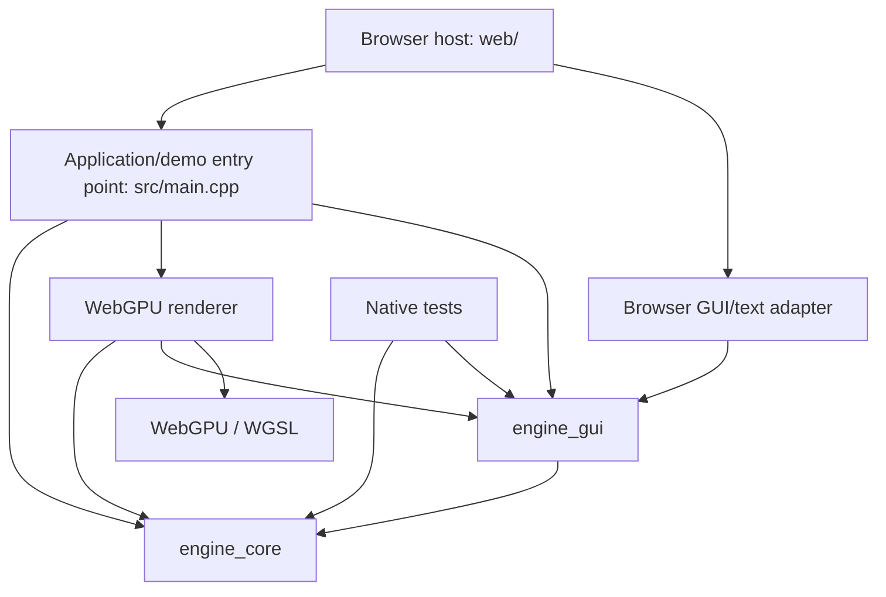

# WebEngine architecture

## Purpose and scope

WebEngine is a C++20 engine for games running in desktop and mobile browsers through WebAssembly and WebGPU. Its reusable systems should support multiple game types. A cat puzzle game is one application of the engine, not the model for its public API.

This document describes the implementation inspected on 2026-10-10 and the architectural boundaries for future work. The current architecture sections describe existing code. The evolution table describes intended additions and extensions, not delivered functionality. Keep these sections current when implementations change; source code and focused validation establish actual capability.

## Current architecture

### Build and dependency structure

[CMakeLists.txt](CMakeLists.txt) defines the following targets:

| Target | Responsibility and dependencies |
| --- | --- |
| `engine_core` | Portable application runtime/clocks, scene hierarchy, lifecycle, prefabs/factories, input state, camera controllers, assets/importers, audio, animation, physics, effects, scene archives, render preparation and performance data. Privately links ufbx, cgltf, meshoptimizer, Jolt and the image decoder. |
| `engine_gui` | Portable retained widget tree, layout, input handling and font/draw-list generation; publicly depends on `engine_core`. |
| `engine_gui_browser` | Emscripten-only GUI input/text adapter; depends on `engine_gui`. |
| `engine_assets_browser` | Optional Emscripten HTTP source adapter for portable asset loaders; links `engine_core` and propagates Fetch linkage. |
| `asset_browser_tests` | Explicit Emscripten HTTP/resource acceptance runner, excluded from normal builds; uses a self-hosted smoke server without a GPU. |
| `engine_audio_browser` | Emscripten-only Web Audio device adapter; publicly depends on `engine_core`. |
| `webengine` | Browser executable: application/demo entry point, WebGPU renderer, GUI renderer and demos; links the libraries above. |
| Native test executables | Exercise portable systems without the browser renderer. The current native configuration is a core/test build, not a native game rendering backend. |
| `spatial_query_tests` | Explicit Emscripten test target, excluded from normal builds; executes physics/query/sensor assertions in browser Wasm without publishing the playground. |
| `animation_control_wasm_tests` | Explicit Emscripten test target, excluded from normal builds; executes portable animation controller/event/output assertions in Node Wasm without publishing the playground. |

Emscripten is pinned by [.emscripten-version](.emscripten-version), currently to 6.0.11. The WebGPU executable uses the Emdawnwebgpu port. WGSL source in `shaders/` is embedded through generated headers during CMake configuration. The browser host and selected build outputs publish into `dist/`.

The current browser runtime is single-threaded. JavaScript handles browser APIs and forwards data to Wasm; C++ updates the scene and submits WebGPU rendering. The renderer header exposes WebGPU types and is a backend API, not a portable core interface.

This is a responsibility diagram, not a claim that these responsibilities already have fully independent build targets. In particular, physics/ship demos and the material showcase currently compile into `engine_core`; the renderer compiles into `webengine`. Future extraction should preserve behaviour while moving application examples away from reusable libraries.

### Scene model, ownership and lifecycle

[Application](include/engine/application.hpp) uniquely owns loaded scenes through
application-scoped `SceneId` handles. It implements start, pause, resume, terminal
shutdown, host suspension and scene load/unload/transitions at frame boundaries.
Scene hooks cover load, activation, pause/resume, deactivation and unload. Failed
loading or presentation binding preserves the active scene. Inactive scenes can
be retained for return; unload destroys their actor/physics/resource ownership.
A presentation binding releases borrowed scene/camera references before shutdown
destruction. The browser archive workflow stages decode separately and transfers
validated scenes into the runtime. See
[application lifecycle contracts](docs/application-lifecycle.md).

`Scene::synchronize()` reconciles lifecycle, physics registration and skeletal
resources without variable or fixed ticks. Application uses it while paused;
passing zero to `Scene::update()` remains a real tick for standalone callers.

The engine uses an owned scene graph rather than an ECS. [Node](include/engine/node.hpp) supplies a name, local transform, enabled state and children owned with `unique_ptr`. `Scene`, `Actor` and `Component` derive from it. Actors and components can be nested; a component's owner is its nearest actor ancestor. Disabling a node makes its subtree inactive.

[Scene](include/engine/scene.hpp) registers actors and components with scene-scoped, generation-checked `ActorId` and `ComponentId` handles. Lookups reject stale or foreign handles and objects pending removal. Direct references and query pointers are non-owning and require the object to remain alive.

`Scene::update(deltaSeconds)` reconciles lifecycle state and runs enabled variable ticks, including animation. `Scene::fixedUpdate(stepSeconds)` reconciles lifecycle state, runs enabled fixed ticks and steps physics. It does not advance animation clocks. Both flush deferred destruction after guarded traversal. `updateAnimations()` is a compatibility alias for `update()`, not an additional animation pass.

Destroying an object during a tick safely queues removal and immediately excludes it from relevant lookup/traversal. Detachment and reparenting require an idle hierarchy. Lifecycle cleanup hooks must not throw. Protected implementation children, such as those within skeletal components, cannot be independently removed or reparented. `KeepWorld` reparenting rejects transforms requiring unrepresentable shear.

Transforms and normal matrices are cached. Public transform writes remain supported and are observed by cache evaluation; future APIs must preserve invalidation and inherited-transform behaviour.

### Reusable object definitions and factories

[Prefab](include/engine/prefab.hpp) is an optional portable `engine_core` module.
It owns a configured actor-root hierarchy with stable definition-local keys;
applications own a versioned `ComponentFactoryRegistry` and register executable
component construction. Explicit [built-in factories](include/engine/prefab_components.hpp)
reuse mesh/material/texture/skeleton, collision-shape and effect resource types.
Each instance owns independent nodes, transforms, overrides and component state.

Instantiation validates key-based overrides, snapshots factory callables, builds
and validates a detached subtree, then publishes through one `Node::adoptChild`.
Failed construction leaves the destination hierarchy intact. Scene handles and
nearest-actor ownership use the existing registration path; attach/spawn/tick and
scene-dependent physics constraints reconcile normally. Guarded tick-time additions
begin on the next update. A traversal guard protects the destination from callback
detachment/flush, while destruction requests are rechecked before publication.

`PrefabInstance` contains non-owning scene-scoped actor/component handles, not
borrowed raw references or a separate instance registry. Definition-local keys
are unrelated to runtime or saved identities. Factories are synchronous trusted
application code with explicit capture lifetimes; external callback side effects
are outside construction rollback. Definitions are in-memory data, with no
serialization of arbitrary configuration or executable factories. Existing scene
archives serialize supported built-in instances and shared assets; custom archive
codecs, asynchronous loading and definition-file formats remain separate concerns.
See [prefab contracts and usage](docs/prefabs.md).

### Frame execution and input

The portable frame scheduler lives in [Application](src/application.cpp), with
browser callbacks in [src/main.cpp](src/main.cpp) and hosting in
[web/app.js](web/app.js). Its main sequence is:

1. The browser submits input records and a RAF timestamp converted to seconds.
2. Application commits pending lifecycle controls, updates its asset manager, prepares ready transition candidates and commits scene transitions, then starts one `InputSystem` snapshot and invokes the input callback. Pending dependencies keep the outgoing scene active; publication also runs before start and while paused/suspended, without advancing suspended clocks.
3. While running, invoke application simulation policy and call the active scene's variable update once. While paused, reconcile without ticking.
4. While running, advance the application-owned `FixedStepClock` for bounded fixed updates and physics interpolation.
5. Invoke `afterSimulation` and presentation callbacks. The application-owned audio example updates fades and scene emitters using presentation delta after simulation; the browser renders, synchronizes GUI text state and refreshes diagnostics.

Application owns separate input, variable simulation and presentation clocks plus
fixed simulation scheduling. Pause freezes simulation while camera/menu input and
rendering continue. Host suspension freezes every clock and rejects input.
Lifecycle boundaries clear queued/held input, fixed remainder and timestamp
baselines, preserving elapsed totals and avoiding hidden-time catch-up. Game
motion, level flow and camera policy live in host callbacks. Standalone scene
users can continue supplying their own scheduler.

[web/input.js](web/input.js) maps mouse, keyboard, pen, touch gestures and virtual controls to portable actions. [InputSystem](include/engine/input.hpp) maintains action edges, held axes, deltas and ordered pointer/event records. Input ownership prevents GUI, scene gestures and virtual controls from competing for the same contact. Text entry uses the browser text service rather than physical key codes. Pointer conversion distinguishes CSS coordinates from canvas backing pixels. Blur, hidden-page and context changes cancel held input; visibility changes suspend/resume the application while preserving explicit pause state.

See [input validation and device scope](docs/input-validation.md).

Portable `InputBindings` maps application-defined control IDs to the same queued
actions through an ordered context stack. It borrows `InputSystem`, owns a
reserved source range and releases only those sources on reconfiguration,
cancellation or destruction. The browser adapter provides named stacked contexts
and disposable virtual controls with validated stick configuration; physical key
and DOM semantics remain outside portable controllers. See
[UI/input integration](docs/ui-input-integration.md).

### Assets, animation and effects

Mesh components share geometry through `shared_ptr<const Mesh>`; textures, materials, skeletons, clips and effect definitions also have shared resource representations. Per-instance transforms, material overrides, morph weights and playback state remain separate from shared assets. Treat published geometry as immutable; deliberate geometry changes must follow the existing bounds/cache invalidation contracts.

FBX and GLB importers convert source assets into engine representations, validate input and report unsupported arrangements. Texture decoding uses stb_image; mesh optimization uses meshoptimizer. The material system supplies PBR maps/factors, material overrides and environment lighting. The material graph authoring tool bakes output into material data; editable graph source has its own JSON persistence.

[AssetManager](include/engine/assets.hpp) supplies a portable owner-thread registry
of logical typed asset IDs, shared in-flight operations and immutable resource caches.
Loader completion endpoints accept synchronized worker reports and publish only at
`update()`. Move-only request interests separate per-consumer cancellation from IO
abort; weak completion endpoints reject stale generations and survive owner teardown.
Explicit eviction/collection drops cache ownership while live shared resources remain
valid. Importers remain synchronous decoders; sources own IO and validation policy.
The optional `engine_assets_browser` target supplies HTTP fetch/progress/timeout/abort
with no browser types in the portable manager. Browser decoding remains synchronous;
native hosts supply their own IO/executors, with no implicit thread pool.

Application owns one manager and optional per-scene `AssetPreparation` batches.
Transition dependencies and an idle preparation callback complete before binding or
activation; failure retains the active scene. Scene unload releases batch ownership;
shutdown clears scenes/preparations/cache. Preparation does not add GPU prewarming:
renderer caches and GPU creation remain backend-owned. Runtime IDs/registrations and
callbacks are not archived. See [asset contracts and validation](docs/assets.md).

Skeletal components coordinate skeleton state and animation playback. Animation supports clip playback, blending, crossfades and opt-in root-motion extraction. An optional shared immutable controller definition supplies typed parameters, ordered state transitions and parameter-driven two-clip blends; instance control evaluates in the player's variable tick. Shared clips carry validated event markers. The player queues owned marker events and accumulated movement for explicit consumption, with no callbacks or scene subscriptions. Controller transitions preserve pending output; skeleton replacement cancels control/output. Extracted root motion does not automatically move an actor; its consumer owns movement/collision policy. Scene archives retain controller data, markers and pending output. Morph targets and particle/flipbook effects have their own instance state and rendering preparation. See [animation control contracts](docs/animation-control.md).

See [material graph](docs/material-graph.md) and the detailed feature contracts in [README.md](README.md).

### Physics and spatial queries

[PhysicsWorld](include/engine/physics.hpp) wraps one single-threaded Jolt system per scene, created lazily. Public physics headers keep Jolt implementation types private. Rigid bodies support static, dynamic and kinematic motion; collider components supply shapes. `FixedStepClock` caps catch-up work and discards excess elapsed time rather than replaying an unlimited backlog after interruption.

Simulation transforms are authoritative. Rendering can interpolate body poses without changing those transforms. Raycasts, convex-shape overlaps and linear sweeps use simulation poses and return scene-safe actor/body handles. A shared query filter supplies layer masks, motion/sensor categories and actor/body exclusions independently of the simulation layer-pair matrix. Overlaps return one deepest hit per body; sweeps report closest contact and initial penetration. Triangle meshes are supported targets, while query geometry is convex and unit scale.

Collision layers are separate from rendering visibility masks. Begin/stay/end contact-manifold events are delivered after solver locks are released, under scene traversal protection. `RigidBodySettings::isSensor` enables convex trigger volumes without collision response. Sensors use post-step narrow-phase overlap sets to emit one Enter/Exit per directed sensor/body pair, including sleeping and stationary bodies. Trigger pairs obey the simulation layer matrix and exclude self. Exit retains original handles after removal or transfer and arrives on the next fixed step; callbacks must resolve handles before using objects. Detection samples final fixed-step poses and does not guarantee detection of a body crossing completely between samples. The world owns bounded pair history and callbacks; scene archives retain sensor settings but recreate history/subscriptions. Version-1 body archives load as solids; version 2 and later retain sensor settings.

See [physics ownership, queries and validation](docs/physics.md).

### Movement controllers

[CharacterMotorComponent](include/engine/character_motor_component.hpp) is an
optional portable movement component. Gameplay submits persistent world-space
velocity and latched jump commands; input, AI and network adapters remain outside
the motor. Its last fixed-step result reports requested/actual displacement,
velocity, ground state/handles and jump, landing and obstruction flags.

The scene hierarchy owns the component. Collision-aware mode lazily initializes
the existing `PhysicsWorld`, whose private implementation owns Jolt virtual
characters through scene-scoped component/actor handles. Gameplay fixed ticks run
before rigid-body simulation; collision-aware motors solve after bodies and before
contact delivery. Free XYZ motors run in their own fixed tick without initializing
physics. One active motor controls a scene-root actor with unit world scale; a
rigid body on that actor is rejected. Disable/detach/transfer/destruction removes
the old character and clears transient state and commands.

Grounding, slopes, steps, snapping, jumps and moving-ground velocity use authoritative
simulation poses. Physics render interpolation affects visuals only. Archives
retain settings and persistent velocity commands, rebuilding support and clearing
jump edges/vertical solver velocity on load. Virtual characters collide with
rigid-body geometry, have no broad-phase bodies, and do not currently collide
with each other. Additional movement modes and root-motion policy remain
application/extension concerns. See [movement contracts and validation](docs/movement.md).

### Camera controllers

[CameraController](include/engine/camera_controller.hpp) is an application-owned,
portable stack over `CameraComponent`: orbit, follow, tracking, group framing,
half-life smoothing, interruptible pose/lens transitions and collision constraints.
Targets use scene-scoped actor/component handles or sampled world points. The
controller owns behaviours and callbacks; its scene or explicitly borrowed camera
must outlive it. Evaluation validates a candidate before publishing camera state.

Applications update the stack after scene/physics updates and before rendering,
supplying camera delta seconds and viewport aspect. Composition runs before
smoothing and transitions; collision constraints run last and reuse optional
`PhysicsWorld::sweep` with sphere geometry, filters and subject exclusion. Cameras
alone never initialize physics. Custom collision queries can supply another backend.
Only camera presentation changes; target simulation poses remain authoritative.
The legacy parent-space `OrbitController` and its input/archive contract remain
available; an application chooses one writer for a camera. Runtime behaviours
are reconstructed by applications after archive loading. See
[camera controller contracts and examples](docs/camera-controllers.md).

### Rendering and presentation

`Scene::collect()` fills reusable `SceneFrame` descriptions of meshes, lights and particles. `RenderFrame` and `FxFrame` prepare per-view draw data, batching and presentation decisions. [Renderer](include/engine/renderer.hpp) owns WebGPU resources, pipelines, upload caches and command submission; it borrows its scene, cameras and optional GUI, which callers must keep alive.

Ordered camera views compose into one canvas. Each view draws Background, World and Overlay with separate layer depth ranges; GUI draws once afterward. Cameras provide projection, viewport, masks, coordinate conversion and frustum data. Rendering includes instancing, frustum culling, material pipelines, directional shadow maps and shared GPU asset caches. Current code also includes projected-size mesh LOD, independent shadow-detail controls and configurable shadow resolution/filter taps. Portable `RenderQuality` profiles and resolution/shadow budgets compose these controls; applications choose their quality policy. The WebGPU backend reports actual device limits/features and constrains canvas dimensions without changing CSS layout or simulation.

`MeshOptimizer::generateLods` prepares shared immutable static geometry before
publication; the fleet demo opts into that policy. `mesh_detail` provides portable
projected-bounds selection, and `RenderFrame` owns per-camera/per-light hysteresis,
light-volume culling and selected material ranges. These decisions never mutate
component meshes or authoritative simulation/collision state. The WebGPU renderer
owns all depth-array recreation, filtering and resource uploads. Derived LOD caches
are currently excluded from archives and can be regenerated by applications on
restored assets. See [mesh detail and shadow validation](docs/mesh-detail-validation.md).

Performance instrumentation reports CPU preparation/update/submission, optional GPU timings, uploads and scoped memory estimates. Report frame intervals separately from engine CPU work and GPU execution. GPU device/surface loss queues bounded adapter/device reacquisition at host frame boundaries. GPU resources and pending callbacks are released/invalidated while borrowed scenes, cameras, GUI and CPU assets survive; failed recovery exposes explicit retry. Browser visibility, freeze/resume and pagehide/pageshow reasons compose application suspension, preserving explicit pause and avoiding hidden-time catch-up. Optional authored semantic BC7/ETC2/ASTC mip variants use retained RGBA fallback when unsupported or disabled. These derived payloads remain outside archives. See [quality and browser resilience](docs/rendering-quality.md) for ownership, budgets, lifecycle, compression and validation scope.

### GUI, audio and persistence

[engine_gui](docs/gui.md) owns a retained C++ widget tree, absolute/flow/wrapping layout, logical UI scaling, wrapped labels, vertically scrolling panels and portable accessibility descriptions. Scroll offsets and GUI focus remain presentation state. Widget IDs are never reused; delayed accessible focus/activation resolves against the current tree and rejects inactive or stale targets. The optional browser adapter owns the native text service and a visually hidden semantic representation, synchronizing native buttons/textboxes, names, descriptions, disabled state, focus and live text with C++ state. It is detached before GUI destruction. Font shaping and physical assistive-technology/device acceptance have documented limits. See [UI/input integration](docs/ui-input-integration.md).

[AudioSystem](include/engine/audio.hpp) is an optional application-owned portable
service in `engine_core`: immutable shared PCM assets, independent voices,
hierarchical volume/mute buses, interruptible fades and explicit scene-scoped
emitter/listener handles. It owns its backend and never retains scene pointers.
Applications select playback and update time domains after simulation; disabled,
removed or foreign emitters stop at synchronization. Simulation transforms remain
authoritative. The Emscripten-only `engine_audio_browser` adapter owns a lazily
created Web Audio context, shared active buffers and per-voice nodes. Activation,
suspension, decoding and asynchronous disposal remain browser responsibilities.
The playground's audio example lives outside core in `src/audio_demo.cpp` and
uses a private scene; original [web/audio.js](web/audio.js) waveform playback and
its archive payload remain independent. Runtime audio has no built-in archive
codec. See [audio contracts and validation](docs/audio.md).

[Scene archives](docs/scene-archives.md) serialize built-in scene/asset data with versioning, validation, budgets and shared-resource identity. Runtime handles are recreated on load; version-4 saved node identities remain stable. Application-owned `ComponentCodecs` validate and construct registered custom components and resolve saved references before lifecycle synchronization. Unknown types are rejected. Executable behaviour, callbacks, input bindings and GUI trees are reconstructed deliberately; physics restoration is not a deterministic solver checkpoint.

[Persistence](docs/persistence.md) in `engine_core` adds `ApplicationArchive`: a versioned application payload, selected scene documents, active saved scene identity and pause policy. Decode, bounded migration and validation produce separate staged ownership without changing a running `Application`. The application controls publication, clocks and lifecycle policy. `web/storage.js` supplies optional IndexedDB and localStorage byte adapters with namespacing, budgets, cancellation, transaction completion and explicit disposal. Browser APIs remain outside portable interfaces. The playground composes these adapters with its existing staged archive/audio workflow for an explicit checkpoint; autosave policy remains application-owned.

## Architectural boundaries for all future work

1. **Keep engine mechanisms generic and game rules in applications.** Public engine types and services must not depend on cats, puzzle levels, quests, combat rules, inventories, score or unlock progression. Games compose reusable mechanisms and supply policy/configuration. Example implementations belong with application/demo code.
2. **Controllers consume commands, not device events.** Movement receives desired movement/actions; cameras receive targets and parameters. Keyboard, touch, AI, replay or network adapters can produce the same command contract. Portable controller code must not read DOM events or hard-code physical keys.
3. **Use generic targets and explicit interfaces.** Cameras track transforms/handles; interactions expose actions on generic targets; emitters follow nodes. Reuse the scene's handle/ownership conventions rather than adding game-specific globals or competing object registries.
4. **Make systems optional and composable.** Character, grid, flying and vehicle movement can be separate modules. Games should not initialize physics, audio or character logic merely to use input, UI or scene data. Prefer small working contracts and useful defaults over a framework for hypothetical genres.
5. **Separate portable systems from platform adapters and rendering backends.** Browser input/text, storage, audio activation, page lifecycle and capability probing connect through explicit contracts. New portable interfaces must avoid DOM, Emscripten and WebGPU implementation types. Existing backend-specific headers remain identified as such; target separation may evolve incrementally.
6. **Keep simulation state independent of presentation.** Rendering, interpolation, culling and LOD must not decide gameplay visibility, collision or authoritative position. Controllers own how root motion becomes simulation movement. Define time domains, update ordering and pause/resume policy at the application-runtime boundary.
7. **Keep ownership and lifetimes explicit.** Scene hierarchy owns instances; shared resources own assets; renderer references are borrowed. Use generation-checked handles for delayed work targeting scene objects. Subscriptions, callbacks and asynchronous operations need cancellation/lifetime rules that prevent updates to removed or replaced objects.
8. **Provide persistence extension points rather than serializing behaviour.** Keep runtime handles separate from stable saved identities. Custom codecs/factories validate versioned data and rebuild behaviour deliberately. Storage adapters handle bytes; applications decide save contents, migrations, checkpoints and autosave timing. Do not silently degrade unknown types.
9. **Distinguish asset definitions from instance state.** Prefabs configure hierarchies and shared assets, with explicit instance overrides. Loading/caching/unloading belongs to resource services; application rules choose manifests and priorities. Define cancellation and publication boundaries so partial or stale loads cannot replace current state.
10. **Expose capabilities and budgets; let applications choose policy.** Quality settings, device support and storage/audio failures should be observable. Applications choose supported devices and visual targets. Existing touch support or desktop WebGPU evidence does not prove physical mobile performance or browser compatibility.

## Intended reusable extensions

These are design directions. Confirm the current implementation before scheduling work; extend existing APIs instead of duplicating delivered functionality.

| System | Reusable extension | Application responsibility |
| --- | --- | --- |
| Application runtime | Lifecycle, owned scene activation/unloading/transitions, separate clocks and asynchronous asset dependency/preparation gates are implemented in `Application`. Further extensions can add custom scheduling policies. | Menus, level flow and completion/failure rules. |
| Movement extensions | Build on the delivered optional character motor and command/result contracts with other movement modes, root-motion adapters or character-to-character collision when required. | Input/AI commands, abilities, speeds and genre-specific motion. |
| Queries and sensors | Build on delivered filtered raycasts, convex overlaps/linear sweeps, exclusions and sensor enter/exit events; add other query geometry or continuous sensor detection when required. | Hazards, checkpoints, perception and detection rules. |
| Selection and interaction | Target resolution, available/eligible actions, execution and focus/selection notifications. | Action meaning, range policy and feedback. |
| Camera extensions | Build on the delivered composable stack with application-specific behaviours or additional presentation policies when needed. | Targets, framing constraints and mode changes. |
| Animation extensions | Typed parameters, states/transitions, two-clip blends, clip markers and consumable root-motion/event output are implemented. Extend with layers or larger blend trees when required. | State definitions, transition conditions, marker responses and movement/collision policy. |
| Prefabs and factories | Configured hierarchy instantiation, shared assets, stable-key instance overrides and versioned registered component factories are implemented in `Prefab`. Definition-file authoring remains an extension; archive codecs and resource loading use separate registration. | Object definitions, behaviour registration and content loading policy. |
| Persistence services | Versioned application snapshots, custom component codecs, stable saved identities and browser byte adapters are implemented over scene archives. Further extensions can add other adapters or application-specific conflict policies. | Saved game state, migration, publication and checkpoint/autosave policy. |
| Audio extensions | Shared sounds, simultaneous/looping voices, buses, volume/mute, fades, positional emitters/listeners and browser activation are implemented. Further adapters, streaming, DSP/occlusion and audio persistence can extend these contracts. | Music, sound assignments, timing and playback restoration. |
| UI/input extensions | Portable action bindings/context stacks, disposable browser virtual controls, wrapping, UI scaling, vertical scrolling and browser accessibility semantics are implemented. Further text shaping, additional scroll axes and device acceptance remain extensions. | HUD, menus, prompts, semantic labels and control schemes. |
| Resource services | Logical typed IDs, asynchronous loading, shared caches, progress, cancellation, unloading and scene preparation are implemented. Further extensions can add manifests, priorities, automatic budget policy or background decoding. | Sources, import policy, content, loading screens and eviction policy. |
| Quality/platform services | Profiles, canvas/shadow budgets, device capabilities, bounded GPU recovery, composed browser lifecycle and optional authored compressed textures are implemented. Future work can add measured adaptive policy, texture transcoders and additional backends. | Device support, visual targets and quality defaults. |

A small example game should exercise these APIs end to end while keeping its rules outside the engine systems. General event/subscription or timer/tween utilities may be extracted when concrete consumers justify them. Pathfinding, networking and other genre services should be independent additions when required, not assumptions imposed on every application.

## Repository map and validation

| Location | Role |
| --- | --- |
| `include/engine/` | Engine APIs; `renderer.hpp` and `gui_browser.hpp` identify backend/platform integration points. |
| `src/` | Core implementations, rendering backend, adapters and current application/demos. |
| `web/` | Browser shell, input/audio adapters, inspector and authoring/demo controls. |
| `shaders/` and `cmake/` | WGSL sources, generated shader integration and dependency configuration. |
| `third_party/` | Pinned dependencies, fonts and provenance/licenses. |
| `tests/` and `scripts/*-smoke.cjs` | Portable regression tests and browser checks. |
| `docs/` | Feature contracts and scoped validation evidence. |
| `scripts/`, `.github/` | Setup/build/serve helpers and CI. |
| `build/`, `dist/`, `.tools/` | Generated build/evidence, published browser output and local toolchain. |

Use focused native tests for portable contracts and relevant browser smoke checks for adapter/rendering changes. A configured native build can be checked with `cmake --build build/native` followed by `ctest --test-dir build/native --output-on-failure`. Browser setup/build/serve instructions are in [README.md](README.md). Physical Android/iOS input, browser compatibility, audible output and sustained device performance require their own evidence. No new runtime validation is implied by this architecture document.
