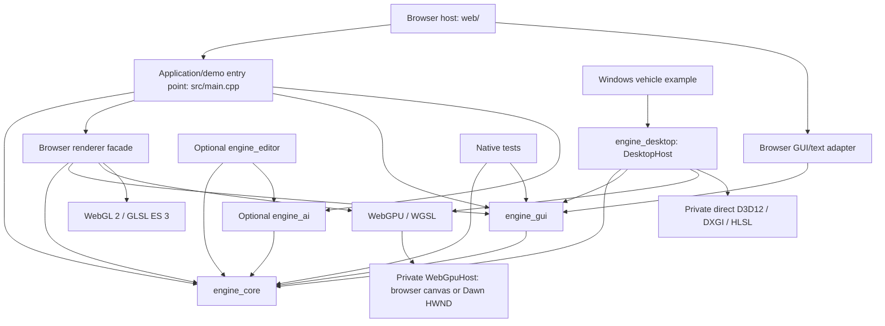

# WebEngine architecture

## Purpose and scope

WebEngine is a C++20 engine for games running in desktop and mobile browsers through WebAssembly with WebGPU and a WebGL 2 fallback. An optional native Windows x64 desktop host and vehicle example share the portable engine through SDL3, with selectable Dawn/WebGPU and direct D3D12 rendering. Direct D3D12 currently supports static and animated meshes, conventional and layered terrain materials, water/underwater, PBR/lighting/shadows, sky/fog/HDR post and the vehicle/native GUI; full feature parity remains future work. Its reusable systems should support multiple game types. A cat puzzle game is one application of the engine, not the model for its public API.

This document describes the implementation inspected on 2026-10-10 and the architectural boundaries for future work. The current architecture sections describe existing code. The evolution table describes intended additions and extensions, not delivered functionality. Keep these sections current when implementations change; source code and focused validation establish actual capability.

## Optional RPG library R1-R10 and release candidate (2026-10-25)

`engine_rpg` / `WebEngine::RPG` now implements the optional standard-C++20 foundation
above Modules: explicit content/session/entity identities, bounded metadata
catalogues, typed definition validators and independent application-owned runtimes.
Immutable catalogues retain module snapshots/providers; registry callbacks are
destroyed before provider captures. Composition or catalogue validation failure
does not replace existing published state. Runtime identity allocation creates no
scene entity and owns no clock, renderer, physics, IO or gameplay scheduler.

The root and standalone builds share `rpg/`. RPG and its tests default off;
missing Modules/bridge dependencies fail explicitly; the demo requires the root host build. The external
`examples/rpg` consumer configures no engine core or platform dependencies. Native
Windows/Linux and pinned Emscripten/Node contract/configuration tests are provided.
See [delivered API](docs/rpg.md) and [actual evidence](docs/rpg-validation.md).

The [full architecture](docs/rpg-library-architecture.md) and
[ten prompts](docs/rpg-library-release-1-prompts.md) remain the release roadmap.
R2 now adds immutable character/resource/progression definitions and independent
state, checked additive modifiers, explicit XP/unlock proposals and shared command
prepare/commit. Private runtime identity, generation/revision and producer watermarks
reject stale input. Preparation stages all operations; publication swaps state with
no allocations/callbacks and retires old state with the consumed candidate. Pure
advancement handlers cannot mutate a preparing runtime. Read-only views expire on
publication. See [R2 contracts](docs/rpg-characters.md) and
[R2 evidence](docs/rpg-r2-validation.md). R3 adds immutable item/inventory definitions,
durable item ownership, bounded stacks, split/merge/transfer and atomic equipment
replacement through the same command transaction. Equipment modifiers are derived
from equipped IDs and cannot be edited as ordinary modifier sources. See
[R3 contracts](docs/rpg-inventory.md) and [evidence](docs/rpg-r3-validation.md).
R4 adds typed pure ability evaluators, atomic costs/item use and bounded resource/
status proposals. Explicit owner/round phase commands drive status ticks and
expiry. Candidate PCG32 state and draw budgets preserve randomness on rejection
and preview. Commit remains a single no-throw publication. See [R4 contracts](docs/rpg-abilities.md)
and [evidence](docs/rpg-r4-validation.md). R5 adds explicit encounter begin/end/finish/exit,
bounded initiative and turn epochs, policy allowances/outcomes and cooldown phases
inside the same transaction. Encounter phases only affect its fixed roster; status
failures roll back initiating actions. No clock advances combat. See
[R5 contracts](docs/rpg-encounters.md) and [evidence](docs/rpg-r5-validation.md).
R6 now adds tactical ability/item/move authorization, AP/movement/resource costs,
immutable runtime/turn/world-stamped query quotes and bounded ordered reactions.
Commit rechecks the host-supplied world stamp without callbacks. A pending
presentation blocks input until a matching acknowledgement; acknowledgement only
unlocks, never replays gameplay. The R9 sample reserves routes before commit and attaches no competing simulation
writers to its presentation actors. See [R6 contracts](docs/rpg-tactics.md) and
[evidence](docs/rpg-r6-validation.md). R7 adds the optional RPGQuests target above
RPG and Quests, keeping their registries distinct. A private owner-thread coordinator
prepares quest progress, typed reward operations and bounded award receipts,
preflights both kernels and publishes without callbacks/interleaving. Failed rewards
preserve the quest queue. Replay records suppression without granting rewards. See
[R7 contracts and publication proof](docs/rpg-quests.md) and [evidence](docs/rpg-r7-validation.md).
R8 adds canonical catalogue/snapshot bytes, strict compatibility and state validation,
rebased standalone restore and one-swap combined RPG/quest restore. The sample outer
envelope joins its checkpoint state to both kernels. No IO, migration, scene archive
change or reward evaluation occurs during restore. See [R8 contracts](docs/rpg-snapshots.md)
and [evidence](docs/rpg-r8-validation.md).
R9 adds a shared primitive 3D sample controller and scene under examples/rpg,
with thin browser and DesktopHost adapters. Application owns ticks; only explicit
commands advance turns. Camera inspection is presentation-only. Scene-scoped handles
are rebuilt on travel/load; interrupted playback snaps to committed positions before
acknowledgement. The example uses existing WaypointGraph navigation and host-owned
combined saves (localStorage / atomic DesktopFiles). No host dependency enters the
RPG kernel. See [host contracts](docs/rpg-hosts.md) and [R9 evidence](docs/rpg-r9-validation.md).
R10 adds a complete alternate standalone ruleset and the [release audit](docs/rpg-release-1.md).
L1 retained API 1.7.0 / wire 1 and closed the RPG rendered CI gates with
separate WARP/SwiftShader and Intel hardware evidence.
Library stabilization L1 adds explicit `WEBENGINE_D3D12_WARP=1` diagnostic
rendering for software-only Windows CI; default hardware selection remains strict.
Adapter enumeration failures are checked before dereferencing returned interfaces.
Native pipelines initialize valid disabled-state enums and check debug-layer
errors before command submission. Non-layered unlit materials have a dedicated
pixel shader preserving alpha, clipping, emission and fog semantics; browser
pipelines already specialize material shaders. The sample shares primitive meshes
to exercise batches; instance-buffer binding and lifetime remain unchanged.
Linux software WebGPU acceptance uses full Chromium under Xvfb with Vulkan
shared-image presentation and retains real frame/input/storage assertions and
the normal GPU watchdog. See [L1 evidence](docs/rpg-l1-validation.md).

Library milestone L2 adds persistent parties (active/reserve members, leader,
control metadata) and explicit encounter teams to the portable RPG kernel.
Party changes use atomic commands outside encounters; encounter team assignments
are immutable and complete when supplied. Hosts own recruitment, AI, targeting and
victory policy. API 1.8.0 supports v1 snapshots and a v2 party/team extension,
while preserving v1 output for states without L2 data. Both rendered hosts use the
shared party/team sample. See [L2 contracts](docs/rpg-parties.md) and
[validation status](docs/rpg-l2-validation.md).
Third-person camera policy, Lattice abilities, balance, factions and campaign/world state stay
in RPGGame. Existing engine core, Quests and hosts never depend on RPG.

Library milestone L5 adds synchronous bounded combat planning: hosts enumerate
stamped tactical candidates, the ordinary transaction pipeline filters legality,
and pure game scorers select with stable ID tie-breaking. Validated EndTurn is
the explicit fallback. Stop tokens and runtime/turn/world stamps protect deferred
execution; planning never publishes state or RNG. The RPGQuests coordinator
forwards planning without exposing its kernels. Both sample hosts expose AI step;
automatic scheduling, navigation and enemy policy remain game-owned. API 1.11.0
retains L4 snapshot formats. See [contracts](docs/rpg-combat-ai.md) and
[validation](docs/rpg-l5-validation.md).

Library milestone L4 adds optional vitality over existing character resources,
typed damage/healing/defeat/revival effects, incapacitated actor gates and
nonempty-team defeat queries. Rulesets own formulas, resistance, revival costs,
outcomes and checkpoint policy. Transactions publish life state with costs/RNG;
runtime snapshot v3 stores profiles while v1/v2 remain supported. Both rendered
hosts share the vitality sample. API 1.10.0; see
[contracts](docs/rpg-vitality.md) and [validation](docs/rpg-l4-validation.md).

Library milestone L3 adds pure, bounded, exact-integer 3D single/sphere/cone/line
target queries, cast range, self/LOS and L2 team filters. An optional query in the
existing immutable spatial quote enforces the complete selected set before and
after BeforeAction reactions. Existing action transactions publish all costs,
effects and RNG together. Host physics facts and authored shape/effect policy stay
outside the kernel. API 1.9.0 leaves durable snapshot formats unchanged; shared
Windows/browser sample actions exercise the new query. See [L3 contracts](docs/rpg-targeting.md)
and [validation status](docs/rpg-l3-validation.md).

## Current architecture

Library milestone L7 adds optional equipment prerequisites, multi-slot occupancy
and point-budgeted progression choices (API 1.13.0). Ordinary transactions validate
every intermediate build before callbacks; respec requires explicit unequip first.
Automatic and selected unlock ownership remain distinct. Catalogue v2 and runtime
v4 extensions preserve older output when unused and validate build integrity on
restore. Both hosts share mastery/equipment/respec controls. Game content, costs
and specialization policy stay in consumers. See [contracts](docs/rpg-builds.md)
and [validation](docs/rpg-l7-validation.md).

Library milestone L6 adds bounded weighted loot and receipt-backed atomic reward
bundles through the existing portable transaction pipeline (API 1.12.0).
XP/items/status/resource grants, RNG and receipts publish together; full inventory
rejects the bundle for an explicit game-owned retry. RPGQuests accepts loot in
coordinated rewards and reserves its receipt namespace. Existing snapshots persist
all consequences. Both hosts share Collect loot and quest loot examples. Content,
eligibility and pending claims remain game-owned. See
[contracts](docs/rpg-rewards.md) and [validation](docs/rpg-l6-validation.md).

### Optional planetary terrain, stages 1 and 2 (2026-10-23)

`engine_planet` / `WebEngine::Planet` layers above `engine_core` without changing
its heightfield or scene contracts. It owns a bounded six-face cube-sphere CPU
quadtree and publishes immutable ordinary Mesh resources with parent-surface morph
targets, source-derived normals/materials and visual boundary skirts. One global
procedural height source is independent of presentation detail. Owner-driven
updates prepare at most one four-child split; complete sibling merges and priority
reclamation keep the tree bounded. No scene, renderer, physics, callback, worker or
platform ownership enters this optional library.

PlanetPosition retains double planet-centred coordinates and subtracts the chosen
origin before narrowing to float. `examples/planet` owns Application input, guided
and manual flight, a bounded ordinary actor/component pool, and camera-relative
patch projection on browser and Windows hosts. It keeps the camera at local zero
and uses adaptive clipping with existing rendering/morph paths. This does not add
a generic scene/physics rebasing service or a planetary depth-buffer pipeline.
The scene and renderer retain their existing ownership and frame boundaries.

Stage 2 adds portable radial gravity, immutable tangent-chart collision preparation
from the same source and an arbitrary-up spherical explorer motor using existing
PhysicsWorld overlap/sweep queries. It borrows the world only during fixed steps
and retains no scene/callback/solver types. The +Y character motor is unchanged.
Collision sampling/residency never follows camera LOD, morphs or render origins.

The demo publishes a bounded static source collider at the idle pre-simulation
callback, then existing scene reconciliation precedes its normal fixed component.
Global double motion survives infrequent translation-only solver-origin rebases;
dynamic cargo retains pose/velocity and receives radial forces each fixed tick.
Camera-relative interpolated presentation is separate from the stable solver frame.
Input cancellation precedes queued button publication, preserving jump requests.
There is no new Application phase, physics scheduler or scene ownership model.

Stage 2 supports collision landing, stable surface movement, jump and takeoff.
Planetary atmosphere, water, authored sources, persistence and full rigid-body ship
flight remain future work. See [planet contracts](docs/planet-terrain.md),
[planetary physics](docs/planet-physics.md) and [stage 2 evidence](docs/planet-stage2-validation.md).

### Optional multiplayer foundation (2026-10-22)

`engine_network` / `WebEngine::Network` is an optional standard-C++20-only module
for versioned binary session/lobby messages, peer/entity identities, bounded commands
and complete snapshots (plus M5 per-peer deltas below). It owns no scenes, clock, renderer or platform resources. Registries own validation
callbacks; transport decorators explicitly own adapters, as detailed in M8–M10 below. Applications map network IDs to existing scene-scoped handles and own
payload schemas, movement/interaction policy and entity lifetime. Server ownership,
session/sequence checks and complete validation precede state publication.

`engine_network_browser` privately adapts Emscripten WebSockets;
`engine_network_windows` privately adapts WinHTTP with owned IO workers. Adapter
queues are bounded; scene work stays on the owner thread and disposal cancels IO
and callbacks. Browser/native clients use identical portable protocol code.

`examples/multiplayer` provides an authoritative kinematic arena and headless C++
Application host, with a loopback Node/ws socket gateway. Existing component fixed
ticks own motion, server monotonic time owns simulation, and full snapshots feed
client presentation. No core scheduler, archive format, renderer or physics
determinism contract changes. Transport wakeups do not supply simulation time.

Browser and Windows editors can launch this isolated test arena with a configured
endpoint while retaining their source documents. DesktopEditor exposes an optional
host-owned launch callback; executable process policy stays in the sample host.
The fixed-arena launcher remains separate from authored-scene milestones below.
M7 adds registered component state; general physics rollback and internet
identity/deployment remain future work. See [multiplayer contracts](docs/multiplayer.md)
and [runtime evidence](docs/multiplayer-validation.md).

### Authored multiplayer scenes, milestone 2 (2026-10-22)

Optional `engine_network_scene` / `WebEngine::NetworkScene` layers above network
core and engine_core. It packages an existing self-contained scene archive with a
saved player-template identity, validates a bounded static mesh/camera/light
profile, and maps transform snapshots to ordinary Actor instances and existing
generation-checked handles. Network core remains scene-independent. Its separate
ContentReceiver stages ordered bootstrap chunks without knowing archive types.
Invalid/incomplete content never replaces the server's accepted scene. No archive
version, generic component codec, renderer or Application phase changes.

The scene example freezes the first valid publication for the server process,
requires byte-identical later publications, transfers content before admission,
and runs kinematic player movement in the existing fixed traversal. Saved identity
selects the template; transient peer/entity identity selects spawned instances.
Clients send intent and project complete authoritative local transforms. Scene
owns instances and assets; TransformReplicas owns its detached template and handle
map. The idle owner validates complete snapshots before spawn/pose/despawn work.
Client host scene replacement rebinds views before releasing previous scenes.

Both editors expose Host selected actor and Join authored scene. Native workbench
callbacks synchronously borrow source/views/assets, leaving serialization and
process policy to the host. Browser publication uses the same portable validator,
then a bounded expiring IndexedDB handoff to an isolated client tab. Native uses a
temporary package consumed by its client process. The editor source, history and
ordinary Play state remain retained. Runtime changes are never applied back.

This milestone supports embedded static visuals and one mesh actor template,
not arbitrary authored gameplay, component replication, physics or collaborative
editing. Milestone 3 below adds kinematic prediction to these clients. Limits, ownership and runtime evidence are documented in
[authored multiplayer scenes](docs/multiplayer-scenes.md) and its
[validation](docs/multiplayer-scenes-validation.md).

### Multiplayer prediction and reconciliation, milestone 3 (2026-10-23)

Optional network core now provides header-only PredictionHistory for bounded opaque
state/input replay with synchronous application-supplied deterministic callbacks.
It stages corrections and replay before publishing state and owns no scene, clock,
transport or retained callback. Sequence/acknowledgement validation and 128-input,
256-byte payload/state bounds preserve the previous valid history on rejection.

The authored-scene example upgrades its session schema to MP03. Each movement
command represents one 60 Hz step; existing server fixed traversal consumes at most
one per player per tick and acknowledges applied sequences in snapshots. Shared
example moveStep policy drives client prediction and server simulation. Client
presentation replays pending inputs from authoritative snapshots without modifying
session records; remote replicas remain authoritative. Leave/reconnect cancel the
entire prediction lifetime. Editor Host/Join automatically launch these clients.
M1 keeps its separate MP01 arena. Saved scene packages/archives do not change.

The loopback gateway has optional bounded development latency injection, disabled
by default. M4 below adds remote interpolation and positional correction smoothing.
General physics rollback and component prediction remain future work. See
[contracts](docs/multiplayer-prediction.md) and
[validation](docs/multiplayer-prediction-validation.md).

### Multiplayer presentation, milestone 4 (2026-10-23)

Optional engine_network_scene adds TransformTimeline and CorrectionSmoother over
existing portable Transform/Vec3 values. Timelines retain at most 32 validated
receipt-time poses and interpolate position/scale and shortest Euler paths with
100 ms default delay, holding endpoints without extrapolation. Long gaps,
teleports and scale-sign changes reset the buffer. Positional correction offsets
decay with an 80 ms half-life, with bounded snap/reset behavior. Caller-owned clocks
and ordinary host frame boundaries drive these presentation-only mechanisms.

Authored-scene clients stage remote buffer updates alongside validated snapshots
and M3 reconciliation. Local presentation receives a compensating offset only for
corrections; prediction/session state remains authoritative and untouched by these
visual mechanisms. Despawn/reconnect/scene replacement cancel presentation history.
Editor Host/Join inherits these defaults on both runtimes. MP03 messages and saved
archives remain compatible. There is no physics/scheduler/renderer boundary change.

The development gateway can inject bounded, FIFO jitter independently in each
direction. An explicit scene-server test flag issues one bounded authoritative
position correction per player to verify visual decay. Both facilities default off.
General physics rollback, extrapolation, adaptive clock synchronization and
component/skeletal prediction remain future work. See
[contracts](docs/multiplayer-presentation.md) and
[validation](docs/multiplayer-presentation-validation.md).

### Multiplayer replication, milestone 5 (2026-10-23)

Optional engine_network now provides per-peer reliable-stream delta baselines.
ServerSession::snapshot(all) still atomically replaces the complete authoritative
ownership registry. snapshotFor(peer, relevantIds, forceFull) selects from it,
always includes peer-owned records, and emits full keyframes or smaller deltas
containing upserts, removals and sparse changed-byte patches. Baselines are bounded
and discarded with the peer. First/forced/resync publications and at least every
20 publications use full packets. ClientSession reconstructs and validates a
complete candidate before publication. BaselineMismatch and requestSnapshot add
bounded recovery control without consuming gameplay command sequence. The host
must send generated packets in order or close the peer on failure.

Selection policy remains application-owned. The scene example uses authoritative
local XZ distance with 4-unit entry and 5-unit exit hysteresis; own entities always
remain selected. This affects dynamic replication only, independently of global
command ownership, simulation, presentation and full static-scene bootstrap.
M3 replay and M4 smoothing consume reconstructed complete records; relevance
removal/re-entry clears/recreates remote histories and ordinary actor replicas.

Both editor Host/Join launch paths use scene schema MP05 and keep source/history
isolated. MP03 scene binaries must be rebuilt together; WES2 packages, scene
archives and M1 MP01 full-snapshot arena remain compatible. WEN1 envelope version
1 adds Delta and Resync message types. No scheduler, renderer, platform adapter or
module dependency changes were required for M5. M7 below adds registered component
state. Bandwidth budgets, compression, unreliable transports and internet deployment remain future
work. See [contracts](docs/multiplayer-replication.md) and
[validation](docs/multiplayer-replication-validation.md).

### Multiplayer authoring and diagnostics, milestone 6 (2026-10-23)

Header-only network_authoring.hpp adds declarative ReplicationSettings over
existing Actor/Component values. An inert ordinary Component stores one reserved,
versioned tag, preserving existing archives, cloning, prefabs and editor history
without a core/protocol dependency or archive-format change. EditorSession's
NetworkReplication creation and the built-in property registry expose Player/
Server ownership, Distance/Always/OwnerOnly relevance and validated entry/exit
radii. Both editor frontends use these same contracts and undo/save/load paths.
Unknown or invalid annotations remain inert in generic scenes and reject network
publication; inspectors omit invalid typed fields while retaining component removal.

NetworkScene now returns a validated replicated-actor catalogue. The chosen player
template uses per-peer instances; at most 48 configured server actors retain
server ownership and deterministic content-scoped IDs/kinds sorted by saved ID.
TransformReplicas can snapshot multiple authored prototypes keyed by record kind,
retaining ordinary generation-checked actor handles and staged validation. Client
scenes hide source templates after preparing replicas. No arbitrary gameplay
component codecs or behaviors enter this bounded static visual profile.

Server relevance consumes each entity's configuration independently of the complete
ownership registry and simulation. Clients validate kind/owner/entity against the
catalogue before committing records, replay or presentation. Existing M3-M5
prediction, smoothing, deltas and recovery continue unchanged. The isolated clients
add read-only authority/prediction/correction/replication diagnostics. Editor source
documents and history never receive runtime changes.

Scene schema MP06 requires server/client rebuilds together; legacy WES2 packages
without annotations retain player defaults. Archive and package envelope versions
and the M1 MP01 arena are unchanged. Engine core, standard-only network core,
platform adapters, renderers and Application phases gain no new dependencies.
Only network_scene_tests additionally links engine_editor for authoring acceptance.
See [contracts](docs/multiplayer-authoring.md) and
[validation](docs/multiplayer-authoring-validation.md). M7 below adds registered
gameplay fields; ownership transfer, physics rollback and internet services remain
future work. MP06 and the static-only profile above describe the M6 stage.

### Gameplay-component replication, milestone 7 (2026-10-23)

Optional engine_network_scene now owns ComponentReplicationRegistry and bounded
opaque per-component state encoding. A registration combines an existing custom
ComponentCodec with a network version, declared maximum, capture/validation,
allocation-owning prepared updates and detached passive-replica setup. Game classes,
typed fields, simulation and action rules remain in application code. Standard-only
engine_network has no scene/editor dependency; its new snapshotForRecords validates
peer payload projections against the complete authority registry before the
existing delta/keyframe/recovery pipeline. Per-component audience does not alter
command ownership. Authored bootstrap values are public, even for OwnerOnly fields.

NetworkScene packages explicitly registered, childless components directly on
replicated root actors. Canonical content slots map to generation-checked local
ComponentIds after adoption. Runtime component topology is fixed. Registries are
owned values; callback captures must outlive their copies. At most 32 type
registrations and 8 components per actor are allowed. The authored scene rejects
declared worst-case state exceeding the existing 256-byte record budget, including
the pose/ack/component headers. WES3 adds an exact sorted schema/version/bounds
manifest before archive construction. Legacy unregistered WES2 still loads and the
ordinary scene archive version does not change.

TransformReplicas owns custom-codec prototype copies and offers a synchronous
Stage hook. All records and component plans validate/allocate before any pose,
spawn or component state publication. PreparedComponentUpdate commits are no-throw,
callback-free and cannot change topology. Plans borrow targets only for that idle
owner transaction. Scene retains actor/component ownership and deferred destruction.
Detached replica setup suppresses game behavior/subscriptions and disables ticks;
presentation interpolation/prediction remains independent of authoritative fields.

EditorComponentSupport adds optional custom-codec/factory values to EditorSession.
DesktopEditor and browser adapter retain this support across reopen and Play and
display registered creation choices and shared property registries. Header-only
network_component_editor.hpp extends a registry with component replication audience
without making engine_editor depend on network implementations. Registered custom
archive bytes participate in structural history fingerprints. Subtree duplication
accepts detached custom codecs; used resolve callbacks reject this partial-scene
operation, while complete-scene loading/clone retains its earlier resolve contract.

Both opt-in example editors register application-owned Vitals and Progress and launch
MP07 sessions. Server fixed traversal owns gameplay, clients submit action intent,
and diagnostics read actual replica fields. Everyone and OwnerOnly state uses
per-peer projection through full/delta/resync updates; hidden components remain
passive authored defaults. Leave, interest re-entry and scene replacement clear
bindings alongside existing prediction/presentation lifetimes. Server/client schema
must match (MP07); WEN1 version 1, M1 MP01, transport adapters, renderers and frame
phases remain unchanged. No client field authority, automatic reflection, runtime
component composition, generic prefab spawning, RPC/event routing or physics
rollback is introduced. See [contracts](docs/multiplayer-components.md) and
[separate browser/Windows evidence](docs/multiplayer-components-validation.md).

### Runtime multiplayer lifetimes and invocation streams, milestone 8 (2026-10-23)

Optional standard-only engine_network adds owning InvocationRegistry values and
independently sequenced bounded RPC/Event messages (WEN1 types 7/8). The protocol
checks session/peer/target ownership before queuing client RPCs; game code checks
the registered schema, authored permissions and policy before dispatch. Host-chosen
event recipients implement private replies/multicast. Events are transient ordered
messages, never snapshot state or replay history. Each queue remains bounded to 64.
No remote function pointers, game handlers or scene dependencies enter network core.

Optional engine_network_scene adds PrefabSpawner over existing prefab/archive
representations. It owns detached prototypes, codecs and generation-checked instance
maps; Scene owns adopted actors and must outlive all calls. Idle-owner spawn stages
the detached instance and bookkeeping before adoption; despawn uses ordinary deferred
destruction. IDs start at 16777216, increase monotonically and never reuse. Explicit
clear destroys instances; spawner destruction only releases its own maps/prototypes.
The application owns quotas, owner cleanup and allowed spawn choices.

The shared ReplicationSettings annotation gains Prefab ownership. NetworkScene
catalogues at most 32 authored runtime prefab kinds (1024+, sorted saved ID), hidden
until spawned. The existing ordinary Component metadata/factory/property mechanism
adds invocation bitmasks via network_gameplay_authoring.hpp/network_rpc_editor.hpp;
default generic permissions deny all. Existing editor history, duplicate/save/load
and PrefabAsset provenance are reused. NetworkScene WES4 validates exact component
and invocation manifests before constructing the archive; compatible legacy WES2/3
remain readable. Scene archive version does not change. MP08 was the M8 schema;
the current physics-capable profile below uses MP09. Sample spawn/despawn/pulse
handlers, per-owner quotas and effects live in examples/multiplayer. See
[contracts](docs/multiplayer-runtime.md).

### Authoritative replicated physics, milestone 9 (2026-10-23)

engine_network_scene adds portable ReplicatedPhysics capture/encoding and detached
passive-replica setup. NetworkScene accepts validated paired root body/collider
components with unit world scale; moving bodies require Server or Prefab ownership.
Static unconfigured ground remains bootstrap content. The selected sample player
remains the earlier kinematic/predicted actor and rejects a rigid body. Existing
physics components, shapes, archive settings and editor properties are reused.

The native headless Application owns real Jolt simulation through its normal fixed
traversal. Transport wakeups never supply solver time. MP09 records append a strict
28-byte motion/enabled/linear/angular velocity projection for body templates, within
the existing 256-byte record budget. Client hosts disable all bootstrap/replica
bodies and colliders before simulation; snapshot poses and M4 smoothing drive their
visuals, independently of the solver, relevance and culling. No client physics state
can become authoritative. There is no solver checkpoint, contact-cache replication
or deterministic rollback contract.

Application Arena chains/restores the scene contact callback and bounds queued Begin
notifications; it dispatches collision events after solver locks/fixed traversal.
The sample validates owner/live dynamic body/finite bounded impulse before applying
an impulse RPC. Physics state persists through the guest reconnect grace below.
Core physics, renderer and frame phase boundaries do not change. See
[contracts](docs/multiplayer-physics.md).

### Guest lobbies and authenticated recovery, milestone 10 (2026-10-23)

Optional standard-only engine_network adds bounded WEL1 guest authentication/roster
codecs and LobbyConnection, an owning Connection decorator. It pumps handshake on
the owner thread, filters service controls and retains capabilities in memory. The
existing browser Emscripten and Windows WinHTTP adapters remain the transport boundary.
Network core owns no credential generation, account provider, timers or processes.

examples/multiplayer/lobby-server.cjs owns random invitation/session capabilities,
hashed token lookup, host-only content publication, rosters, capacity/rate limits,
grace timers and one authoritative native scene process per room. This is optional
application/service policy above the portable mechanisms; the legacy direct gateway
remains available. Credentials rotate on resume with confirmation of delivery. Active
duplicate login, expired capabilities and stale epochs reject. Default 30-second
disconnect grace reserves identity/slots and retains player/gameplay/owned objects
while physics continues. Explicit leave or expiry removes them; empty rooms stop.

ServerSession suspend/resume reserves peers independently of ready recipients;
simulationPeers includes reservations. Resume rotates the per-peer epoch, resets
queues/sequences/baselines and requires fresh Hello/content admission. The shared
scene Client injects its transport factory, retains credentials, bounds retry/backoff,
and rebuilds component/prediction/presentation lifetimes after fresh authoritative
state. Source documents never receive runtime state. Events are not replayed.

Both editors expose guest/room/invitation launch settings outside document history.
The browser hands capabilities to the intended same-origin client through bounded
expiring BroadcastChannels; only a random non-secret handle enters its URL. The
native host restricts an inherited anonymous stdin pipe to its intended client.
Capabilities never enter source archives, normal saves, diagnostic JSON, clipboard
writes, launch arguments or credential files. Public content handoff retains the
earlier IndexedDB/native temporary scene-package paths. Native process policy stays
in examples; DesktopEditor only stores transient settings/calls host launchers.

These current sections supersede earlier stage-only exclusions for runtime prefabs,
RPCs, rigid bodies and guest session services. WEN1 version 1, M1 MP01, ordinary scene
archive formats and module dependency direction remain. Accounts, durable recovery,
public deployment, host migration, arbitrary component composition and physics
rollback remain extensions. See [lobby contracts](docs/multiplayer-lobbies.md) and
[separate browser/Windows evidence](docs/multiplayer-runtime-validation.md).

### Hybrid terrain milestones 1–5 (2026-10-22)

Portable TerrainData now has an optional immutable cell hole mask. Generation,
source ground queries and full/chunk colliders omit the same triangles, including
physical-surface remapping. Cut chunks partition mixed tiles and simplify only
planar solid regions while retaining every tile, hole and chunk boundary segment;
curved regions retain their source triangles. Uncut
chunks preserve their existing LOD. Both use independent camera/shadow selection.
Empty chunks retain source/component
identity, return null collision, and ordinary scene collection skips zero-index
meshes. Collision-enabled factories/streams retain disabled collider/body handles
for empty geometry and re-enable source collision when filled. TerrainAsset::withHoles
and Hole/Fill brushes publish immutable source revisions with validated dirty chunks;
TerrainEdit::holesChanged rebuilds geometry/collision and restores LOD on filled chunks.
Source-only editing remains lazy. Provider TerrainPage data has no hole channel and
explicitly rejects Hole/Fill modes. Authoring-only terrainRaycast includeHoles picks
the uncut source; ordinary terrain/physics queries continue to omit holes.
EditorSession strokes retain collision resource/enablement snapshots for stable
ordered undo/redo, and combine sorted dirty chunks across stamps.

makeMeshTerrainActor composes an ordinary scene-root Actor, MeshComponent and
optional static collider/body from a validated immutable authored Mesh. It adds no
asset registry, custom component kind, scene graph or scheduler. Render LOD never
changes source collision. Terrain queries remain heightfield-only; hybrid gameplay
uses existing PhysicsWorld rays/sweeps and CharacterMotorComponent. Applications
own source geometry, materials, placement, residency and traversal policy.

`buildTerrainMeshHoleMask` / `cutTerrainHolesFromMesh` in `terrain_mesh.hpp`
derive a bounded immutable heightfield edit from closed mesh boundaries contacting
uncut source heights. Mesh-to-terrain transforms and separate ownership/union
masks remain ordinary portable data. The operation precedes seam refinement and
uses full base geometry; it owns no scene, renderer, collider or storage adapter.
Applications retain painted masks and publish paired cave/mask resources through
existing terrain-edit boundaries. This is conservative cell rasterization, not
arbitrary closed-volume Boolean excavation. See [contracts](docs/terrain-mesh-holes.md).

`buildTerrainMeshLake` composes the same local refinement mechanism into a
connected basin, a separately clipped water mesh and a finite convex WaterRegion.
The operation stages immutable ordinary resources with bounded work/geometry;
callers publish terrain/collider/water together. Water region metadata lives on
the surface MeshComponent through versioned ordinary tags, preserving existing
archive/component contracts. No renderer or scene ownership enters the geometry
API. UnderwaterView carries optional owned region planes; shared CPU segment
clipping and WGSL/GLSL/HLSL uniforms enforce the polygon and finite bottom for fog
and caustics. Unannotated water retains rectangular bottomless behavior. The demo
owns pond placement/materials, clock input and snapshots of water/terrain resources.
See [lake contracts](docs/terrain-mesh-lakes.md).

`engine_core` also exposes `buildTerrainMeshFormations` in `terrain_mesh.hpp`.
It synchronously prepares an immutable ordinary Mesh by locally refining and
extruding an oriented connected surface patch. Geometric edge adjacency crosses
attribute splits without adding disconnected geometry. Near-edge/vertex anchors
use local retriangulation to avoid slivers. Materials and interpolated UVs stay
in their existing representations; affected coincident normals are reconstructed.
Inherited seam locks and new tip locks feed ordinary MeshLodRecipe regeneration.
The operation has explicit placement, geometry and work bounds and rejects before
publication. It owns no scene, renderer, storage adapter, collider, placement policy
or update loop. Callers publish the result and full-base collider together; existing
mesh/LOD/collider archives retain the baked formations without a format change.
Procedural descriptors remain caller-owned. Both cave hosts compose this mechanism
through application-owned formation placement after cave sculpting. See
[formation contracts](docs/terrain-mesh-formations.md).

Optional engine_core buildTerrainSeam prepares an immutable ordinary mesh from a
full heightfield source and nearby authored mesh. It discovers hole/solid edges,
welds nearby compatible vertices, inserts matching source samples, and derives
normal/material transitions with existing two-layer triplanar materials. It is a
bounded synchronous preparation operation, with no renderer types, background job,
scene mutation or retained subscription. Callers explicitly rebuild after source
edits and publish the prepared mesh/collider at an idle boundary. Unmatched edges
are left open; this is not Boolean intersection. Opposing undersides are excluded.
Output retains full source collision; optional constrained render LOD locks the
entire blend band and open/material borders while simplifying interiors. Generic
MeshLodConstraints belongs to MeshOptimizer, borrows a validated lock span during
preparation and publishes derived levels atomically. Conventional UV maps and
painted multilayer inputs reject. Source meshes, masks and material assets remain
immutable. Existing mesh/material archive records preserve the generated base
result. Mesh optionally owns a versioned MeshLodRecipe with explicit base-vertex
locks. Seam preparation attaches it; MeshOptimizer validates and regenerates the
bounded derived cache atomically without changing source geometry/collision.
Archive v36 stores recipes and reconstructs each shared mesh cache during staged
load, charging derived preparation against aggregate archive allocation limits.
Unmarked/older meshes remain without automatic LOD; heightfield LOD regenerates
from saved source. No renderer or simulation state owns preparation.

Scene/asset/application archive v35 adds TerrainData holes; older records default
to all solid. Mesh sections use existing resource/component codecs. Browser host
and worker artifacts must be built together. examples/hybrid_terrain shares cave,
overhang, pointer editing and explorer content between standalone browser and Windows
hosts. The demo owns grid-aligned cave dimensions, paired mesh/mask publication,
protected entrance footprint, automatic seam rebuilding, manual holes and bounded
history; none is engine policy. Both hosts expose close-up and material-blend views.
The demo stores entrance/manual-hole metadata alongside ordinary scene data;
browser localStorage and native atomic files publish through staged scene/host
rebinding. History, gestures and movement commands reset on load. Generic archives
remain unaware of cave editing policy. The demo owns a continuous indexed cave loft: a terrain-rim collar, arched mouth,
shared tunnel rings, three chambers offset horizontally and vertically, two curved descending passages,
closed rear dome, bounded shared-edge refinement and rock
sculpting. Floor, sides and ceiling belong to the same connected source surface.
The example also owns deep-room lights, static mesh plateau extension, chamber
view controls and a full motor traversal route. The same smooth centreline drives
loft offsets, camera/light positions and bounded motor steering. HYBRID7 identifies
curved layouts while retaining straight HYBRID6 and single-cave HYBRID5 readers;
old base geometry retains its matching route. The generic archive
format is unchanged. One limestone material and reconstructed smooth normals cover the cave; terrain
blend normals and full-detail collision are preserved. These compose existing
mesh/seam/LOD APIs without changing engine defaults or archive formats.
The Lower Grotto scales its three nominal dimensions by cbrt(10), retaining the
−8 m floor and narrower passage. An application-owned dry rock basin composes
existing connected-floor lake preparation and publishes only its terrain mesh;
no water surface/region is added for that bowl. Local refinement/shoreline locks,
full-base collision, undo/redo and archive LOD regeneration preserve its shape.
HYBRID10 identifies the enlarged grotto/basin and view 11. HYBRID11 adds the
mesh-authored inset contact rim; history retains its ownership mode, and older envelopes remain
readable and retain their baked cave dimensions until an entrance/hole rebuild.
The example's free-flight camera consumes shared InputBindings/InputSystem actions
on the Application input clock, with browser canvas focus/capture and DesktopHost
device adapters. Its transient gestures reset on cancellation/load; ordinary
camera transforms persist through the existing archive. It adds no engine camera
API or independent frame scheduler and does not alter explorer collision.
Arbitrary mesh partitioning, Boolean cuts, remote hole
paging and nondestructive modifiers remain future work. See
[contracts](docs/hybrid-terrain.md), [LOD validation](docs/hybrid-terrain-lod-validation.md)
and [save/load validation](docs/hybrid-terrain-save-load-validation.md).

### Open-path terrain cliffs (2026-10-23)

Optional `engine_core` `buildTerrainMeshCliff` in `terrain_cliff.hpp` stages a
bounded immutable heightfield hole edit and ordinary static replacement Mesh.
An application-supplied open X/Z path, upper/lower elevations and steep face angle
define a surface with shoulders and tapered ends. The rectangular grid-aligned
collar preserves every source perimeter edge, height and normal. Shared interior
edge cuts/refinement avoid T-junctions; continuous signed distance handles gentle
bends. A private material-layer helper is shared with seam preparation, retaining
existing renderer/material contracts. Triplanar ground/rock and normal transitions
make the collar continuous with surrounding terrain. LOD recipes lock the blend
band and lip/toe neighbourhoods; collision always uses full base triangles.

The operation owns no scene, actor, renderer, storage adapter, retained callback
or automatic rebuild policy. Callers stage collision and publish both resources
together at an idle boundary, retaining footprint ownership independently of
paint/other cuts. Existing holes inside the collar, incompatible materials,
heterogeneous cell surfaces, invalid paths and exceeded budgets reject before
publication. This bounded heightfield replacement does not perform arbitrary mesh
Booleans, closed mesas or overhangs. Existing scene records save baked geometry and
LOD locks; editable descriptors remain application metadata. Shared browser/native
demo controls, protected brush ownership and checkpoint binding compose the same
portable builder. See [contracts](docs/terrain-cliffs.md) and
[validation](docs/terrain-cliffs-validation.md).

### Accessibility and native contacts (2026-10-22)

`engine_desktop` privately owns WindowsAccessibility alongside the SDL text and
lifecycle adapters. Its HWND subclass returns UI Automation fragment providers.
Providers retain synchronized copied GuiAccessibleNode snapshots and stable COM
identities, never GUI/scene borrows. A bounded 128-action queue drains on the host
owner before Application advancement, revalidating current IDs and eligibility.
Cancellation invalidates pending batches. State publication converts clipped
logical rectangles to screen coordinates and raises semantic change events.
Removed elements and shutdown explicitly disconnect providers before GUI/window
destruction. UIAutomationCore/COM remain private native dependencies. Browser
semantic DOM remains owned by engine_gui_browser; both adapters use the existing
focus, activation and value paths. Portable snapshots now include clipped bounds
and keyboard focus eligibility without changing rendering or simulation.

Private SdlPointerInput maps native 64-bit touch/pen identities to portable contact
IDs, pressure and logical/backing coordinates, bounded to 32 tracked contacts.
Each contact retains GUI/scene/ignored ownership; mouse and non-mouse input share
one GUI capture. Synthetic SDL mouse/touch duplicates are filtered. Reentrant
lifecycle cancellation is generation-guarded; pen proximity loss cancels contact.
Applications own native gesture/action policy. BrowserInput retains its existing
gestures and uses retained coordinates for positionless capture-loss cancellation.
No platform types enter portable APIs, and no second input/frame clock is added.
See [contracts](docs/accessibility-input.md) and
[validation](docs/accessibility-input-validation.md).

### Compiled module SDK release handoff (2026-10-23)

The standalone `examples/modules` and `examples/quests` consumers configure only
the optional portable module/quest libraries. The quest consumer's separate
`Example::QuestBindings` target installs pure typed inventory-fact evaluation;
the executable owns independent runtimes, a staged game wallet and snapshot IO.
Enabled and omitted targets register CTest on native and Node/Wasm. The SDK
workflow validates this matrix independently of renderer/physics dependencies.
There is no new runtime scheduler, scene owner or binary plugin ABI. See
[module SDK handoff](docs/module-sdk.md).

### Formula circuit application demo (2026-10-19)

`src/formula_demo.hpp` composes existing immutable closed spline/route resources,
terrain, static barriers and VehicleComponent tuning with the supplied car visual.
`src/formula_laps.hpp` owns ordered gates, forward seam detection, lap validity
and session timing. The main host advances it after simulation with simulation
delta; the existing CameraFollowRig alone writes the chase camera. Browser-only
`web/formula.js` / `formula.css` provide HUD, minimap and action-source controls.
Canvas-relative mouse steering owns one BrowserInput Move source with explicit
focus/context/lifecycle cancellation; keyboard steering temporarily overrides it.
The Formula application's mouse mapping is inverted by user preference; portable
vehicle command semantics and other input mappings remain unchanged.
`src/formula_handling.hpp` owns the Formula-only easy preset and an ordinary
chassis component that shapes raw input on fixed simulation ticks before vehicle
physics. Speed-dependent steering, exponential smoothing and throttle taper own
no extra solver/clock and clear at neutral, pause/reset and component handoff.
VehicleDefinition supplies the higher grip, lower torque and mild AWD tuning.
The browser diagnostic `formulaInputState` reports raw requested input while
normal vehicle telemetry continues reporting the actual shaped command.
No engine API, physics owner or archive format changes are introduced. The
optimized car is a derived ordinary GLB; its preparation is an offline tool.
The private Jolt adapter converts positive-right portable steering to Jolt's
opposite angle convention; this preserves the existing public command contract.
Race progress is transient and this demo does not support editor Play/save of
race rules. See [Formula demo](docs/formula-demo.md).

### Recorded poses, diagnostic events and visual ghosts

Optional engine_core replay values and immutable ReplayRecording assets capture
named JointPose/numeric channels plus ordered diagnostic events. ReplayRecorder
owns a bounded in-memory buffer; ReplayPlayer advances only an explicit eligible
clock. Sampling uses existing quaternion blending and cut boundaries. WEGHOST 1
files contain values/context, not resources, scene ownership, callbacks or solver
state. No scene/application archive version or automatic event execution is added.

ReplayGhost constructs an ordinary scene-owned mesh-only actor, sharing existing
immutable resources and storing generation/scoped handles without retained scene
borrows. Its subtree is transient under the existing archive exclusion mechanism.
It has no physics/vehicle components, tick subscriptions or input ownership. All
candidate poses validate before publication. Applications explicitly remove it on
handoff; scene teardown independently releases it. Portable APIs contain no browser,
SDL, Dawn or Jolt implementation types.

examples/driving_replay.hpp owns driving-specific schema/geometry compatibility,
up-to30Hz authoritative post-simulation capture, commands/gear/reset/bug events,
recording budgets and live-review/ghost policies shared by browser and Windows.
Wheel poses come from current vehicle state, independently of render interpolation,
culling and LOD. Browser adapters are in src/replay_browser.inc/web/replay.js;
native GUI/dialog adapters remain in examples/windows_vehicle_app.hpp. Review
pauses live physics, owns camera and mesh visibility temporarily, and advances
recorded presentation only. Close restores those presentation settings and prior
pause policy. Race explicitly teleports the live car to the recording start at
rest and runs a non-colliding1x ghost using simulation time. Capture is not solver
replay; applications still own course revisions, race validity, scoring and bug
reproduction policy. No second solver step, hidden frame phase or asset worker
transport is introduced. See [replay contracts](docs/replay-recording.md).

### Build and dependency structure

[CMakeLists.txt](CMakeLists.txt) defines the following targets:

| Target | Responsibility and dependencies |
| --- | --- |
| `engine_core` | Portable application runtime/clocks, scene hierarchy, lifecycle, prefabs/factories, input state, camera controllers, assets/importers, audio, animation, cinematic sequence assets/evaluation, pose/event replay assets/recording/clocks and transient visual ghosts, physics, effects, scene/application archives, render preparation and performance data. Privately links ufbx, cgltf, meshoptimizer, Jolt and the image decoder. |
| `engine_gui` | Portable retained widget tree, constrained/content measurement, flow/grid alignment, scaling/scrolling, themes/state styles, input/accessibility and font/draw-list generation; publicly depends on `engine_core`. |
| `engine_ai` | Optional portable waypoint/static-navmesh A* search, explicit versioned surface invalidation/publication, immutable state-machine definitions, typed actor controllers, bounded event queues and per-agent runtime, private Recast/Detour 1.6.0 dependencies, application-owned path follower/navigator with capsule clearance and bounded obstacle recovery, explicit-candidate sight queries and bounded-frequency decision clock; publicly depends on `engine_core`. No renderer/browser dependency or scene owner. |
| `engine_editor` | Optional portable authoring: independent AI/animation/prefab/cinematic documents and history, typed properties, structural/component and grouped transform commands, imports/materials, selection, duplication, placement/snapping, bounded history and isolated Play/cinematic previews; publicly depends on `engine_core` and `engine_ai`. |
| `engine_editor_gui` | Optional retained authoring frontend shared by browser and Windows. Borrows idle Scene/EditorSession/GuiSystem, owns bounded UI command queue and independent asset documents; publicly links engine_editor and engine_gui. Platform files stay in host adapters. |
| `engine_gui_browser` | Emscripten-only GUI input/text and accessibility adapter; depends on `engine_gui`. |
| `engine_assets_browser` | Optional Emscripten HTTP and bounded isolated decode-worker adapters; links `engine_core` and propagates Fetch linkage. |
| `asset_decode_worker` | Isolated browser Wasm importer/decoder; returns validated resource transport, with no scene/GPU ownership. |
| `texture_tool` | Native offline semantic mip export and validated KTX2/fallback bundle packaging. |
| `asset_browser_tests` | Explicit Emscripten HTTP/resource acceptance runner, excluded from normal builds; uses a self-hosted smoke server without a GPU. |
| `engine_audio_browser` | Emscripten-only Web Audio device adapter; publicly depends on `engine_core`. |
| `webengine` | Browser executable: application/demo entry point, renderer facade, WebGPU and WebGL 2 backends, GUI rendering and demos; links the libraries above. |
| Native test executables | Exercise portable systems without a renderer; still the default native configuration. |
| `engine_network` / `WebEngine::Network` | Optional standard-C++20 session/lobby protocols, bounded commands/RPCs/events, invocation registries, ownership registry, suspend/resume epochs, full/delta snapshots, per-peer relevance selection and owning authentication adapter; no core/scene/platform implementation dependencies. |
| `engine_network_browser` / `engine_network_windows` | Optional WebSocket IO adapters over network core; Emscripten and WinHTTP implementation details stay private. Windows owns cancellable IO workers; neither adapter accesses scenes. |
| `engine_network_scene` / `WebEngine::NetworkScene` | Optional core/network integration: bounded scene packages and component/invocation manifests, saved template selection, registered component state adapters, prefab lifetimes, physics state projection and staged ActorId/ComponentId-backed passive replicas. No platform or renderer dependency. |
| `multiplayer_server` / multiplayer demo clients | Opt-in application examples: headless authoritative C++ arena with a loopback Node gateway, browser and Windows rendered consumers, and editor test launchers. Gameplay and deployment policy remain outside engine_network. |
| `multiplayer_scene_server`, `multiplayer_scene_demo`, `multiplayer_scene_windows` | Opt-in authored-scene server/client hosts over the shared transport, scene package and transform APIs; editor publication/join, kinematic player movement, body simulation, game RPC/event policy and process policy remain application-owned. The optional Node lobby service owns guest capabilities, room processes and reconnect grace. |
| `engine_desktop` / `WebEngine::Desktop` | Optional public Windows x64 host API (`engine/desktop.hpp`): owns Application, GUI, SDL window/input, scene view handles and renderer lifetime; publicly links `engine_platform_windows`, privately SDL3 and selected renderer libraries through DesktopGraphics. |
| `engine_renderer_d3d12` | Optional private direct native D3D12/DXGI renderer, embedded HLSL, conventional/layered PBR/IBL materials, terrain LOD, GPU skinning and cached morph streams, water/refraction/reflection/underwater, point/spot lighting, directional/cascade/spot shadows, sky/fog, HDR bloom/grading, checked MSAA and native GUI. Owns GPU resources, swapchain and fences; no Dawn/WebGPU dependency. |
| `engine_platform_windows` / `WebEngine::Platform` | Optional bounded directory/file adapters, explicitly owned background asset IO/decode executor and SDL AudioBackend over existing AssetManager, SoundAsset, AudioSystem and archives. Publicly depends on core; SDL3/Win32/Threads/Media Foundation stay private. No implicit scene, device or scheduler. |
| `engine_editor_desktop` / `WebEngine::DesktopEditor` | Optional native scene workbench, retained GUI and idle command queue; publicly composes portable `engine_editor_gui` and `engine_desktop`. Host Application owns source/Play scenes. |
| `engine_windows_runtime` / `WebEngine::WindowsRuntime` | Optional process-scoped Windows session logs, best-effort crash dumps, executable path discovery and distribution manifest verification. No core, GUI, SDL or renderer dependency; Windows/BCrypt/Shell types stay private. |
| `engine_renderer_windows` / `webengine_windows` | Private shared WebGPU/WGSL implementation and public-API vehicle application. `webengine_windows_smoke`, `desktop_api_tests` and optional `windows_acceptance` exercise native integration. The portable gallery content lives in `examples/windows_acceptance_scene.hpp`. See [Windows API](docs/windows-desktop.md). |
| `persistence_wasm_tests` | Optional Node/Wasm persistence regression runner, enabled with `WEBENGINE_BUILD_PERSISTENCE_WASM_TESTS`; exercises the portable contracts on the 32-bit Wasm ABI. |
| `spatial_query_tests` | Explicit Emscripten test target, excluded from normal builds; executes physics/query/sensor assertions in browser Wasm without publishing the playground. |
| `physics_joint_wasm_tests` | Explicit Emscripten test target, excluded from normal builds; executes the portable joint solver/lifetime suite in browser Wasm without publishing the playground. |
| `animation_control_wasm_tests` | Explicit Emscripten test target, excluded from normal builds; executes portable animation controller/event/output assertions in Node Wasm without publishing the playground. |
| `animation_layers_wasm_tests` | Explicit Emscripten/Node target for blend-tree weights, layered poses, composition lifetimes, library persistence and editor state swapping on the Wasm ABI. |

Emscripten is pinned by [.emscripten-version](.emscripten-version), currently to 6.0.11. The browser executable links the Emdawnwebgpu port and Emscripten GLES3/WebGL 2 support. WGSL source in `shaders/` is embedded through generated headers during CMake configuration. The browser host and selected build outputs publish into `dist/`; generated site files copy first, then current `web/` adapters override any stale host files retained in reused build directories.

The scene/application/render runtime is single-threaded. Optional asset workers use isolated Wasm heaps for source parsing and image decoding. JavaScript handles browser APIs and forwards data to Wasm; C++ updates the scene and submits rendering through the browser renderer facade. Its public header contains no WebGPU/GLES/Emscripten types; backend resource types are private in `src/webgpu_renderer.hpp` and `src/webgl_renderer.hpp`. The facade remains linked in the browser executable. Default native builds provide portable core/tests; `WEBENGINE_BUILD_WINDOWS=ON` additionally provides the SDL3 host with selectable private Dawn/WebGPU or direct D3D12 rendering.

This is a responsibility diagram, not a claim that these responsibilities already have fully independent build targets. In particular, physics/ship demos and the material showcase currently compile into `engine_core`; browser rendering compiles into `webengine`, and the optional Windows target compiles the shared WebGPU implementation into `engine_renderer_windows`. Future extraction should preserve behaviour while moving application examples away from reusable libraries.

### Native Windows desktop host (2026-10-22)

Optional `engine_desktop` (`WebEngine::Desktop`) exposes `engine/desktop.hpp` with
no SDL/Windows/Dawn types or private include requirements. It owns one window,
Application, retained GUI, InputBindings, platform adapters and renderer. This
first API supports one host/event dispatcher per process on its creation thread.
The private `engine_renderer_windows` compiles the same `webgpu_renderer.cpp`,
`webgpu_water.cpp`, `gui_renderer.cpp` and embedded WGSL as the browser.
`WebGpuHost` keeps time/diagnostics/surface/event/presentation responsibilities
private. Browser DOM/canvas behavior and the public Renderer facade's WebGL2
fallback remain browser-owned. Native Dawn uses D3D12/Vulkan/D3D11 with an HWND surface, explicit Present and
owner-thread AllowProcessEvents dispatch. SDL/Dawn dependencies are private.

DesktopSettings::backend selects Automatic (default), strict Dawn/D3D12,
Dawn/Vulkan, Dawn/D3D11 or direct Direct3D12. DesktopHost::backend reports the
current candidate and diagnostics separately report readiness/attempts. The private DesktopGraphics boundary
owns binding, presentation, quality/capabilities, diagnostics and capture operations.
The Dawn implementation wraps existing WebGpuRenderer/SdlGpuHost. The direct
implementation owns D3D12/DXGI device, queue, swapchain, resource caches, uploads,
PSOs/descriptors and fence contexts; HLSL is compiled by DXC and embedded at build
time. Both retain the same SDL window/input/audio, Application scheduler,
RenderViews/RenderFrame, Scene resources and GuiSystem draw lists. Public APIs
contain no renderer implementation types. No simulation depends on presentation.
WEBENGINE_WINDOWS_DAWN/D3D12 independently gate native dependencies, default ON;
direct-only configuration never looks up or links Dawn. Automatic selects a bounded D3D12/Vulkan/D3D11 Dawn chain; strict choices never
switch. Direct-only builds have a single direct-D3D12 Automatic candidate. Browser
preference/fallback stays unchanged.

The delivered direct milestone renders the existing vehicle course/static meshes,
conventional PBR/unlit materials and the retained
GUI with clipping. It supports resize/resolution budgets, SDL borderless fullscreen
and fenced framebuffer PPM captures. GPU cache identities weakly reference CPU
assets; retired resources and upload/descriptor reuse wait for submission fences.
Window/GUI outlive either backend. Scene/view borrows release before scene unload;
shutdown cancels readback, including after graphics failure. Direct capabilities
now support PBR/IBL maps, all three light types, directional/cascade/spot shadows
and hardware-checked 4x MSAA, sky/fog and format-checked HDR post-processing.
Direct mesh instancing and semantic BC7 uploads are supported. Particle/ribbon/
mesh-particle rendering consumes shared FX outputs. Direct and Dawn each retain
bounded device recovery. Full renderer feature/material parity,
exclusive fullscreen and performance comparisons remain future work. See
[direct D3D12 contracts](docs/windows-d3d12.md) and
[milestone evidence](docs/windows-d3d12-validation.md).

Direct milestone 2 uses existing immutable Material/Texture/Environment assets,
semantic mip generation, per-camera RenderFrame LOD history, FxFrame transparent
ordering and planShadows. HLSL follows conventional material/PBR/IBL and standard
display math. Private d3d12_images.inc and d3d12_pipelines.inc divide resource/PSO
implementation inside D3D12Graphics; no new portable interface or dependency is
introduced. Each submission owns immutable material descriptor tables until its
frame fence completes; descriptors are created in place. Float16 environment cube
and LUT resources and replaced images retire behind fences. Shadow depth arrays
transition between depth write and shader read for each ordered view; independent
caster LOD includes off-camera geometry. Resolution/sample changes fence old
attachments, recreate compatible scene color/depth, resolve MSAA before the GUI
and retain capture ordering. Unsupported content and invalid texture/environment
candidates reject before command recording. Optional examples/lighting_gallery.hpp
owns portable acceptance content; webengine_lighting_windows adds native GUI
policy without changing renderer or simulation ownership. Browser rendering stays
on its existing WebGPU/WebGL2 implementations. See
[milestone 2 evidence](docs/windows-d3d12-milestone2-validation.md).

Direct milestone 3 reuses Scene-owned SkyBackground/FogSettings, prepareSky,
prepareFog and skySphereMesh. Private d3d12_environment.inc owns environment PSOs
and HDR targets; HLSL includes mirror the shared sky/fog/post math. No renderer
advances sky/day-night/cloud clocks. Applications explicitly call advanceSky.
Sky draws after each view clear and before Background geometry; fog affects World
meshes and sky, respects view opt-outs and extinguishes additive emission without
adding haze. Background/Overlay geometry and retained GUI remain outside fog.
Optional post-processing draws the complete ordered scene into RGBA16F. HDR format,
blend/sample/load support and 4x resolve support are queried independently.
MSAA resolves into single-sample HDR before quarter-resolution bloom and full-frame
exposure/Reinhard/saturation/contrast/sRGB composition, then the ordinary GUI.
Zero bloom skips extraction. Post enable/sample/extent changes fence attachment
replacement and preserve capture ordering. Requested quality stays unchanged when
effective HDR/MSAA are unavailable. Bloom can cross view boundaries, as on WebGPU.
This is SDR presentation of HDR scene rendering, not an HDR monitor swapchain.
See [milestone 3 evidence](docs/windows-d3d12-milestone3-validation.md).

Direct milestone 4 consumes existing SkinPose/BoneUniform, SkinVertex and MorphPose
records without changing the animation scheduler or portable APIs. A private
d3d12_deformation.inc owns weak pose caches and revision-based uploads. Shared
immutable joint/weight vertex buffers accompany each mesh; HLSL skins morphed or
base vertices with a structured palette of up to 1024 bones. Positions use bone
transforms, normals their inverse transposes, and both tangent axes retain handedness.
Color and shadow PSOs select skinning independently of alpha mode, winding, HDR
and MSAA. The same CPU-produced bounds drive camera and shadow culling; deformed
geometry retains full source detail under the existing RenderFrame contract.
Changed palettes/morph vertices stage once per revision into bounded frame uploads
and copy to reusable default-heap resources. Queue barriers order previous reads,
copies and subsequent reads; frame fences protect staging and retired allocations.
Unchanged poses upload nothing. Camera-list changes reset collected frames/LOD
history so inactive view slots cannot retain old poses; unbinding releases collected
CPU resources. Pose caches hold weak CPU identities and retire expired GPU buffers
behind the next submission fence. Optional examples/deformation_gallery.hpp supplies
portable imported-rig acceptance content; webengine_animation_windows adds native
controls for playback/blending, morph weights and presentation. Browser WebGPU
retains its GPU skinning and WebGL2 its existing CPU deformation fallback.
See [animated rendering contracts](docs/windows-animation-rendering.md) and
[milestone 4 evidence](docs/windows-d3d12-milestone4-validation.md).

Direct milestone 5 reuses MaterialLayers, materialTextures/TextureSemantics,
materialLayerParameters, TerrainComponent meshes and RenderFrame camera/shadow LOD.
Private desktop_layers.hlsli implements four-layer color/alpha/roughness, packed
normal/height relief, active-weight height blending and signed world triplanar
projection. The 56-float shared layer payload extends ObjectConstants to 448 bytes
in a 512-byte aligned per-draw upload slot. Nine material descriptors retain
per-role color/data/normal mips and independent wrapping; tables key layered roles
as well as texture identities. Existing weak resource identities and submission
fences govern their lifetimes. Shadow vertices carry matching deformed world
position/normal/tangent/UV attributes for layered cutouts. No terrain generation,
simulation, collision, query, paging or authoring responsibility moves into the
renderer. Per-view LOD counters expose shared collector decisions. Optional
examples/terrain_gallery.hpp supplies portable acceptance content;
webengine_terrain_windows owns native GUI and presentation choices. Browser
WebGPU/WebGL2 keep their existing layer implementations. See [terrain contracts](docs/terrain.md)
and [milestone 5 evidence](docs/windows-d3d12-milestone5-validation.md).

Direct milestone 6 consumes existing WaterSettings/waterParameters,
waterReflection, underwaterView, WaterInteractionParameters and prepareUnderwater
without moving simulation/contact policy into a renderer. Private d3d12_water.inc
owns optional color/depth snapshots, mirrored opaque World captures and underwater
composition. HLSL includes mirror Gerstner displacement after deformation,
normal ripples/Fresnel/IBL, refraction/foam, transformed footprint ray clipping,
absorption/scattering/caustics and transient rings/wakes. Double-sided PSOs retain
front-face orientation through mirrored transforms, independently of culling.

Object constants now hold 560 bytes in 768-byte slots aligned to 256 bytes;
private FrameConstants use 2352 bytes including bounded interaction data.
Frame uploads retain their 64 MiB bound, reserving separate per-view headroom for
shadow matrices, main/mirrored frame payloads and underwater uniforms. All draws
share existing material semantic caches, deformed bounds and fenced lifetimes.
Main depth has a typeless R32 resource with typed D32/R32 views. An opaque snapshot
loads single-sample color/depth or averages 4x color/selects minimum depth; World
continues into its existing scene attachments. Mirrored captures reverse winding,
clip the selected plane, exclude water/transparency and retain off-camera geometry.
Per-view scissors/clamps isolate ordered snapshots. Underwater composition occurs
after completed World and before Overlay. HDR retains linear inputs; non-HDR 1x
water copies offscreen accumulation to the swapchain before GUI. Size/sample/format
and effect changes fence replacement; inactive scratch targets shrink to 1x1.

DesktopHost::setWaterInteractions validates/copies existing portable values and
forwards them to both native renderers, preserving view/recovery inputs and clearing
them on successful scene handoff. DesktopHost supplies Application simulation
seconds through the private setWaterTime boundary, independently of GUI presentation;
pause/suspension freeze water on Dawn and direct D3D12. Browser clocks remain caller-owned.
Optional examples/water_gallery.hpp supplies portable acceptance content;
webengine_water_windows owns retained controls and moving-source emission policy.
See [water contracts](docs/water.md) and [milestone 6 evidence](docs/windows-d3d12-milestone6-validation.md).

Direct milestone 7 consumes FxFrame's 112-byte particle instances and six 48-byte
ribbon vertices per segment, preserving mixed mesh/FX alpha ordering followed by
additive effects. Private d3d12_fx.inc owns HLSL pipelines and per-view numeric/GPU
streams; scene simulation, seeded emission, contact sampling and archive ownership
stay portable. Byte comparisons skip unchanged uploads; ordered copies and resource
retirement share existing frame fences. Identical resolved camera snapshots retain
streams and RenderFrame LOD history; changed camera identities invalidate caches.
Soft FX and water share the opaque World snapshot, including minimum 4x depth,
per-view reconstruction and underwater-before-Overlay composition. Preflight bounds
FX staging to 32 MiB inside the combined 64 MiB frame arena; FX and mesh submissions
share 40960 draws. Milestone 8 adds mesh instancing and BC7 uploads to these paths.
Optional examples/fx_gallery.hpp supplies portable cases; webengine_fx_windows owns
retained preset/playback/presentation controls. No portable API or browser shader
changes are introduced. See [native FX](docs/windows-fx-rendering.md) and
[milestone 7 evidence](docs/windows-d3d12-milestone7-validation.md).

Direct milestone 8 adds a private engine_desktop recovery owner around the
renderer. Typed removed/reset/hung/driver device errors queue bounded same-backend
reacquisition at idle service boundaries; ordinary content/user exceptions retain
their failure paths. Old GPU/swapchain/readback resources release before replacement.
Scene-scoped camera handles, GUI, quality/shadows, clocks and water inputs survive;
new resources upload lazily. Three attempts/backoff and 120 stable presentations
bound recovery; explicit retry resets exhaustion. Pending direct captures cancel.
Host graphics unavailability cancels inputs and freezes advancement without catch-up.
The diagnostic loss API can remove the actual D3D12 device when opted in.

Direct camera/shadow/reflection rendering now consumes shared RenderFrame batches
and 256-byte object slots. Private d3d12_instancing.inc uploads dirty ranges to
per-view streams; HLSL reads per-instance transforms/tint/receive flags while
preserving complete bindings, winding, independent LOD and transparency order.
Instance staging has a 32 MiB bound within the combined 64 MiB frame arena. Private
image uploads choose supported semantic BC7 variants, use device block footprints,
and retain RGBA/GUI fallback. Compression changes fence invalidated caches; recovery
rechecks capabilities and recreates all derived resources. No portable API, resource
codec or simulation responsibility moves into either implementation. See
[recovery/performance contracts](docs/windows-d3d12-recovery-performance.md) and
[milestone 8 evidence](docs/windows-d3d12-milestone8-validation.md).

Direct GPU profiling lives in private d3d12_profiling.inc. Three independently
fenced timestamp/readback slots sample nested command-list/view/pass spans at
10 Hz without adding waits. Shared PerformanceMonitor GPU summaries accompany
bounded inclusive/self durations and sampled submission metadata. Scene/view,
quality and attachment edits invalidate measurement epochs; pending old epochs
cannot publish. Recovery destroys old queries/readbacks/history. Idle owner-thread
DesktopHost::gpuProfileTrace exports the current device's GPU-clock trace on demand,
without scene borrows or CPU clock correlation. Native Dawn retains summaries and
an empty detailed trace; browser timing/fallback contracts remain unchanged. See
[GPU profiling](docs/windows-gpu-profiling.md).

DesktopHost reserves its owned Application's scene-binding slot. DesktopView
stores scene-scoped camera handles with portable composition data. Full candidates
validate before replacement; transitions rebind before outgoing scene unload,
shutdown releases rendering before scenes, and removed cameras are omitted during
presentation rather than dereferenced. `step` is guarded against reentry, polls
input/services graphics, calls Application::advance once and renders after the
application's present callback. Only Application schedules variable/fixed ticks.
Optional monotonic timestamps support deterministic tools. requestClose defers
shutdown to an idle boundary, including when requested from a GUI/frame callback.
Readback callbacks retain their own buffers; shutdown cancels pending captures.

GUI gets pointer/wheel/key ownership before scene input; consumed actions and
focus/menu/lifecycle handoffs cancel held driving sources and capture. Focus loss
and minimize suspend clocks while preserving explicit pause. Gamepad axes/triggers
use fixed dead zones and neutral rearming. Event and GUI callbacks are synchronous;
applications retain responsibility for their capture lifetimes. The host clears
event callbacks before destruction. A private SDL text service borrows the owned
GUI/window, starts/stops OS text input with textbox focus, edits UTF-8 selections,
and bridges clipboard and IME preedit/commit events through GuiSystem::editText.
Composition retains widget identity and revision, rolls back on cancellation and
cannot overwrite later application edits or a different focused widget. Queued
text from previous focus is discarded. Destruction stops OS services without
invoking widget callbacks. Native accessibility uses the private UI Automation
bridge described below; text editing
is single-line/codepoint based, without shaping, bidi or grapheme navigation.

The private WindowsLifecycle subclass observes sent/queued WM_POWERBROADCAST
messages without running application code in WndProc. The host consumes its
bounded suspend/resume state at the next idle poll, cancels input and resets clock
baselines, preserving explicit pause and focus/minimize suspension. Its hook is
removed before window destruction. Comctl32 is a private desktop dependency.
SDL window coordinates, logical GUI units and physical framebuffer pixels are
converted using display content scale and pixel density. Mouse/wheel locations
and IME candidate rectangles use the same conversion; DPI events relayout the GUI.
`DesktopSize::pixelRatio` includes display scale. Shared simulation is unaffected.

`DesktopSettings::allowGraphicsFaultInjection` defaults to false. Opted-in tools
may call `simulateGraphicsLoss()` at an idle boundary to destroy the Dawn device
and exercise the existing bounded recovery path. This never resets the OS driver.
Native render-state diagnostics include the selected adapter. The private
WebGpuHost adapter notification has no default browser behavior. The opt-in
`windows_acceptance` executable composes public animation, terrain, water,
particles and lighting in an example scene and captures actual Dawn swapchains.
Its Win32/SDL test automation is separate from scene content and engine behavior.
See [broader Windows acceptance](docs/windows-acceptance.md); missing controllers,
mixed-DPI displays, physical sleep/wake and driver resets are explicit open cases.

`examples/windows_vehicle.cpp` and `windows_vehicle_app.hpp` use the public host
API, existing course construction, vehicle commands and CameraFollowRig. They own
menu/shortcut/settings policy and model preview. The modal pause/settings menu
uses shared Button/Checkbox/Slider/ScrollPanel/TextInput widgets and retains fixed Resume,
Reset and Quit actions outside scrolling content. Synthetic SDL injection lives
only in tests. Driver settings and checkpoint policy are application state. Controller
Start opens/toggles the menu, D-pad traverses/adjusts, south activates and east
returns. Modal navigation stays usable while driving axes await neutral rearming.
Public-header, real native-frame/menu and browser acceptance have
separate evidence. Native platform services now add optional lazy SDL audio,
asset/user directories, atomic save/settings bytes and Unicode native open/save
dialogs. AssetManager still owns resource publication; archives own schemas,
validation and migration. Audio callbacks own private shared PCM, never scene/GUI/
user callbacks; AudioSystem remains application-owned. Dialogs validate before
cancelling input/suspending clocks, run synchronously at host idle/GUI event
boundaries, then restore suspension with fresh timing. They retain no asynchronous
user state. The example persists committed settings and explicit checkpoints
through ApplicationArchive, restoring them on launch. The optional native scene workbench now reuses portable EditorSession commands;
specialized graphical panels remain browser-only. See [native editor](docs/windows-editor.md). Distribution now has a deterministic ZIP, per-user installer and
separate symbols; clean-VM/signing acceptance is tracked separately. See
[distribution contracts](docs/windows-distribution.md),
[platform contracts](docs/windows-platform-services.md),
[desktop API contracts](docs/windows-desktop.md),
[build](docs/windows-native.md) and [validation](docs/windows-native-validation.md).

### Windows distribution and process diagnostics (2026-10-21)

The optional WindowsRuntime target exposes `engine/desktop_runtime.hpp` without
platform types. DesktopSessionLog is entry-point owned, one per process, and
outlives host/devices/callbacks. It owns a per-user session file, optional standard
stream redirection, exclusive process unhandled-exception/terminate slots and
best-effort MiniDumpNormal output through system DbgHelp. Hooks/streams are
restored before release. Crash handling uses precomputed paths and direct file
writes, never application callbacks. Log/dump retention touches only session-
prefixed files in its configured directory. This is not a process watchdog,
external crash reporter, guaranteed fail-fast handler or telemetry service.

`inspectDesktopPackage` performs bounded manifest/path/size/SHA-256 checks; schemas,
game state and content decoding remain in existing owners. The launcher in
`examples/windows_launcher.cpp` compiles the same runtime implementation with
the static MSVC CRT, independently of SDL/Dawn/core. It verifies the complete
package and DLL loading before starting the normal vehicle executable, then
reports loader/runtime errors with a support log location. The application adds
session/graphics context and a bounded diagnostic startup mode using public APIs.
The launcher never becomes a second simulation/scene owner.

`tools/package_windows.py` owns offline PE import closure (including delay
imports), explicit Windows-system dependencies, app-local VC redistributable
selection, notices, SHA-256 inventory, deterministic ZIP metadata and separate
PDB packaging. This is repeatable packaging of fixed inputs, not a fully
reproducible source-to-toolchain build. The per-user PowerShell installer owns
install receipts, stage/replace/rollback, HKCU Apps registration and Start menu
shortcuts. Upgrades reject unrecognized install-directory files; uninstallation
removes only owned files and retains user data. These are application distribution
policies outside reusable engine systems. Browser/core build boundaries stay
unchanged. See [validation](docs/windows-distribution-validation.md) for the local
isolated-install evidence and the not-yet-executed clean Windows Sandbox fixture.

### Scene model, ownership and lifecycle

[Application](include/engine/application.hpp) uniquely owns loaded scenes through
application-scoped `SceneId` handles. It implements start, pause, resume, terminal
shutdown, host suspension and scene load/unload/transitions at frame boundaries.
Scene hooks cover load, activation, pause/resume, deactivation and unload. Failed
loading or presentation binding preserves the active scene. Inactive scenes can
be retained for return; unload destroys their actor/physics/resource ownership.
A presentation binding releases borrowed scene/camera references before shutdown
destruction. The browser archive workflow stages decode separately and transfers
validated scenes into the runtime. See
[application lifecycle contracts](docs/application-lifecycle.md).

`Scene::synchronize()` reconciles lifecycle, physics registration and skeletal
resources without variable or fixed ticks. Application uses it while paused;
passing zero to `Scene::update()` remains a real tick for standalone callers.

The engine uses an owned scene graph rather than an ECS. [Node](include/engine/node.hpp) supplies a name, local transform, enabled state and children owned with `unique_ptr`. `Scene`, `Actor` and `Component` derive from it. Actors and components can be nested; a component's owner is its nearest actor ancestor. Disabling a node makes its subtree inactive.

[Scene](include/engine/scene.hpp) registers actors and components with scene-scoped, generation-checked `ActorId` and `ComponentId` handles. Lookups reject stale or foreign handles and objects pending removal. Direct references and query pointers are non-owning and require the object to remain alive.

`Scene::update(deltaSeconds)` reconciles lifecycle state and runs enabled variable ticks, including animation. `Scene::fixedUpdate(stepSeconds)` reconciles lifecycle state, runs enabled fixed ticks and steps physics. It does not advance animation clocks. Both flush deferred destruction after guarded traversal. `updateAnimations()` is a compatibility alias for `update()`, not an additional animation pass.

Destroying an object during a tick safely queues removal and immediately excludes it from relevant lookup/traversal. Detachment and reparenting require an idle hierarchy. Lifecycle cleanup hooks must not throw. Protected implementation children, such as those within skeletal components, cannot be independently removed or reparented. `KeepWorld` reparenting rejects transforms requiring unrepresentable shear.

Transforms and normal matrices are cached. Public transform writes remain supported and are observed by cache evaluation; future APIs must preserve invalidation and inherited-transform behaviour.

### Reusable object definitions and factories

[Prefab](include/engine/prefab.hpp) is an optional portable `engine_core` module.
It owns a configured actor-root hierarchy with stable definition-local keys;
applications own a versioned `ComponentFactoryRegistry` and register executable
component construction. Explicit [built-in factories](include/engine/prefab_components.hpp)
reuse mesh/material/texture/skeleton, collision-shape and effect resource types.
Each instance owns independent nodes, transforms, overrides and component state.

Instantiation validates key-based overrides, snapshots factory callables, builds
and validates a detached subtree, then publishes through one `Node::adoptChild`.
Failed construction leaves the destination hierarchy intact. Scene handles and
nearest-actor ownership use the existing registration path; attach/spawn/tick and
scene-dependent physics constraints reconcile normally. Guarded tick-time additions
begin on the next update. A traversal guard protects the destination from callback
detachment/flush, while destruction requests are rechecked before publication.

`PrefabInstance` contains non-owning scene-scoped actor/component handles, not
borrowed raw references or a separate instance registry. Definition-local keys
are unrelated to runtime or saved identities. Factories are synchronous trusted
application code with explicit capture lifetimes; external callback side effects
are outside construction rollback. Definitions are in-memory data, with no
serialization of arbitrary configuration or executable factories. Existing scene
archives serialize supported built-in instances and shared assets; custom archive
codecs and asynchronous loading remain separate concerns. Immutable built-in
definition files, variants and explicit editor propagation are provided by the
separate [PrefabAsset module](docs/prefab-editor.md), described below.
See [prefab contracts and usage](docs/prefabs.md).

### Frame execution and input

The portable frame scheduler lives in [Application](src/application.cpp), with
browser callbacks in [src/main.cpp](src/main.cpp) and hosting in
[web/app.js](web/app.js). Its main sequence is:

1. The browser submits input records and a RAF timestamp converted to seconds.
2. Application commits pending lifecycle controls, updates its asset manager, prepares ready transition candidates and commits scene transitions, then starts one `InputSystem` snapshot and invokes the input callback. Pending dependencies keep the outgoing scene active; publication also runs before start and while paused/suspended, without advancing suspended clocks.
3. While running, invoke application simulation policy and call the active scene's variable update once. While paused, reconcile without ticking.
4. While running, advance the application-owned `FixedStepClock` for bounded fixed updates and physics interpolation.
5. Invoke `afterSimulation` and presentation callbacks. The application-owned audio example updates fades and scene emitters using presentation delta after simulation; the browser renders, synchronizes GUI text state and refreshes diagnostics.

Application owns separate input, variable simulation and presentation clocks plus
fixed simulation scheduling. Pause freezes simulation while camera/menu input and
rendering continue. Host suspension freezes every clock and rejects input.
Lifecycle boundaries clear queued/held input, fixed remainder and timestamp
baselines, preserving elapsed totals and avoiding hidden-time catch-up. Game
motion, level flow and camera policy live in host callbacks. Standalone scene
users can continue supplying their own scheduler.

[web/input.js](web/input.js) maps mouse, keyboard, pen, touch gestures and virtual controls to portable actions. [InputSystem](include/engine/input.hpp) maintains action edges, held axes, deltas and ordered pointer/event records. Input ownership prevents GUI, scene gestures and virtual controls from competing for the same contact. Text entry uses the browser text service rather than physical key codes. Pointer conversion distinguishes CSS coordinates from canvas backing pixels. Blur, hidden-page and context changes cancel held input; visibility changes suspend/resume the application while preserving explicit pause state.

See [input validation and device scope](docs/input-validation.md).

Portable `InputBindings` maps application-defined control IDs to the same queued
actions through an ordered context stack. It borrows `InputSystem` or owns a
submission callback to `Application::submitInput`, preserving the runtime's
input gate. It owns a reserved source range and releases only those sources on reconfiguration,
cancellation or destruction. The browser adapter provides named stacked contexts
and disposable virtual controls with validated stick configuration; physical key
and DOM semantics remain outside portable controllers. See
[UI/input integration](docs/ui-input-integration.md).

### Assets, animation and effects

Mesh components share geometry through `shared_ptr<const Mesh>`; textures, materials, skeletons, clips and effect definitions also have shared resource representations. Per-instance transforms, material overrides, morph weights and playback state remain separate from shared assets. Treat published geometry as immutable; deliberate geometry changes must follow the existing bounds/cache invalidation contracts.

FBX and GLB importers convert source assets into engine representations, validate input and report unsupported arrangements. Texture decoding uses stb_image; mesh optimization uses meshoptimizer. The material system supplies PBR maps/factors, material overrides and environment lighting. The material graph authoring tool bakes output into material data; editable graph source has its own JSON persistence.

[AssetManager](include/engine/assets.hpp) supplies a portable owner-thread registry
of logical typed asset IDs, shared in-flight operations and immutable resource caches.
Loader completion endpoints accept synchronized worker reports and publish only at
`update()`. Move-only request interests separate per-consumer cancellation from IO
abort; weak completion endpoints reject stale generations and survive owner teardown.
Explicit eviction/collection drops cache ownership while live shared resources remain
valid. Importers remain synchronous decoders; sources own IO and validation policy.
The optional `engine_assets_browser` target supplies HTTP fetch/progress/timeout/abort
with no browser types in the portable manager. Custom byte callbacks remain
synchronous; `browserDecodedAssetLoader` owns a bounded queue of isolated workers
for FBX/GLB/images/texture bundles, including timeout and cancellation. Owner-side
archive hydration remains validated copying. Native hosts supply their own
IO/executors, with no implicit thread pool. Windows now supplies the explicitly
owned optional `DesktopAssetExecutor` (`asset_desktop.hpp`, platform target): 2
workers (1..8), 64 pending jobs (1..256), shared source/decode limits and existing
requests/publication. It copies paths/decoders, reads bounded chunks and performs
portable decode/transport/hydration off-thread; scene/GPU work stays on the owner.
An independent watchdog plus completion gate enforces admission-based deadlines;
cancel/timeout suppress late results but cannot preempt native importers or blocked
IO. Active work retains its slot until return. Destruction fails pending work and
joins all threads; registrations hold only weak executor references. The vehicle
application owns progress/cancel/replacement policy and adopts only ready previews.
The browser adapter retains its isolated-worker termination and owner hydration.
No frame phase, global pool, HTTP native source, terrain executor or GPU prewarm
is added. See [Windows background assets](docs/windows-background-assets.md).
[Mobile asset contracts](docs/mobile-assets.md)
cover worker ownership, budgets and restricted KTX2 delivery tooling.

Application owns one manager and optional per-scene `AssetPreparation` batches.
Transition dependencies and an idle preparation callback complete before binding or
activation; failure retains the active scene. Scene unload releases batch ownership;
shutdown clears scenes/preparations/cache. Preparation does not add GPU prewarming:
renderer caches and GPU creation remain backend-owned. Runtime IDs/registrations and
callbacks are not archived. See [asset contracts and validation](docs/assets.md).

Skeletal components coordinate skeleton state and animation playback. Animation supports clip playback, blending, crossfades and opt-in root-motion extraction. An optional shared immutable controller definition supplies typed parameters, ordered state transitions, parameter-driven two-clip and 1D/2D blend trees, and ordered masked override/additive layers; instance control evaluates in the player's variable tick. Shared clips carry validated event markers. The player queues owned marker events and accumulated movement for explicit consumption, with no callbacks or scene subscriptions. Controller transitions preserve pending output; skeleton replacement cancels control/output. Extracted root motion does not automatically move an actor; its consumer owns movement/collision policy. Scene archives retain controller data, markers and pending output. Morph targets and particle/flipbook effects have their own instance state and rendering preparation. See [animation control contracts](docs/animation-control.md).

See [material graph](docs/material-graph.md) and the detailed feature contracts in [README.md](README.md).

`AnimationLibrary` in `engine_core` composes immutable skeleton/clip assets with
stable clip-entry IDs, folder/tag/display metadata and the existing controller
definition. Append-only clip slots preserve runtime references; same-rig imports
validate names/hierarchy/bind poses and remap joint samples without retargeting.
Optional `animation_retarget.hpp` in `engine_core` performs synchronous rest-relative
clip baking for explicit named correspondences between compatible mapped hierarchies.
`AnimationLibrary::appendRetargeted` appends complete destination-local results
without changing strict append/apply compatibility, target skin bindings or playback.
`AnimationLibraryArchive` wraps bounded metadata and existing checksummed scene
codecs in `.weanim` files. Scene archives retain applied runtime assets/controller
state; library organization/layout remains separately saved authoring data.
`AnimationLibraryEditor` in optional `engine_editor` owns bounded independent
history. `EditorSession::setAnimationLibrary` stages a supported skeletal subtree,
preserves node identities/handles and skin bindings, and publishes one guarded
undoable in-place exchange of mesh/skeleton/player state. DOM/SVG in `web/editor-animation.js` submits validated edits through
`src/editor_animation_browser.cpp`. Preview configures only the existing isolated
Editor Play clone; parameters/clocks/marker consumption stay per instance. Document
unbinding invalidates targets and stale file completions. The player exposes transient
last-transition/count diagnostics without adding callbacks or changing tick ownership.
See [animation authoring contracts](docs/animation-authoring.md).

### Physics and spatial queries

The optional portable [terrain module](docs/terrain.md) in `engine_core` owns
validated immutable heightfield source data and derived chunk LOD chains.
`TerrainAsset` shares source/material/meshes; `TerrainComponent` extends ordinary
mesh components with source/chunk identity. `makeTerrainActor` prepares a detached
actor with chunk components and optional full-resolution static triangle collision.
Existing scene ownership, handles, rendering caches, culling and backend recovery
remain authoritative. Ground/ray helpers visit active terrain triangles independently
of camera visibility/interpolation and never initialize physics. Physical instances
retain the root-actor/unit-scale/body ownership contract.

Optional `MaterialLayers` blends four tiled albedos/roughness values using a linear
RGBA weight map on ordinary PBR/unlit materials. Optional packed linear RGB normal /
alpha height maps add per-layer relief and height-based weight transitions. Signed
world-axis triplanar projection blends color, height and reoriented normal samples;
weight maps remain mesh-UV based. Defaults preserve old linear/mesh-UV shading.
Nine material texture bindings fit alongside the seven existing frame textures;
backend shaders, semantic upload caches and material keys own rendering, with no
GPU types in portable contracts. WebGL 2 retains basic lighting and supports directional/spot shadow maps.
Terrain LOD generation preserves every source perimeter vertex/segment and fans
coarse interiors into that boundary, so neighboring levels need no negotiation or
skirts. Existing `RenderFrame` selection/history chooses camera pixels and shadow
texels independently; optional generic `MeshLodPolicy` adds per-instance scales and
fixed levels. Presentation selection never changes source meshes, picking or physics.

`TerrainAsset::edit` stages immutable raise/lower, flatten, smooth and RGBA paint
versions. Height edits rebuild intersecting chunk chains plus a two-sample normal
halo, sharing every unaffected mesh; painting shares all geometry. Explicit idle
`applyTerrainEdit` publication preserves component handles and prepares collision
before replacement. The existing whole-instance collider recooks for height edits;
paint changes no collision. Source-local brush semantics and game undo policy are
separate from renderer selection.
`TerrainAsset::withLayers` stages a validated immutable material-layer replacement
sharing all geometry/LOD chains and retaining patch metadata. The resulting
appearance-only `TerrainEdit` uses the same publication path, retaining height
data and collision. Stream owners can publish it through their existing apply path.

Optional `TerrainStream` borrows a longer-lived Scene and retains a source-only
asset (`create(data,false)`). Application-selected focus, radius, resident count
and per-update admission budgets own derived CPU geometry and optional per-chunk
static bodies. Eviction uses existing actor destruction and backend weak caches;
it does not hide an eagerly retained terrain. Source samples remain resident and
bounded by terrain limits. World queries/physics cover resident chunks, whereas
asset ground queries cover the full source. Stream edits rebuild resident dirty
chunks; absent chunks build from the latest source on admission. Update/apply/clear
and owner destruction require an idle scene boundary. No camera/render setting
implicitly changes residency or simulation.

Optional `terrain_paging.hpp` separates bounded source IO from that full-source
editing path. `TerrainPageLayout` describes a large grid without allocating it;
each immutable revision/page supplies one chunk and a clipped two-sample halo.
`generateTerrainPage` performs portable CPU base/LOD/raw-collider generation with
global positions/UVs and page-local weights. `TerrainPagedStream` borrows Scene,
owns per-job AssetManagers and resident actor handles, and bounds resident source
bytes/count, pending jobs and per-update admissions. Asset completion contexts
permit worker reports without capturing Scene; idle `update` validates identity,
revision, payloads and neighboring halos before publication. Focus changes,
clear/destruction cancel obsolete requests; late reports are harmless. Failure
records are bounded to the desired set and require explicit retry. Queries and
collision cover resident pages only. Dataset revisions are immutable; WETP v2
adds per-page generations while the decoder retains v1 base-page compatibility.

Opt-in `TerrainPagedStream::enableEditing` takes a portable atomic batch writer.
One queued brush pins/loads its required source pages, including all copies of
shared two-sample halos, within existing resident/source caps. The idle owner
evaluates frozen global samples and prepares every changed page before publishing
the stamp. Height edits regenerate affected base/LOD/collision; paint shares mesh
and collision pointers. Component/actor handles and instance policy survive.
Brush evaluation and edit rebuilding are bounded synchronous owner work; worker
generation remains the page-load path. There is no hard edit-latency guarantee.

Dirty pages are pinned within the same residency budget until their exact snapshot
is acknowledged by the writer. One bounded batch can be pending while newer edits
continue; generation-aware acknowledgements leave newer versions dirty. Writers
must compare expected generations and atomically commit all page/halo replacements.
Conflicts/failures retain local data and stop automatic retries. `flush` retries
explicitly; default `clear` rejects unsaved data, whereas `clear(true)` and owner
destruction cancel pending interests and discard unsaved state. Applications own
safe shutdown/history and any conflict merge policy. Aborting a write cannot undo
an already committed transaction.

`engine_assets_browser` supplies `browserTerrainPageLoader`: isolated workers own
bounded HTTP, page decoding and chunk generation, using `terrain-worker.js` with
the matching `asset_decode.js/.wasm`. No shared memory/pthreads are required.
The owner validates/copies prepared mesh transport without regenerating chunk
topology, then registers/cooks optional Jolt bodies; backend uploads remain on the
renderer path. Pending count and admission limits are not a hard time budget.
Native applications supply their executor/IO through ordinary AssetLoader loader
and writer factories. Browser `browserTerrainPageWriter` uses `terrain-storage.js`
for an origin-bound IndexedDB overlay. Workers read that namespace before HTTP;
the owner writer compares generations and commits the complete batch in one strict
readwrite transaction, acknowledging only transaction completion. Dataset layout/
revision identifies compatible records. Portable paging introduces no implicit
thread pool, database dependency or frame scheduler.

Format-15 scene/application and asset archives retain source sharing, layer data,
LOD generation/policies, instance state, optional physics and eager/source-only
generation mode. Only saved resident components regenerate for source-only assets,
with each reconstruction charged to allocation budgets. Runtime streaming owners,
focus/budgets and undo history belong to the application and are not serialized.
Format 15 adds optional patch interior/global-offset metadata, so resident paged
snapshots save their bounded source halos and rebuild independently of providers.
URLs, revisions, per-page generations/dirty state, pending jobs and provider
configuration remain application state. Saved patch geometry/weights include
current edits but do not flush page storage or restore a writer.
Older terrain defaults to eager generation (format 10/11 also defaults to full detail).
Terrain adds no alternate graph or simulation scheduler. Browser-owned
`src/terrain_demo.*` and `web/terrain.js` compose terrain with shared pointer input,
exclusive brush/camera gestures, a 16-stamp undo/redo history, explicit streaming
controls, physics and staged archives. A separate editable 1025² paged sample world
releases the editable source and loads static page fixtures generated by
`tools/terrain_demo_pages.py`; controls expose IO/source budgets, dirty/write state,
save/retry and explicit discard. Reset/return retain unsaved pages until writeback
completes or the user discards them. Its IndexedDB overlay persists edits across
eviction and reload; clearing it is an explicit action outside the paged world.
Geomorphing remains a future extension.

[PhysicsWorld](include/engine/physics.hpp) wraps one single-threaded Jolt system per scene, created lazily. Public physics headers keep Jolt implementation types private. Rigid bodies support static, dynamic and kinematic motion; collider components supply shapes. `FixedStepClock` caps catch-up work and discards excess elapsed time rather than replaying an unlimited backlog after interruption.

Simulation transforms are authoritative. Rendering can interpolate body poses without changing those transforms. Raycasts, convex-shape overlaps and linear sweeps use simulation poses and return scene-safe actor/body handles. A shared query filter supplies layer masks, motion/sensor categories and actor/body exclusions independently of the simulation layer-pair matrix. Overlaps return one deepest hit per body; sweeps report closest contact and initial penetration. Triangle meshes are supported targets, while query geometry is convex and unit scale.

Collision layers are separate from rendering visibility masks. Begin/stay/end contact-manifold events are delivered after solver locks are released, under scene traversal protection. `RigidBodySettings::isSensor` enables convex trigger volumes without collision response. Sensors use post-step narrow-phase overlap sets to emit one Enter/Exit per directed sensor/body pair, including sleeping and stationary bodies. Trigger pairs obey the simulation layer matrix and exclude self. Exit retains original handles after removal or transfer and arrives on the next fixed step; callbacks must resolve handles before using objects. Detection samples final fixed-step poses and does not guarantee detection of a body crossing completely between samples. The world owns bounded pair history and callbacks; scene archives retain sensor settings but recreate history/subscriptions. Version-1 body archives load as solids; version 2 and later retain sensor settings.

See [physics ownership, queries and validation](docs/physics.md).

The same world optionally owns hinge, slider, distance-spring and movable point-grab
constraints through portable settings and non-owning world-scoped `PhysicsJointId`
handles. Endpoints reuse scene component handles; world-space creation anchors
become body-attached simulation points. Connected-body collision suppression is
independent of query filtering. Constraints are released before either solver body
is removed or rebuilt, and never resurrect after disable/transfer/reconfiguration.
Creation and retargeting occur outside solver locks, including guarded gameplay
callbacks. Joint definitions/IDs are runtime state and have no built-in archive or
prefab codec. Input mapping, grab cancellation and puzzle rules remain application
policy. See [joint contracts and validation](docs/physics-joints.md).

### Movement controllers

[CharacterMotorComponent](include/engine/character_motor_component.hpp) is an
optional portable movement component. Gameplay submits persistent world-space
velocity and latched jump commands; input, AI and network adapters remain outside
the motor. Its last fixed-step result reports requested/actual displacement,
velocity, ground state/handles and jump, landing and obstruction flags.

The scene hierarchy owns the component. Collision-aware mode lazily initializes
the existing `PhysicsWorld`, whose private implementation owns Jolt virtual
characters through scene-scoped component/actor handles. Gameplay fixed ticks run
before rigid-body simulation; collision-aware motors solve after bodies and before
contact delivery. Free XYZ motors run in their own fixed tick without initializing
physics. One active motor controls a scene-root actor with unit world scale; a
rigid body on that actor is rejected. Disable/detach/transfer/destruction removes
the old character and clears transient state and commands.

Grounding, slopes, steps, snapping, jumps and moving-ground velocity use authoritative
simulation poses. Physics render interpolation affects visuals only. Archives
retain settings and persistent velocity commands, rebuilding support and clearing
jump edges/vertical solver velocity on load. Virtual characters collide with
rigid-body geometry, have no broad-phase bodies, and do not currently collide
with each other. Additional movement modes and root-motion policy remain
application/extension concerns. See [movement contracts and validation](docs/movement.md).

### Game AI

Optional `engine_ai` owns immutable authored waypoint graphs and bounded
synchronous A* searches, application-owned `PathFollower` state, explicit-candidate
`observeActor` sight queries and `DecisionClock`. It depends publicly on
`engine_core`, with no browser/render/worker dependency and no new scene registry
or implicit frame phase. Games call the follower from actor fixed ticks before
child motors, and advance decision time only during simulation. One command
producer owns a motor; the application cancels on disable, detach, target loss
and handoff. The follower retains points, not borrowed actors/components. Sight
resolves existing generation-checked handles and uses authoritative poses plus
optional existing-world filtered rays, never presentation visibility.

`Navigator` (`WaypointNavigator` compatibility alias) additionally owns a shared
immutable `NavigationSurface` (waypoint graph or static navmesh), optional shared
`NavigationSource` publication slot, current goal,
follower route, a cached engine capsule probe and finite retry/deadline state. It
binds a scene-scoped motor handle, retains no borrowed scene/motor pointers, and
checks the next pending segment before movement. Search augments the graph with
bounded explicit source/goal connectors and a synchronous non-retained traversal
predicate. Clearance uses existing-world sweeps/overlaps, motor collision layers,
agent exclusions and authoritative poses. Blockage stops commands immediately;
simulation-time-delayed searches can choose alternate routes or fail explicitly.
Only one bounded search is allowed per eligible step, with per-step query limits
and a total request deadline/replan count. Ground support, access and terrain
residency remain application guarantees; clearance does not emulate motor steps
or rebuild topology. Custom navigator state has no built-in archive codec.

`src/ai_demo.cpp` implements patrol/follow/investigate/return/blocked policy outside
reusable libraries and compiles into the browser executable/native AI tests.
Application owns pause/suspension/transitions; debug geometry only presents state.
Returning destroys its custom actors and restores source nodes/orbit. Its custom
actor has no archive codec and active-demo saves reject explicitly; applications
reconstruct executable behavior through existing custom persistence contracts.
`NavMesh` bakes registered static collision through an owned `PhysicsGeometry`
snapshot; solver leaf traversal preserves collider transforms. Scene bakes remove
solid-occupied voxel spans before polygonization; raw triangle bakes describe
surfaces and require caller-defined interiors. Baking is synchronous owner/idle
preparation work bounded by cell/raster/occupancy/polygon limits, with atomic
resource publication. Recast/Detour stay private to `engine_ai`; no scene, solver
or browser objects survive in the immutable resource. Per-query scratch, endpoint
projection, bounded polygon A*, checked funnel paths and engine debug geometry
compose the existing navigator/motor lifecycle. Main application input performs
click ray mapping; debug rendering never advances navigation. Moving baked static
geometry requires explicit replacement. See [navmesh contracts](docs/navmesh.md).

`NavigationSource` adds explicit owner-thread invalidation and revision-checked
atomic publication, retaining an old surface for diagnostics while dirty. It owns
no scene, callback or worker. Applications invalidate before collision changes,
synchronize and explicitly prepare a complete replacement. Active navigators stop
stale follower commands before child motor ticks, wait without spending search
queries/retries, then replan the original goal against the new revision. The total
deadline and finite search budget survive replacement; terminal requests do not
resurrect. Stale/duplicate bake completions reject. There is no automatic physics
subscription or affected-region tracking. See [update validation](docs/navigation-updates-validation.md).

`StateMachineDefinition` owns validated immutable flat or hierarchical graphs with named
behavior/condition keys. Per-agent `StateMachine` instances own current state,
simulation timers and bounded transition/condition work. Applications supply
synchronous non-retained `StateMachineHost` callbacks, stop on lifecycle/control
handoff, and keep all game behavior outside reusable libraries. Exit/enter ordering,
exception cleanup and reentry rejection are explicit. The patrol example now binds
the same runtime; manual navigation hands control away from the machine.

`AiGraphEditor` in `engine_editor` owns a separate asset document/history, never a
second scene or scene-history stream. The editor now publicly links `engine_ai`.
`web/editor-ai.js` supplies graphical node/edge authoring and modal input ownership;
`src/editor_ai_browser.cpp` bridges validated portable edits and an isolated preview
using the real C++ runtime. Preview condition values are independent of scene/game
contexts. `.weai` version-4 files serialize hierarchy, definitions/layout and blackboard
schemas/defaults, not callbacks or live state; readers retain versions 1–3. Application-side demo binding validates known keys before adoption. Source
scene archive schema remains unchanged; actor assignments use the optional AI codec below.
See [state-machine/editor contracts](docs/ai-state-machines.md).

`AiControllerComponent` adapts these graphs to ordinary actors through an immutable
`AiBindingRegistry` and complete typed state/condition parameter mappings. Each
component owns fresh runtime state and a bounded transition log; explicit lifecycle
cancellation stops its motor commands. `Component::fixedTickOrder()` provides stable
ascending sibling order during fixed traversal (default 0, AI controllers -100),
without changing hierarchy order, actor-first dispatch, guarded traversal or render
ticks. This makes command-before-motor ordering explicit, including free motors.

The optional `engine.ai.controller` custom codec embeds configuration/definition
text and resolves saved actor references after hierarchy reconstruction. Core does
not link AI; scene save/load, generic codec-aware cloning and EditorPlaySession
receive caller-supplied registries. The browser host supplies the built-in binding
registry/AI codec. Source scene history owns controller assignment/configuration;
graph-document history stays independent. The live debugger resolves the selected
source component's saved ID in the isolated Play scene and presents only that
runtime's state, elapsed time, live blackboard values and transition guards. Explicit
Play-only value edits preserve source authoring. No runtime commands/timers or
callback closures are persisted. See [actor controller contracts](docs/ai-controllers.md).

See [AI contracts](docs/ai.md) and [crowd/dynamic navigation](docs/crowd-navigation.md).
Incremental tiled carving, dynamic waypoint-graph generation,
behavior trees, AI runtime checkpoints remain extensions.

### Selection and interaction

[InteractionComponent](include/engine/interaction_component.hpp) opts actors into
the scene-owned, lazily created [SelectionSystem](include/engine/selection.hpp).
It resolves pointer/ray targets, maintains single-target selection and focus,
reports available actions with eligibility reasons, rechecks action handles on
execution and publishes ordered selection/focus notifications. Targets and
providers use the existing generation-checked scene handles; callbacks execute
under guarded traversal and applications own their capture/subscription lifetimes.

Picking defaults to transformed mesh bounds or explicit proxy bounds, including
render interpolation. Per-query opt-in CPU triangle picking tests original mesh
parts after morphing/skinning and returns surface attributes. Optional visible-mesh
triangle occlusion includes nonparticipating geometry with independent blocker
visibility masks. No GPU/readback, LOD dependency or physics initialization is
required; texture alpha and shader deformation remain outside geometric picking.

[ManipulationController](include/engine/manipulation.hpp) is an optional portable,
application-owned exclusive transform writer over scene-scoped target/provider/
surface handles. World plane/axis dragging and pivot rotation write validated
authoritative local TRS through the existing hierarchy API. Commit retains the
pose; cancel/destruction rolls back only while ownership is valid. Target/provider
loss, hierarchy/parent motion or external writes release ownership without
overwriting later changes. Physics/motor-controlled actors or ancestors are
rejected; physics grabs use separate physics commands. The scene must outlive the
controller. It owns no callbacks, subscriptions or input-device integration.

Applications choose the active camera/view, route shared input and cancellation,
draw feedback and supply snapping, legality, action meaning, distance and gameplay
policy. Per-query precision/occlusion and manipulation sessions are runtime-only.
Archives retain provider picking configuration and inert action IDs/labels;
applications rebuild executable callbacks and runtime selection state. See
[selection contracts](docs/selection.md).

### Camera controllers

[CameraController](include/engine/camera_controller.hpp) is an application-owned,
portable stack over `CameraComponent`: orbit, follow, tracking, group framing,
half-life smoothing, interruptible pose/lens transitions and collision constraints.
Targets use scene-scoped actor/component handles or sampled world points. The
controller owns behaviours and callbacks; its scene or explicitly borrowed camera
must outlive it. Evaluation validates a candidate before publishing camera state.

Applications update the stack after scene/physics updates and before rendering,
supplying camera delta seconds and viewport aspect. Composition runs before
smoothing and transitions; collision constraints run last and reuse optional
`PhysicsWorld::sweep` with sphere geometry, filters and subject exclusion. Cameras
alone never initialize physics. Custom collision queries can supply another backend.
Only camera presentation changes; target simulation poses remain authoritative.
The legacy parent-space `OrbitController` and its input/archive contract remain
available; an application chooses one writer for a camera. Runtime behaviours
are reconstructed by applications after archive loading. See
[camera controller contracts and examples](docs/camera-controllers.md).

### Rendering and presentation

Optional [animated water](docs/water.md) uses portable `WaterSettings` on existing
shared meshes/materials and slot instances. Both backends render bounded Gerstner
waves, analytic normals, moving ripples, Fresnel reflection and direct highlights.
WebGPU can use existing IBL; WebGL 2 uses authored sky radiance. Optional World
refraction/absorption and shoreline foam capture the current camera's non-water
opaque/masked color and depth before water/transparency. Renderer-owned scratch
targets are shared serially across views; half-texel viewport clamps, world-depth
and plane rejection prevent view/foreground feedback. Other layers retain surface
shading. Active camera masks gate conservative scene-input preflight; disabling
effects releases canvas-sized targets and preserves normal scene pass counts.
WebGPU averages MSAA color and selects minimum depth into sampleable snapshots;
WebGL uses complete RGB8/DEPTH_COMPONENT24 framebuffers and matched color/depth
blits. These are intermediate captures, separate from the final canvas resolve
before GUI. Single-sample water scenes use an accumulation target and presentation
pass. Backend resources are recreated on resize/recovery; scratch memory and
capture/continuation World timing are observable. Optional planar reflection adds
one single-sample mirrored-camera World pass per affected view, sharing the first
visible requesting water plane among coplanar surfaces. The transformed local-Y=0
plane clips submerged geometry and reverses winding; retained opaque/masked
batches include off-camera objects with existing poses/LODs and masks. Water,
transparent/particle geometry, sky and GUI are excluded. Clear-alpha samples retain
the sky/IBL fallback. Separate capture bindings prevent attachment feedback;
reflection color/depth targets share the same resize/recovery and serial-view
lifetime, while their memory and World GPU timing are reported. Main MSAA and
final resolve ordering remain unchanged. Optional underwater presentation selects
one active World water containing each camera from the mesh's local XZ bounds
below its transformed mean plane; selection respects masks and hierarchy without
requiring surface frustum visibility. Portable `UnderwaterView` copies the region
and settings; `underwaterDistance` clips viewing segments to its sides and surface
in world units. After World transparency, a depth snapshot and fullscreen composite
apply exponential absorption/scattering before Overlay, leaving GUI untouched.
Perspective/orthographic ray reconstruction and clear-depth far endpoints share
the existing 1x/4x capture targets; the fog pass matches scene sample count and
ordered views consume snapshots serially. Pure underwater also requests optional
scratch targets, with per-view private uniforms, resize/recovery and World timing.
Optional interaction ripples and directed wakes use copied `WaterInteraction`
snapshots supplied explicitly through the renderer facade, with at most 16 sources.
Portable validation and per-camera age/mask staging reject invalid snapshots
atomically and omit future/expired inputs. Application code owns contact detection,
object motion and emission/history policy; renderer time never advances itself.
World-space ring/V fields perturb World water normals and crest highlights on both
backends, adding no vertices, textures or passes and changing no simulation bounds,
physics or picking. The WebGPU frame payload grows to 2400 bytes with cached
per-view numeric staging; WebGL 2 uploads matching bounded fragment uniforms.
CPU snapshots survive GPU recovery, are retained across view changes, and clear on
successful scene replacement. They borrow no scene objects and are excluded from
material identity and scene archives. The playground sources live in WaterDemo.
Optional animated caustics reuse this composite: depth-reconstructed World receivers
inside the footprint and below the surface exclusion band receive procedural ridges
projected in the water plane, weighted by geometric depth-normal orientation and
world-depth fade. The shared application water clock drives animation; validated
material strength/scale/speed/depth participate in identity and v13 archives, with
caustics off in older files. The private view payload is 256 bytes and caches
unchanged values. Caustics multiply decoded receiver color before absorption/fog,
adding no targets, passes or queries. This screen-space artistic effect has no
light/shadow transport or above-water visibility; transparent color uses opaque
depth behind it. Overlay/GUI remain outside composition.
There is no bottom boundary or inferred arbitrary water volume, and transparent
fog uses the opaque depth behind it. These are presentation mechanisms independent
of collision, buoyancy and camera movement policy. Public interfaces expose no
backend types. Water appearance/time and camera policy survive resource recovery.
Material/batch identity includes validated water settings; animation time uses
per-view frame data and the same clock for shadow vertex deformation rather than
creating per-frame material assets. `Renderer::setWaterTime` never advances itself;
applications choose clock/pause policy. Source bounds expand by effective wave
amplitude without modifying CPU geometry, physics or triangle picking.
Format 11 adds optional underwater settings, with underwater off in older files.
Format 9 adds optional planar strength; format 8 preserves refraction/foam with
planar capture disabled, and format 7 retains
reflective water with new effects off, and earlier formats retain legacy defaults.
Renderer time remains application state. The playground demo lives outside core
in `src/water_demo.*`, borrows the scene, and restores checked handles/saved node
identities. Hidden/offscreen/transparent transmission, mutual water refraction,
additional reflection planes, transparent reflections, arbitrary underwater volumes,
buoyancy and fluid simulation remain
extensions. Refraction composes decoded tone-mapped colors in linear display
light; it is a screen-space approximation rather than physical volume transport.

Optional [sky backgrounds](docs/sky.md) are portable scene-owned `SkyBackground`
settings published through an atomic validating setter. Gradient radiance and a
shared immutable panorama remain independent of `Scene::environment` lighting.
Each `RenderView` can suppress sky drawing independently of clearing. Both browser
backends draw camera-direction sky triangles or inward mesh spheres before Background objects,
without depth writes or participation in scene collection, shadows, picking or
simulation. Camera translation is excluded; orthographic cameras use parallel rays.
Backends own pipelines, per-view bindings and cached/admission-budgeted texture
uploads and recreate them after device/context loss. Format-5 archives retain
sky settings, shared panorama pixels and per-view sky flags. Format 6 adds optional
inward-facing, unlit mesh sphere geometry, bounded Rayleigh/Mie single-scattering
atmosphere settings, procedural cloud coverage/density/wind phase and day/night
clock state. The sphere is camera-relative for each view, forced to far clip depth
and excluded from collected scene meshes, shadows, physics and picking. It shares
immutable `Mesh` resources and backend upload caches; no camera-follow scene actor
is moved during collection. The portable `advanceSky` function accepts a caller's
time step and an optional scene-scoped directional-light handle; it validates
candidates and light transforms before publishing sky phase, ambient light, IBL
intensity and sun/moon light settings. Applications choose clock, target light and
whether to enable this policy. The playground supplies simulation delta after
simulation, so pause/suspension freeze the cycle and cloud wind. No IBL rebaking,
volumetric clouds/cloud shadows, multiple scattering or object aerial perspective
is implemented. Formats 1-4 load without visible sky; format 5 retains its original
gradient/panorama behavior with the new weather/cycle settings disabled.

WebGPU material pipelines specialize shader family, alpha mode, optional map
presence, terrain-layer use and reflection clipping through pipeline constants.
The backend cache keys include these choices; opaque ordinary draws compile
without discard and unused material paths. Portable material data, archive
formats and application policy do not change. See
[material pipeline specialization](docs/rendering-quality.md#webgpu-material-pipeline-specialization).

`Scene::collect()` fills reusable `SceneFrame` descriptions of meshes, lights and particles. `RenderFrame` and `FxFrame` prepare per-view draw data, batching and presentation decisions. [Renderer](include/engine/renderer.hpp) selects a backend and borrows its scene, cameras and optional GUI, which callers must keep alive. Each backend owns its GPU resources, pipelines, upload caches and submission. WebGPU is preferred; automatic mode uses WebGL 2 when the API is missing or initial adapter/device acquisition fails before the canvas acquires a context. Explicit backend query options support diagnosis. Selection is permanent once a canvas context is acquired, preserving DOM/input ownership; later WebGPU loss retains bounded WebGPU recovery.

Ordered camera views compose into one canvas. Each view draws Background, World and Overlay with independent layer depth; GUI draws once afterward. WebGPU uses layer depth ranges; WebGL 2 clears depth between layers and converts the shared zero-to-one clip depth in its vertex shader. The fallback reuses `RenderFrame`, `FxFrame`, materials, RGBA textures, immutable LOD chains, CPU skeletal/morph poses and the GUI draw list. It provides basic directional/point/spot lighting and individual draws; PBR maps/environment lighting, instancing, compressed uploads and GPU timing are reported unavailable; directional/spot shadows are supported. WebGL context loss releases invalid handles and restoration rebuilds resources at host frame boundaries while retaining borrowed state. See [fallback contracts](docs/rendering-fallback.md). Cameras provide projection, viewport, masks, coordinate conversion and frustum data. WebGPU rendering includes instancing, frustum culling, material pipelines, directional shadow maps and shared GPU asset caches. Current code also includes projected-size mesh LOD, independent shadow-detail controls and configurable shadow resolution/filter taps. Portable `RenderQuality` profiles and resolution/shadow budgets compose these controls; applications choose their quality policy. The WebGPU backend reports actual device limits/features and constrains canvas dimensions without changing CSS layout or simulation.

Optional `RenderQuality::msaaSamples` selects 1 or 4 independently of simulation
and scene archives. Backends report attachment support and effective samples.
WebGPU owns canvas-sized multisampled color/depth and matching scene pipelines;
all camera/layer passes retain color until one final resolve into the single-sample
canvas. WebGL 2 uses a format-probed, completeness-checked multisampled framebuffer
and color blit. GUI runs after resolution with single-sample rendering; shadow maps
retain their existing sampling. Resize, quality changes and recovery recreate
attachments while retaining application quality policy. See
[MSAA contracts](docs/rendering-quality.md#optional-msaa).

`MeshOptimizer::generateLods` prepares shared immutable static geometry before
publication; the fleet demo opts into that policy. `mesh_detail` provides portable
projected-bounds selection, and `RenderFrame` owns per-camera/per-light hysteresis,
light-volume culling and selected material ranges. These decisions never mutate
component meshes or authoritative simulation/collision state. The WebGPU renderer
owns all depth-array recreation, filtering and resource uploads. Derived LOD buffers
are excluded from archives; optional v36 MeshLodRecipe resources regenerate on
staged load. Unmarked mesh caches can be regenerated by applications on
restored assets. See [mesh detail and shadow validation](docs/mesh-detail-validation.md).

Portable `UploadBudget` supplies opt-in per-frame asset admission to both browser
backends. WebGPU admits meshes, semantic textures, materials, new pose buffers and
environments; WebGL 2 admits mesh/RGBA cache creation. Deferred draws retry without
changing simulation. One indivisible oversized resource makes progress; dynamic
writes, GUI and pipeline creation are outside admission. Backend caches remain
responsible for GPU lifetimes and recovery. Selected LODs upload on demand.

Performance instrumentation reports CPU preparation/update/submission, optional GPU timings, uploads and scoped memory estimates. Report frame intervals separately from engine CPU work and GPU execution. GPU device/surface loss queues bounded adapter/device reacquisition at host frame boundaries. GPU resources and pending callbacks are released/invalidated while borrowed scenes, cameras, GUI and CPU assets survive; failed recovery exposes explicit retry. Browser visibility, freeze/resume and pagehide/pageshow reasons compose application suspension, preserving explicit pause and avoiding hidden-time catch-up. Optional authored semantic BC7/ETC2/ASTC mip variants use retained RGBA fallback when unsupported or disabled. These derived payloads remain outside archives. See [quality and browser resilience](docs/rendering-quality.md) for ownership, budgets, lifecycle, compression and validation scope.

### GUI, audio and persistence

`Widget` exposes optional portable painting, pointer/key, activation and
accessibility hooks. `GuiPainter` borrows the current draw list/font only for
`onPaint`; local design-unit primitives inherit system-owned scaling, clipping
and disabled appearance. `GuiSystem` retains traversal, focus, capture and
semantic identity. Capture replies reserve a drag from ancestor scrolling;
ordinary handled presses can be cancelled by scroll takeover. Cancellation also
reaches hidden/disabled/clipped captures and Escape. Built-in `Checkbox` and
horizontal stepped `Slider` use these hooks; the browser adapter mirrors native
checkbox/range semantics and routes their actions back through C++. Application
settings preview policy stays in `src/gui_demo.cpp`. Existing built-in drawing
and text editing remain incremental specialized paths. Explicit sizing and
unique parent ownership remain; no child-removal or custom measurement hook is added.
See [custom widgets and controls](docs/gui-widgets.md).

`GuiSystem` owns a validated `GuiTheme` value with global/component defaults and
partial per-state patches. Normal layers resolve before checked, hovered,
focused, pressed and disabled layers; each state applies common, component and
inline overrides. Theme replacement preserves widget identity, values, focus,
capture and layout. Built-ins and custom `GuiPainter::style()` share resolved
colors and once-applied opacity in the portable draw list, so both renderers
consume identical styling. Themes borrow no resources; local invalid patches
are rejected before replacing a complete draw list. Parent-local styles do not
inherit into children; disabled state still follows the existing active subtree
contract. Style geometry/font selection and theme serialization are not added.
See [GUI themes](docs/gui-themes.md).

Portable GUI layout now stages cached measurement and arrangement before
publishing bounds, wrapped lines and scroll extents. Optional per-axis content
sizing, minimum/maximum constraints, group/cell alignment and equal-column grid
placement compose with existing explicit sizes, anchors, stretch and clipping.
Hidden children reserve no flow/grid space. Width resolves before wrapped text
height; content measurement ignores dependent stretch to avoid sizing cycles.
Overflow/budget failure retains the previous complete layout and focus. Layout
work is bounded to depth 128 and 65,536 measurement requests per pass. No browser
or backend types enter portable sizing; both renderers consume the same draw
list. Custom leaves use preferred sizes; parent ownership, callbacks, input
capture and semantic identity are unchanged. See [GUI layout](docs/gui-layout.md).

[engine_gui](docs/gui.md) owns a retained C++ widget tree, absolute/flow/wrapping layout, logical UI scaling, wrapped labels, vertically scrolling panels and portable accessibility descriptions. Scroll offsets and GUI focus remain presentation state. Widget IDs are never reused; delayed accessible focus/activation resolves against the current tree and rejects inactive or stale targets. The optional browser adapter owns the native text service and a visually hidden semantic representation, synchronizing native buttons/textboxes, names, descriptions, disabled state, focus and live text with C++ state. It is detached before GUI destruction. Font shaping and physical assistive-technology/device acceptance have documented limits. See [UI/input integration](docs/ui-input-integration.md).

[AudioSystem](include/engine/audio.hpp) is an optional application-owned portable
service in `engine_core`: immutable shared PCM assets, independent voices,
hierarchical volume/mute buses, variable-rate voices, interruptible fades and explicit scene-scoped
emitter/listener handles. It owns its backend and never retains scene pointers.
Applications select playback and update time domains after simulation; disabled,
removed or foreign emitters stop at synchronization. Simulation transforms remain
authoritative. The Emscripten-only `engine_audio_browser` adapter owns a lazily
created Web Audio context, shared active buffers and per-voice nodes. Activation,
suspension, decoding and asynchronous disposal remain browser responsibilities.
The playground's audio example lives outside core in `src/audio_demo.cpp` and
uses a private scene, including explicit obstruction collision for environmental
audio comparisons; original [web/audio.js](web/audio.js) waveform playback and
its archive payload remain independent. Runtime audio has no built-in archive
codec. See [audio contracts and validation](docs/audio.md).

[Scene archives](docs/scene-archives.md) serialize built-in scene/asset data with versioning, validation, budgets and shared-resource identity. Runtime handles are recreated on load; version-4 saved node identities remain stable. Application-owned `ComponentCodecs` validate and construct registered custom components and resolve saved references before lifecycle synchronization. Unknown types are rejected. Executable behaviour, callbacks, input bindings and GUI trees are reconstructed deliberately; physics restoration is not a deterministic solver checkpoint.

[Persistence](docs/persistence.md) in `engine_core` adds `ApplicationArchive`: a versioned application payload, selected scene documents, active saved scene identity and pause policy. Decode, bounded migration and validation produce separate staged ownership without changing a running `Application`. The application controls publication, clocks and lifecycle policy. `web/storage.js` supplies optional IndexedDB and localStorage byte adapters with namespacing, budgets, cancellation, transaction completion and explicit disposal. Browser APIs remain outside portable interfaces. The playground composes these adapters with its existing staged archive/audio workflow for an explicit checkpoint; autosave policy remains application-owned.

### Scene authoring

Optional `engine_editor` (`editor.hpp`, `editor_properties.hpp`, `src/editor*.cpp`)
owns `EditorSession` over a borrowed idle, non-ticking scene and optional
stable-address explicit `AssetLibrary`. Typed history commands cover local TRS,
registered properties, material overrides, imported-library changes, created/removed
components and KeepWorld/KeepLocal reparented subtrees. The bounded branching history uses saved identities and supported-state
guards; one drag commits one command. Creation undo parks its uniquely owned
subtree in history; redo reattaches it through ordinary scene registration and
recreates runtime handles. Shared immutable resource ownership remains authoritative.
Ordered multi-selection retains a primary inspector target and reduces selected
descendants beneath selected ancestors. Group transform/duplicate/remove/reparent
commands preflight every target and commit once; replay preserves parent/local pose,
sibling indices and selection. Removed ownership stays parked in bounded history.
`Node::setChildIndex` restores idle sibling order without lifecycle changes.
World move/rotate and local-oriented axis/uniform scale reject nonrepresentable shear
and solver-invalid scales. The host owns pause, document publication and borrowed-owner lifetime policy.

`src/editor_terrain.cpp` adds terrain creation and preview/commit/cancel strokes
to the same session and bounded branching history. It composes immutable
`TerrainAsset::edit` and `applyTerrainEdit`, retains chunk handles, reconciles
collision without simulation ticks, and stores the initial/final versions plus
the union of affected chunks as one command. Preview changes do not advance dirty
revision or schedule autosave; commit advances once, cancel reverses the combined
edit. Saved node identities, parent/pose and supported-state fingerprints guard
replay and cancellation against external writers. Sources must be complete eager
instances with identity chunk transforms directly below a top-level actor;
source-only streaming and paged patches remain owned by their respective streams
and are rejected. History retains source/resource versions until expiry.
`EditorSession::setTerrainLayerTexture` changes one layer's texture (null clears)
as one ordinary terrain history command. It updates the source and all chunks,
preserving painted weights, tint, UV parameters and other layers. It rejects active
gestures and keeps other instances sharing the old immutable source unchanged.
Fingerprint guards include complete layer parameters and resource bindings.

`web/editor-terrain.js` owns the Terrain section in dockable Details, Quick Add
creation, projected brush ring, left-pointer capture and bounded stamp cadence.
It sends source-local brush parameters through browser editor commands. Mouse
navigation and Alt orbit retain their input paths; each gesture has one owner.
Blur, hidden page, target/document changes, busy/Play transitions, pointer loss
and Escape cancel previews. The host offers bounded 33/65/129-square creation,
flat or red-channel imported heightmaps, four colored surface layers and optional
static collision. Heightmap sampling uses the existing decoded texture catalog;
it adds no import or persistence format. Terrain source and material weights save
through existing scene/archive/autosave/Play codecs. The standalone terrain demo
suspends its stream/input updates in edit mode; on return it adopts an edited
complete actor's source and invalidates its separate stale demo history.
The Terrain section's four texture selectors consume the existing Assets texture
catalog and refresh from authoritative native layer bindings after edits/history/
document changes. Busy, gesture, read-only and Play gates match terrain authoring.

`EditorPropertyRegistry` stores immutable application registrations with type/range/
choice metadata and validated getters/setters. Built-ins expose common node flags,
mesh/light/camera settings, rigid-body/motor settings and interaction eligibility.
Protected implementation subtrees and the browser navigation camera are read-only;
body/motor transforms remain identity while their supported configuration is editable.
Transforms validate/reconcile without ticks and use existing body teleport APIs for
paused physics poses. Material edits replace per-instance bindings rather than
mutating published source assets. Configuration edits are not solver checkpoints.

`SceneArchive::duplicateSubtree` reuses built-in node encoding with an in-memory
table of shared resource references, stages a detached subtree, and regenerates
all saved identities. It performs no source IO or resource-byte serialization and
adds no archive version. Optional ComponentCodecs support registered detached
custom components; used resolve callbacks, unregistered types, protected roots
and scene roots reject. Executable callbacks and physics joints are not cloned. Mesh
placement creates one root actor at a world-Y=0 ground anchor, retaining asset scale
and applying source minimum-Y grounding. Optional world-grid and relative-angle
snapping composes with placement, duplication and existing world-axis gizmos.

`src/editor_browser.*` borrows the displayed scene/navigation camera/asset library.
The application releases the old session before scene replacement or destruction,
and binds a replacement session after document metadata has moved to its final
owner. Editor mode enforces application pause while camera input/rendering continue;
exit restores prior pause policy. It directly edits the displayed scene.
`EditorPlaySession` owns a separate Application and built-in scene clone with shared
immutable resources and independent mutable nodes/physics/animation/clocks. Source
document/session remain paused and alive. `SceneArchive::clone` uses the bounded
reference-only codec without serializing resource bytes or adding a disk version.
The browser stages a separate camera/controller, then binds preview views; Stop
rebinds source views before releasing preview ownership. Selection, history, source
camera, file checkpoints and imported library survive unchanged. Host suspension
also suspends the preview. File/open/recovery/import/authoring commands are gated
during Play and outstanding autosave is aborted. Unsupported custom classes reject
before publication; game callbacks/input bindings, joints, GUI, audio voices and
demo-specific policies require explicit host reconstruction and are not recreated
by this built-in preview. There is no runtime apply-back operation. Picking uses visible World mesh bounds and the first
render view's camera/backing viewport without adding gameplay interaction providers.

`web/editor-layout.js` owns the browser dock/floating workspace, bounded sizing,
pointer/keyboard layout gestures and validated origin-local layout storage. It
moves existing controls and the same viewport canvas; it owns no scene state or
GPU resources. Browser primitive presets use existing `Mesh` factories and
`EditorSession::placeMesh`; component shortcuts reuse the existing command path.
Layout changes remain independent of document history, selection and persistence.
`web/editor.js` owns hierarchy/transform input and SVG world gizmos.
`web/editor-camera.js` owns mouse navigation capture and a temporary opaque
`EditorFly` input context. It emits existing Look/Move/Pan actions and host-local
lift/speed actions; it does not write scene transforms. The browser editor borrows
the authoring `OrbitController` alongside its camera and clears both before scene
replacement. Its input callback uses input-clock delta while simulation is paused;
Play updates only its owned preview controller. Portable OrbitController supplies
eye-fixed look, camera-local translation, parent-space focus, and optional orbit/
zoom limits with unchanged legacy defaults. Outline framing resolves saved node
identities and active subtree mesh bounds (including skeletal pose bounds), fits
the current lens/aspect, and establishes the controller pivot. Inactive/meshless
nodes use their position. Camera navigation bypasses object history/dirty revision;
the existing camera/orbit archive fields preserve the resulting view when saved.
`web/editor-content.js` generates component/material forms from C++ snapshots,
provides the reusable asset shelf, reads dropped/chosen local files, manages snapping
preferences and implements recovery policy. `web/editor-structure.js` owns component
creation/removal, parent chooser and Play controls; the existing hierarchy supports
modifier/range selection and drag/drop reparenting. Supported component factories
reuse engine built-ins and typed asset references. Physics retains direct top-level
actor topology; managed children and all renderer-borrowed camera subtrees are
protected from removal/reparenting. File-read completions validate the
document generation before calling bounded GLB/FBX/image/library decoders; decoding
currently runs on the owner thread. Valid imported resources enter the explicit
library, including unplaced assets. Editor labels/preferences use the existing
opaque host application metadata; authored scene/configuration/material data use
ordinary archive records. DOM/SVG never owns authoritative nodes or GPU resources.

Autosave debounces committed history revisions, captures scene bytes separately
from manual file-save acknowledgement, and writes a versioned recovery envelope
through the existing IndexedDB byte adapter. Only transaction completion reports
success. Autosave never clears the file checkpoint's dirty state or downloads a
file; explicit recovery stages the snapshot through the ordinary archive/audio
loader and marks it unsaved to a separate file. One origin-local recovery slot is
retained, with explicit status/retry controls. Document generations abort outdated
writes and reject stale completions; write/parse failures preserve the current
scene and prior committed recovery. Shutdown cannot guarantee a final async write.
Selection, history and runtime handles stay out of persisted scene files. See
[editor contracts](docs/scene-editor.md), [content validation](docs/scene-editor-content-validation.md) and [structure/Play validation](docs/scene-editor-structure-validation.md).

## Architectural boundaries for all future work

1. **Keep engine mechanisms generic and game policy in applications.** Engine core and platform services must not depend on game-specific content or genre policy. Optional domain libraries may provide reusable quest, inventory, progression and combat mechanisms above the core boundary, as the existing Quests library and planned RPG library demonstrate. Games supply definitions, balance, story, outcomes and presentation; engine core never depends on those optional libraries. Example rulesets belong with application/demo code.
2. **Controllers consume commands, not device events.** Movement receives desired movement/actions; cameras receive targets and parameters. Keyboard, touch, AI, replay or network adapters can produce the same command contract. Portable controller code must not read DOM events or hard-code physical keys.
3. **Use generic targets and explicit interfaces.** Cameras track transforms/handles; interactions expose actions on generic targets; emitters follow nodes. Reuse the scene's handle/ownership conventions rather than adding game-specific globals or competing object registries.
4. **Make systems optional and composable.** Character, grid, flying and vehicle movement can be separate modules. Games should not initialize physics, audio or character logic merely to use input, UI or scene data. Prefer small working contracts and useful defaults over a framework for hypothetical genres.
5. **Separate portable systems from platform adapters and rendering backends.** Browser input/text, storage, audio activation, page lifecycle and capability probing connect through explicit contracts. New portable interfaces must avoid DOM, Emscripten and WebGPU implementation types. Existing backend-specific headers remain identified as such; target separation may evolve incrementally.
6. **Keep simulation state independent of presentation.** Rendering, interpolation, culling and LOD must not decide gameplay visibility, collision or authoritative position. Controllers own how root motion becomes simulation movement. Define time domains, update ordering and pause/resume policy at the application-runtime boundary.
7. **Keep ownership and lifetimes explicit.** Scene hierarchy owns instances; shared resources own assets; renderer references are borrowed. Use generation-checked handles for delayed work targeting scene objects. Subscriptions, callbacks and asynchronous operations need cancellation/lifetime rules that prevent updates to removed or replaced objects.
8. **Provide persistence extension points rather than serializing behaviour.** Keep runtime handles separate from stable saved identities. Custom codecs/factories validate versioned data and rebuild behaviour deliberately. Storage adapters handle bytes; applications decide save contents, migrations, checkpoints and autosave timing. Do not silently degrade unknown types.
9. **Distinguish asset definitions from instance state.** Prefabs configure hierarchies and shared assets, with explicit instance overrides. Loading/caching/unloading belongs to resource services; application rules choose manifests and priorities. Define cancellation and publication boundaries so partial or stale loads cannot replace current state.
10. **Expose capabilities and budgets; let applications choose policy.** Quality settings, device support and storage/audio failures should be observable. Applications choose supported devices and visual targets. Existing touch support or desktop WebGPU evidence does not prove physical mobile performance or browser compatibility.

## Intended reusable extensions

These are design directions. Confirm the current implementation before scheduling work; extend existing APIs instead of duplicating delivered functionality.

| System | Reusable extension | Application responsibility |
| --- | --- | --- |
| Game AI | Optional `engine_ai` delivers immutable authored waypoint graphs and static collision-baked navmeshes, bounded synchronous A*, command-based path following, clearance-checked connectors and automatic obstacle replanning with finite query/retry/deadline budgets, handle-safe sight, a simulation decision clock, reusable hierarchical/flat state machines and graphical AI asset authoring/preview. Optional CrowdNavigation coordinates existing motors; DynamicNavigation tracks obstacle bounds and publishes footprint-carved whole-mesh replacements. Incremental/worker rebuilding, behavior-tree execution and AI runtime checkpoints remain extensions. | Candidate/query/request budgets across agents, graph support/access and connector policy, state/utility logic, goals/memory/actions, cancellation/control ownership and custom persistence reconstruction. |
| Terrain | Immutable float/image heightfields, layered albedo/normal/height materials with optional world triplanar projection, crack-free camera/shadow LOD, sculpt/paint transactions, affected-chunk rebuilding, optional static collision, ground/ray queries, bounded derived streaming, source paging/worker generation, atomic cross-page sculpt/paint and generation-checked dirty-page writeback, plus format-15 snapshots are implemented. Geomorphing, remote storage adapters and automatic conflict merging remain extensions. | Height/weight data, placement, brush/stroke/history policy, provider revision/loaders/atomic writers, stream focus/source/IO/write budgets and gameplay-safe residency, collision opt-in, detail, biome/foliage rules, publication and safe shutdown. |
| Application runtime | Lifecycle, owned scene activation/unloading/transitions, separate clocks and asynchronous asset dependency/preparation gates are implemented in `Application`. Further extensions can add custom scheduling policies. | Menus, level flow and completion/failure rules. |
| Movement extensions | Build on the delivered optional character motor and command/result contracts with other movement modes, root-motion adapters or character-to-character collision when required. | Input/AI commands, abilities, speeds and genre-specific motion. |
| Queries and sensors | Build on delivered filtered raycasts, convex overlaps/linear sweeps, exclusions and sensor enter/exit events; add other query geometry or continuous sensor detection when required. | Hazards, checkpoints, perception and detection rules. |
| Physics joints | World-owned hinge, slider, distance-spring and movable point-grab APIs with body cleanup are implemented. Motors, break thresholds, rope ranges and built-in joint persistence remain extensions. | Joint definitions, input mapping, target/release policy and mechanical puzzle rules. |
| Selection and interaction | Bounds/proxy and optional CPU triangle picking, visible-mesh occlusion, available/eligible actions, guarded execution, ordered notifications and optional plane/axis drag/pivot rotation with commit/cancel are implemented. GPU picking and accelerated geometry queries remain extensions; physics grabs compose the separate joint API. | Active view/input/cancellation routing, snapping, legality, action meaning, range policy and feedback. |
| Camera extensions | Build on the delivered composable stack with application-specific behaviours or additional presentation policies when needed. | Targets, framing constraints and mode changes. |
| Animation extensions | Typed parameters, states/transitions, two-clip blends, clip markers, consumable root-motion/event output, same-rig animation libraries and visual controller authoring with isolated preview are implemented. Masked override/additive layers and phase-synchronized 1D/2D trees are implemented. Ordered two-bone/look-at IK and explicit physics grounding helpers are implemented. Explicit named-profile retarget baking for compatible hierarchies is implemented; semantic mapping, full-body retarget optimization and recursive trees remain extensions. | State definitions, transition conditions, mapping/profile choices, marker responses and movement/collision policy. |
| Prefabs and factories | Configured hierarchy instantiation, shared assets, stable-key instance overrides and versioned registered component factories are implemented in `Prefab`. `PrefabAsset` adds saved built-in definitions, variant ancestry and inert instance links; optional editor authoring performs explicit grouped updates preserving supported local overrides. Nested linked-prefab composition, explicit dependency refresh and atomic asset reimport are implemented; executable factory serialization and automatic scene rebinding remain extensions. | Object definitions, behaviour registration and content loading policy. |
| Persistence services | Versioned application snapshots, custom component codecs, stable saved identities and browser byte adapters are implemented over scene archives. Further extensions can add other adapters or application-specific conflict policies. | Saved game state, migration, publication and checkpoint/autosave policy. |
| Audio extensions | Shared sounds, simultaneous/looping voices, buses, volume/mute, fades, positional emitters/listeners, bounded physics-ray occlusion, explicit room reverb, streamed encoded tracks and browser activation are implemented. Further adapters, automatic acoustic volumes/material transmission and audio persistence remain extensions. | Music, sound assignments, room selection, timing and playback restoration. |
| UI/input extensions | Portable action bindings/context stacks, disposable browser virtual controls, constrained/content sizing, flow/wrap/grid alignment, themes/state styling, UI scaling, vertical scrolling and browser accessibility semantics are implemented. Further text shaping, additional scroll axes and device acceptance remain extensions. | HUD, menus, prompts, semantic labels and control schemes. |
| Resource services | Logical typed IDs, asynchronous loading, shared caches, progress, cancellation, unloading and scene preparation are implemented. Isolated background decoding, optional GPU upload admission and KTX2/fallback delivery tooling are implemented. Further extensions can add manifests, priorities, automatic cache policy or GPU prewarming. | Sources, import policy, content, loading screens and eviction policy. |
| Water rendering | Animated reflective water, depth-aware World refraction/absorption, shoreline foam, one-plane-per-view opaque planar reflections and depth-based underwater fog/absorption with animated receiver caustics, interaction ripples and directed wakes are implemented on both backends with caller-owned time. Additional planes, transparent reflections, arbitrary water volumes and fluid simulation remain extensions. | Surface geometry, appearance, clock policy and independent buoyancy/collision. |
| Quality/platform services | Profiles, canvas/shadow budgets, optional interval-driven adaptive quality, 4x MSAA, device capabilities, bounded GPU recovery, composed browser lifecycle and optional authored compressed textures are implemented. Texture transcoders and further backends remain extensions; the WebGL 2 fallback is implemented. | Device support, visual targets, adaptive sampling eligibility and quality defaults. |

A small example game should exercise these APIs end to end while keeping its rules outside the engine systems. General event/subscription or timer/tween utilities may be extracted when concrete consumers justify them. Navigation and networking are optional `engine_ai` and `engine_network` additions; other genre services should likewise remain independent of applications that do not need them.

## Repository map and validation

| Location | Role |
| --- | --- |
| `include/engine/` | Engine APIs; `renderer.hpp` is the browser facade; `desktop.hpp` is the optional Windows host API, both without backend types. `gui_browser.hpp` identifies browser integration. |
| `src/` | Core implementations, rendering backend, adapters and current application/demos. |
| `web/` | Browser shell, input/audio adapters, inspector and authoring/demo controls. |
| `examples/` | Native vehicle application/menu policy using public DesktopHost and shared example course content. |
| `shaders/` and `cmake/` | WGSL sources, generated shader integration and dependency configuration. Sky GLSL ES 3 shaders live in `shaders/`; other fallback shaders remain with the private WebGL renderer. `water_capture.wgsl` supplies private snapshot and presentation passes; `underwater.wgsl` and `underwater.*.glsl` supply the post-World underwater composite; `src/webgpu_water.cpp` and `src/webgl_water.cpp` own optional water render targets. |
| `third_party/` | Pinned dependencies, fonts and provenance/licenses. |
| `tests/` and `scripts/*-smoke.cjs` | Portable regression tests and browser checks. |
| `docs/` | Feature contracts and scoped validation evidence. |
| `scripts/`, `.github/` | Setup/build/serve helpers and CI. |
| `build/`, `dist/`, `.tools/` | Generated build/evidence, published browser output and local toolchain. |

Use focused native tests for portable contracts and relevant browser smoke checks for adapter/rendering changes. A configured native build can be checked with `cmake --build build/native` followed by `ctest --test-dir build/native --output-on-failure`. Browser setup/build/serve instructions are in [README.md](README.md). Physical Android/iOS input, browser compatibility, audible output and sustained device performance require their own evidence. No new runtime validation is implied by this architecture document.

The loopback development server remains tooling outside the engine. `serve.ps1`
requests up to 100 consecutive ports; `serve.py` selects by actually binding the
HTTP server, retains the selected socket and prints its URL. Only occupied or
access-denied ports are skipped, without stopping existing servers. Fixed-port
automation uses `-PortAttempts 1` or the direct Python default. Windows binds are
exclusive to prevent sharing an occupied listener.

### Scene atmospheric fog

Optional `FogSettings` in `Scene` owns validated presentation state; `RenderView::fogEnabled` gates each camera. Portable `fog.cpp` provides validation, backend-neutral payloads and analytic ray transmission. Shared WGSL/GLSL fog helpers are composed into material, particle and sky shaders, in linear display light before encoding. World geometry uses per-surface distances; sky rays end at the far plane. Background meshes, Overlay and GUI are excluded. Fog adds no passes/textures or simulation dependencies. Water mixes fogged intrinsic shading with already fogged refraction and two-leg planar captures without repeat atmospheric attenuation. Underwater retains its existing separate composite and limits. Format 16 archives/clones persist scene fog and per-view opt-out; older archives default fog off. Local volumes and volumetric lighting remain future work. See [fog contracts](docs/fog.md).

### Particle FX evolution (2026-10-17)

Portable `ParticleEmitterComponent` now adds optional box/sphere/disc/cone/static
mesh-surface sampling, shape speed, drag/wind, vector velocity/force age curves and
seeded sinusoidal gusts to the existing bounded CPU pools. Immutable mesh emission
uses a component-owned derived area CDF, independent of skin/morph/LOD. Scene ticks
own simulation; varying fields use bounded midpoint integration, while legacy and
constant-drag motion retain analytic integration. `FxFrame` prepares per-camera
velocity alignment and stretch, preserving alpha order and using 80-byte instances.
Optional softDistance requests the existing backend-owned water color/depth scratch
allocator and shares the opaque World snapshot before transparency. Both backends
reconstruct view depth, fade alpha/additive effects, preserve per-view 1x/4x,
resize/recovery and layer boundaries, and allocate no additional canvas targets
when consumers are disabled. Soft-only views add capture/continuation and 1x final
presentation; capturing color too remains an optimization opportunity. Transparent
geometry and water requiring transmission are excluded from soft depth. Format 17
persists definitions, surface resources and live phases; CDFs rebuild on load and
older formats retain legacy defaults. Existing example presets remain in core;
the playground adds Fountain and mist. This first increment added no gameplay contact policy, collision,
GPU simulation or FX editor; authoring is described below. See [particle FX](docs/fx.md).

### Effect authoring and preview (2026-10-17)

Optional engine_editor now owns immutable effect-instance authoring commands and
EffectPreview. EditorSession stages validated EffectComponent replacements, parks
the alternate owned subtree in bounded history and preserves saved identities;
runtime component handles regenerate. Fingerprints guard resources and supported
state against conflicting writers. Effects with extra custom children are rejected.
EffectPreview owns a separate scene, camera, clocks and pooled runtime state. The
browser host rebinds retained source views before stopping/unbinding preview;
authoring Play and document operations are gated while preview views are borrowed.
Preview consumes capped presentation delta; source scene stays idle, and per-emitter
isolation is transient. DOM/SVG curves, timeline gestures, files and diagnostics
are browser adapters over these portable contracts.

Portable engine_core EffectArchive reuses the existing bounded, validated, typed
asset codec for single-effect .wefx files with embedded texture/mesh references.
ParticleEmitterDefinition.startDelay postpones the first rate/burst cycle once;
looping and live particle ages remain independent of the delay. Archive v18 persists
delay and older formats default zero. Matching host/worker deployment is required.
No JSON parser, callback graph, GPU simulation or game policy is introduced. See
[FX authoring contracts](docs/fx-authoring.md).

### Ribbon trail increment (2026-10-17)

`ParticleEmitterComponent` optionally owns a fixed-capacity path ring in
`trail.cpp`, sampled only by scene variable updates with bounded distance sampling,
point expiry and explicit/teleport breaks. World points retain birth poses; Local
points live in the emitter parent's coordinates. No renderer/camera writes the
ring. `SceneFrame::ribbons` contains portable segments; `FxFrame` builds per-camera
vertices and merges segment-center alpha order with meshes/billboards. Both private
renderers supply World depth-tested alpha/additive strips, fog and the existing
optional opaque-depth soft fade. WebGPU owns retained per-view buffers/shadows;
WebGL2 streams batches. Trail counters are separate from billboard counters.

Archive v19 stores definitions and validated live ring/sampler state; older versions
default to Billboard. Editor fingerprints include live points, immutable edits
retain exact alternate state, and preview-only orbit motion moves source emitters
inside the separately owned `EffectPreview` scene. Browser controls stay adapters.
This increment delivers simple joined camera-facing ribbons, not per-particle
subtrails, mesh particles, ground alignment, collision or decals. See
[ribbon contracts](docs/trails.md) and [validation](docs/trails-validation.md).

### Plane particle alignment (2026-10-17)

`ParticleAlignment::Plane` extends existing pooled particle presentation. Definitions
own an emitter-local plane normal and signed world-unit surface offset. Local normals
follow inverse-transpose hierarchy transforms; World normals are captured at birth
and archived with each particle. Singular world births drop; singular local draws
are suppressed. Offset affects collected presentation only, leaving simulation
positions and motion unchanged. `FxFrame` constructs camera-independent orthonormal
plane axes in a 112-byte instance payload. Both private renderers reuse ordinary
particle transparency, curves/atlas, fog, masks, depth and optional soft capture.
No extra passes/resources or gameplay contact queries are introduced.

The existing immutable editor FX commands and isolated preview expose Plane
alignment, normal and offset plus an example Ground ring preset. Archive v20 stores
definition fields and birth normals; prior archives keep existing alignment and
up/zero defaults. Terrain projection and decals remain extensions; mesh particles are described below.
See [plane particle contracts](docs/plane-particles.md).

### Mesh particle increment (2026-10-17)

ParticleRenderMode::Mesh reuses the bounded emitter pool, seeded birth/motion and
age curves, adding static particleMesh resources, seeded Euler rotations, XYZ spin
and birth linear transforms for World particles. No scene nodes, physics bodies or
GPU mesh resources are created per particle. Local rendering composes the current
hierarchy; World rendering retains birth scale/orientation and simulated position.
`mesh_particle.cpp` emits ordinary MeshDraw records, with shared materials, layer
indices, inverse-transpose normals, bounds and culling. RenderFrame's opaque batching
and FxFrame's transparent ordering remain the owners of submission. Existing material
shaders and backend lighting/fog apply. Shader interfaces and passes are unchanged.

SceneFrame and performance counters expose meshParticleCount/meshParticles; uploads
and draw counts remain ordinary mesh/object metrics. Mesh FX is visual only, without
shadow casting, picking or collision. Soft-distance fading is rejected for Mesh mode
in this increment. Definitions validate bounded static geometry and dependencies;
archives v21 retain resources plus live rotation/birth matrices. Resource discovery,
immutable editor commands and isolated preview reuse existing ownership. Browser
adapters add geometry/rotation/spin controls and a Mesh debris preset. See
[mesh particle contracts](docs/mesh-particles.md).

### Terrain surface relief (2026-10-17)

MaterialLayer owns optional immutable normalHeightTexture and normalScale /
heightScale / heightBias; MaterialLayers owns heightBlend and triplanar projection
settings. Existing renderer material keys, upload admission, immutable texture
lifetimes and recovery cover all settings/maps. WebGPU normal mips retain linear
height alpha; WebGL2 uses base-level filtering and its basic directional lighting.
No pass, source generation, collision, ground query or LOD ownership changes.
World projection uses continuous world positions while page-local masks retain
existing source-UV transforms. Archive v23 stores appearance on assets/overrides;
older records retain defaults. Page worker transport reuses that asset codec and
reconnects owner-shared maps on hydration. Deploy matching host/worker artifacts.
See [surface contracts](docs/terrain.md#surface-relief-and-projection).

### Particle contacts and projected decals (2026-10-17)

Optional ParticleCollisionSettings extends existing emitter simulation through
bounded PhysicsWorld sphere sweeps. Bounce/Slide/Kill/Settle responses and settled
state are CPU-owned; query exhaustion freezes unchecked motion while age continues.
Impacts are bounded transient records with scene-scoped receiver handles, consumed
after traversal by application code. No callbacks or per-particle rigid bodies are
introduced. Collision preview owns its own static floor collider.

DecalComponent projects its transformed unit box onto eligible opaque World mesh
triangles. Portable decal.cpp clips source triangles, caches bounded immutable
presentation geometry and publishes ordinary transparent unlit MeshDraws. Static
geometry/pose reuses the cache; source/output budget exhaustion suppresses the
entire candidate. Source geometry is used before camera LOD selection; skins,
morphs, cutouts, Water, particles and other decals are excluded. Mesh receivers
can opt out. Normal offsets, textures and fog reuse both renderer backends with
no new shader/pass or receiver mutation. Caches never enter archives or simulation.

Scene collection appends decals after receiver collection, preserving guarded
traversal and allocation-free warm collection when there are no decals. Optional
editor commands provide typed properties, texture undo/redo and normal component
creation/removal; browser adapters add collision controls and decal texture/status
UI. Archive v22 adds configuration/settled state/decals/receiver flags; v23 retains
them alongside material-layer additions. Queued impacts and projection caches are
transient. Game code owns mark spawning, lifetime, audio and gameplay consequences.
See [contact/decal contracts](docs/fx-contacts-decals.md).

### Wheeled vehicle foundation (2026-10-18)

Optional `VehicleComponent` in engine_core uses shared immutable four-wheel
VehicleDefinition data and independent commands/checkpoints/telemetry. PhysicsWorld
owns private Jolt vehicle constraints, cylinder collision testers and step listeners;
registration follows body reconciliation and cleanup precedes body destruction.
Commands are consumed before the fixed solver step; coherent telemetry publishes
after body poses. Chassis and wheel presentation interpolate together during
collection without modifying simulation. Optional wheel visuals use saved node
identities and existing hierarchy/resources. Body APIs additionally expose world
torque, point forces/impulses/velocity and validated COM/inertia-axis settings.

engine_editor adds typed vehicle/wheel/body properties, structure commands and an
undoable example preset. Existing Play clones and history reuse archive ownership.
Archive v24 deduplicates vehicle definitions, remaps internal duplicate references
and retains supported drivetrain/wheel checkpoint data, excluding commands/contact
caches/listeners and deterministic solver history. Previous body formats default
new COM/inertia settings. The handling-course/application fixture is in
src/vehicle_example.hpp; browser command/report adapters are in
src/vehicle_browser.hpp, main.cpp and editor_browser.cpp, with web/vehicle.js.
Game rules, general road tools and traffic are not part of this
increment. Physical surfaces and compound chassis follow in the section below. See [vehicle contracts](docs/vehicles.md) and
[validation](docs/vehicles-validation.md).

### Physical surfaces, compound collision and impact observations (2026-10-18)

engine_core owns immutable physical-surface resources, bounded compound collision
resources and source triangle/child-path metadata. PhysicsWorld privately cooks
Jolt geometry and retains per-leaf source metadata with cached shapes; queries,
wheel contacts and bounded post-step collision events expose portable observations.
Contact callbacks measure pre-solver point-relative/closing velocity, not impulses
or damage. Material combination, approximate per-vehicle rolling drag and neutral
fallbacks are specified in [physical-surface contracts](docs/physical-surfaces.md).
Simulation owns these independently of render materials, renderer and LOD.

Terrain source/cell maps flow through complete/chunk/paged collision, immutable
edits, WETP3 palettes, write batches and bounded worker hydration. Neutral pages
remain WETP2. Source budgets include mappings/resources; halo and derived collision
metadata are checked before publication. Surface edits share presentation geometry.
engine_editor adds collider/map resource commands and library history; browser-only
forms in src/editor_physics.inc and web/editor-physics.js author child poses and
bindings through these commands. Full-source terrain is editable; paged physical
painting remains future work. Archive v25 retains deduplicated surfaces, compound
resources and maps with neutral older-file defaults. Transient contact queues and
callbacks remain application-owned consumers, excluded from persistence. The
application fixture extends src/vehicle_example.hpp; generic core APIs contain no
lane names, game damage, browser or renderer types. See [validation](docs/physical-surfaces-validation.md).

### Gamepad input and authored camera composition (2026-10-18)

Optional web/gamepad.js polls browser devices through the existing BrowserInput
flush before the Application input snapshot. Each binding owns an independent
source from the existing allocator; controller loss releases only gamepad sources.
Context/focus/lifecycle gates require neutral re-arm. Browser IDs, mappings, held
values and status remain host state. Application vehicle.js owns standard mapping,
preview buttons and live editor device controls; no second input or solver owner
is added. Editor authoring gates distinguish explicit live input controls from
scene changes; camera follow properties remain editable without giving up viewport
navigation's transform/lens/structure ownership.

engine_core extends CameraTarget with explicit simulation/presentation pose source,
PhysicsWorld with a read-only matrix matching collection interpolation, and Tracking
with bounded physical-velocity look-ahead. CameraComponent stores authored
CameraFollowSettings data; explicit application-owned CameraFollowRig composes the
existing follow/tracking/smoothing/final collision stack after simulation. Neither
configuration nor loading creates an automatic tick or initializes physics. The
selected camera has one writer; main and isolated Play rigs release scene/camera
borrows at presentation handoffs. OrbitController adoption resamples the displayed local view at chase-to-editor
handoff without moving the camera. Reset cuts temporal history; unavailable target
handles freeze output safely, and presentation never changes simulation.

Archive v26 retains camera composition data and saved target identities, with
older-file follow-off defaults and duplicate internal-reference remapping. Devices,
held input, bindings and runtime rig/filter history remain transient. Factories and
editor typed history reuse current resource/lifecycle contracts. See
[Stage 3 contracts](docs/driving-controls.md) and [validation](docs/driving-controls-validation.md).

### Variable-rate audio and driving example (2026-10-18)

AudioPlayOptions and AudioSystem expose validated [.125,8] playback rate; the
backend accepts transactional live rate changes without source restart. Offset
units remain source seconds; loop/completion use device time, while host fades
retain their independent update time domain. Browser AudioParam scheduling,
suspension and activation stay in engine_audio_browser / web/audio-system.js.

The browser-only driving example in src/driving_audio_demo.cpp owns its sound
synthesis, RPM/load/slip/surface/impact mappings, buses and private proxy scene.
It consumes authoritative handles/telemetry and forwards collision callbacks
without retaining source scenes. Main and isolated Play hosts prepare callbacks,
update audio after simulation, and stop/disarm it at scene/unbind/Stop boundaries.
The Details editor's separate bounded tuning history, localStorage and version-1
.wedriveaudio document reconstruct application configuration; runtime voices and
devices stay transient. Scene archives remain v26 and audio components/resources
still require explicit codecs. See [driving audio contracts](docs/driving-audio.md).

### Splines and procedural routes (2026-10-18)

Optional SplineAsset, SweepProfile and RouteAsset in engine_core provide immutable
Hermite source data, bounded arc/nearest sampling and synchronous candidate sweeps.
Parallel-transport frames, closure correction and authored bank produce an ordinary
shared Mesh and optional static CollisionShape from identical samples. No renderer,
road-network rules, terrain subscription or camera/LOD clock owns source geometry.
Admission is explicit (ring/vertex/triangle/64 MiB limits); jobs/chunk streaming are
not implicit. Source/editor histories are owned by the calling thread.

RouteComponent owns protected static-body/collider implementation children and
borrows no scene pointers beyond normal Component ownership. Physics accepts
protected static children beneath one identity-local direct component of a scene-
root actor; moving body attachment remains direct. Editor source edits publish
geometry/collision together with rollback on synchronization failure and ordinary
body-rebuild invalidation. Its Details forms, point/tangent overlay, grid snapping,
explicit terrain point bake, duplication/history and isolated Play compose existing
editor ownership. Lane/junction/traffic policy remains application-owned.

Archive v27 stores shared route/spline/profile/material/surface sources, bounds
source counts and charges derived allocation before rebuilding each route once.
Generated geometry is not an independent serialized cache; required child identities
remain persisted. Readers retain versions 1..27, with older records unchanged.
Prefab factories accept shared RouteAsset. See [contracts](docs/splines-routes.md).

### Surface-following trails (2026-10-19)

engine_core extends the existing bounded emitter ring with explicit SurfaceTrail
mode and owner-thread world contact submission. Scene variable updates consume
one supplied endpoint/normal, advance ages and sample the ring. Missing input and
discontinuities break strokes; games own contact/slip and receiver revision policy.
No automatic physics queries, receiver retention, terrain dependencies or collision
mutation are introduced. Existing Ribbon remains camera-facing.

SceneFrame carries surface orientation and normals; FxFrame expands camera-
independent tangent-plane geometry into the existing private renderer trail path.
Depth/blend/fog, uploads, sorting, masks and recovery remain renderer responsibilities.
engine_editor reuses immutable effect history and owns an isolated sloped receiver
and synthetic contact source in EffectPreview. Browser controls are adapters.

Archive v28 persists definitions and bounded live ring/source normals and clocks,
excluding pending input and render caches. Readers retain 1..28 with +Y defaults
for old trail points. Contact resubmission is explicit after load/control handoff.
See [surface trail contracts](docs/surface-trails.md).

### Typed AI blackboard inputs (2026-10-19)

Optional engine_ai shares AiValue/AiParameter data across immutable graph schemas
and controller binding schemas. Graphs own up to 64 validated field declarations;
actor controllers own independent live maps initialized from defaults. Owner-thread
atomic patches validate complete candidates and consuming movement constraints
without restarting state/timers. Each binding can resolve typed parameter sources
from that map immediately before synchronous callbacks; field bounds must fit every
consumer. Saved actor identities resolve through the scene; no target pointer,
worker mutation, subscription or second simulation clock is introduced.

Graph v2 and controller payload v2 retain schemas/defaults/source mappings and read
v1 files. Outer scene codec registration stays optional and unchanged. Live inputs
remain transient and separate from configuration persistence. The graph editor
owns schema history; scene history owns assignments; read-only source authoring
during Play is independent of explicit live debugger input edits. The demo's actor
fixed tick supplies perception before its child controller; application registry
callbacks own navigation and game policy. See [blackboard contracts](docs/ai-blackboards.md).

### Event-driven FX composition (2026-10-19)

Component::postTick is an optional owner-thread variable phase after existing child
updates, inside the same guarded traversal. Newly appended children still begin on
the next update; synchronize/fixed traversal do not invoke this phase. EffectComponent
uses it to consume optional bounded Birth/Impact/Death output from direct emitters.
Immutable EffectAsset rules reference bounded acyclic child assets and finite decal
presets. The root owns spawn/active/depth limits shared across descendants; overflow
is dropped without recursive ticking or deferred backlog. No callbacks enter
particle integration and the existing application impact queue stays independent.

Generated ordinary components are owned by their source but maintain world event
anchors at variable ticks. Parent TRS failures reject/retire generated instances.
Pause/stop/restart and deferred source destruction control the complete chain;
completed one-shot children retire after descendants drain. Managed decals use
simulation age and an effective opacity multiplier without per-frame cache rebuilds.
Rendering, fog, projection cache ownership, physical surfaces and gameplay remain
unchanged. Game code selects effects and owns damage/audio/surface dispatch.

Archive v29 stores graph dependencies/rules/limits, inherited velocity, live owned
children, world anchors, decal age and pause/stop state; earlier files default to
no rules and persistent decals. Events, counters and clipped meshes are transient.
Editor immutable history, .wefx files and isolated previews compose the same runtime;
browser composition forms add no portable browser dependencies. See
[contracts](docs/fx-composition.md) and [validation](docs/fx-composition-validation.md).

### Hierarchical AI state execution (2026-10-19)

Optional engine_ai extends immutable AiState data with optional parent/initial-child
IDs and validates a root entry, direct child entries, acyclic paths and depth <=16.
One runtime owns a single outer-to-inner path and independent ancestor timers.
Updates run outer-to-inner; ancestor interrupts precede descendant transitions,
with vector priority within a source. External transitions retain only common
strict ancestors of both declared endpoints, unwind inner-to-outer and enter
outer-to-inner. Stop/failure cleans up the complete path. Work shares the existing
condition/transition budgets; no second scheduler, thread or scene owner is added.
A synchronous optional host transition callback reports one accepted edge after
complete entry. Actor controllers retain leaf endpoints plus exact edge/source/
target diagnostics and keep persistent-command cancellation in exit hooks.

The editor owns validated parent/initial-child/reparent/subtree move/delete
commands through existing graph history. Browser collapse/focus/breadcrumb state
is presentation-only; the Play debugger resolves the full active chain. WEAI3
embeds hierarchy and reads flat v1/v2 files; existing AIC2/custom codec v1 embeds
the graph without a core archive format change. Runtime paths and timers stay
transient. Concurrent regions and history states remain extensions.
See [hierarchy contracts](docs/ai-hierarchy.md).

### Typed queued AI occurrences (2026-10-19)

Optional engine_ai adds immutable event schemas and named transition triggers to
StateMachineDefinition. Each noncopyable machine owns a bounded queue, activation
identities and a bounded best-effort event trace. Entry/update-produced events are
excluded by the fixed-step sequence cutoff until the following tick. Ready FIFO
occurrences share hierarchy/source ordering with polled guards: ancestors first,
then vector order within a source. One event edge consumes an occurrence once;
false/ineligible guards discard examined events, while budgets defer unexamined
inputs. The existing transition/condition limits and a separate event quota bound
work. Overflow rejects the newest input. This is owner-thread simulation, without
worker messaging, asynchronous subscriptions, a second scheduler or scene owner.

Opaque instance/activation scope values let application adapters reject late
completions and cancel pending scoped events when their state exits. Stop/restart/
failure clears queued input; configuration replacement publishes a fresh instance.
The synchronous currentEvent payload is borrowed only during matched guards and
accepted transition callbacks; game rules deliberately update persistent blackboard
values. Controller adapters validate saved-Actor payload identities against their
scene, resolve targets without raw retained pointers, reject configuration reentry
and retain existing deferred destruction and command cancellation.

Browser adapters author event schemas/triggers through existing graph history and
inject typed requests into isolated preview or Play queues. Diagnostics expose
payloads, accepted edge/sequence and consumption/rejection/cancellation outcomes.
WEAI4 embeds schemas/triggers and reads v1–3; AIC2/custom codec v1 embeds that graph
without a core scene archive format change. Queues, scopes, payload contexts and
traces remain transient. Application-owned animation/perception adapters remain integrations; state-owned
task execution is documented below. See [event contracts](docs/ai-events.md).

### Spotlight foundation (2026-10-19)

engine_core extends ordinary LightComponent/SceneLight with validated Spot type
and inner/outer half angles. Hierarchy collection publishes normalized world
direction, world-unit range and cone configuration; cameras/physics do not own
light state. Allocation-free settings checks preserve warm collection.

The private WebGPU/WGSL light payload grows together with its retained frame upload
cache; WebGL2 adds cone uniforms. Both scale direct lighting/water highlights by
the same smooth cone and existing quadratic range law, retaining eight shared
light slots per masked view. The cone-only path adds no passes or textures. Optional spot shadows and HDR
composition now extend this foundation as documented below; portable interfaces
remain independent of backend resources.

Optional editor typed commands retain rollback/history/Play ownership; a bounded
portable world cone outline feeds a pointer-transparent browser projection, docked
with Details. The headlight example/test fixtures live in application-only
src/spotlight_example.inc. Archive v30 appends light angles/type, retaining 1..29
layouts/defaults; prefab configuration and built-in clone/duplicate persist them.
See [contracts](docs/spotlights.md) and [validation](docs/spotlights-validation.md).

### General region residency (2026-10-19)

`engine_core` now owns optional immutable `RegionManifest` / authored
`RegionManifestComponent`, built-in archive `RegionSource` and owner-thread
`RegionStream`. It borrows existing Scene/AssetManager ownership, stages static
visual/collision content independently, publishes ordinary actors through existing
lifecycle/physics registration, and bounds admissions, cancellation and eviction.
Authoritative physics AABBs plus explicit pins protect support collision;
applications own predictive gating, prefetch, teleport and restoration handoff.
Static mesh/light and static body/collider sources are supported; terrain pages,
custom gameplay components and dynamic persistence remain separate mechanisms.

Scene-owned resident roots have a private archive-transient flag inherited by
descendants; archive traversal/resource discovery excludes their subtrees and editor
commands make them read-only. Archive v31 writes authored manifests and selected
restore requirements, reading 1..31. Checkpoint cloning uses the existing opaque
application-data channel and excludes runtime jobs/caches/handles. Required collision
is loaded before the application explicitly resumes a restored scene.

Optional engine_editor owns manifest commands/history. The browser adapter authors
bounds/references/budgets and source files, borrowing an independent application
example Scene/camera/AssetManager/RegionStream for residency diagnostics and vehicle
traversal. Renderer bindings release those borrows before preview destruction;
source edits/files/Play are gated during preview. Both renderers consume ordinary
scene frames without new backend streaming ownership. This does not imply hard
process-memory limits or asynchronous Jolt cooking. See [contracts](docs/region-streaming.md)
and [validation](docs/region-streaming-validation.md).

### Shadow planning and HDR post-processing (2026-10-19)

Portable engine_core shadow planning now produces at most four value records from
existing collected SceneLight values, a borrowed camera and validated RenderQuality.
Directional cascades (2..4) fit camera slices with blended splits and stable XY;
1 preserves the authored fixed volume. Spot projection uses world pose/cone/range.
No simulation state, ownership, hierarchy or frame scheduling changes. Light shadow
flags retain existing archive fields; renderer quality/post settings stay transient.

Both private browser backends own bounded depth-array shadow passes, caster LOD
and bias/filtering; WebGL2 now supports directional and spot maps as well as WebGPU.
The eight light slots and four total map budget remain independent. A directional
light consumes its requested cascade count up to the remaining budget. WebGPU's
private FrameUniform is 2336 bytes with four 96-byte map records; shaders and cached
staging use the same layout. Point cubemaps remain unimplemented.

Optional PostProcessing switches all scene-color, water and reflection targets to
RGBA16F and keeps mesh/sky/FX/underwater output linear until final canvas composition.
Ordered views and layers share that HDR compositor; MSAA resolves before a quarter
bright-pass and bloom/grade/tone-map pass, then GUI renders in its existing display
space. Bloom acts on the composite and can span view edges. Existing clocks/lifetimes
remain unchanged. Resize/format changes invalidate dependent pipelines/targets;
recovery rebuilds from retained CPU scene and quality state. WebGL2 requires the
float color-buffer extension and independently checks float MSAA, retaining requested
policy while reporting effective availability. Default post is off. Native Dawn
feature acceptance now includes the combined gallery and pixel comparisons in
[Windows acceptance](docs/windows-acceptance.md). This is scoped evidence on one
adapter, not a complete driver/hardware matrix. HDR display output, auto-exposure
or LUT grading is not implied. See
[lighting contracts](docs/lighting-post-processing.md) and validation.

The application-only lighting showcase (`?scene=lighting` and the existing spotlight
editor example) composes ordinary shadowed Spot/Directional components and emissive
meshes in `src/spotlight_example.inc`. `web/editor-spotlight.js` owns preset selection
and comparison controls, using existing quality publication and paused scene orbit
navigation. Startup skips imported model loading for these built-in examples. No
portable API, resource ownership, archive format or frame phase is added.

### State-owned AI task sequences (2026-10-20)

Optional engine_ai extends immutable AiState metadata with bounded ordered task
specifications and zero-payload result-event names. AiControllerComponent owns
per-activation factories/instances, captured typed inputs, deadlines and bounded
diagnostics. One task per active state ticks per existing fixed update; no worker,
second clock, scene owner or browser dependency is introduced. Start/tick failures
become authored failure outcomes; all terminal/exit paths cancel owned resources.
Retained ancestors retain work. Scoped result events use the existing queue cutoff;
full queues retain one terminal result for bounded per-step delivery retry. A raw
StateMachineHost event hook observes each examined occurrence once before guards;
custom hosts remain responsible for task metadata outside actor controllers.

Built-in movement composes Navigator with an explicit transient NavigationSource;
facing/movement require existing motor ownership and reject competing AI writers.
Applications supply animation/game tasks and marshal callbacks through scoped
handles on the scene owner. Stop requested inside callbacks defers runtime teardown
until execution unwinds. Browser graph history owns sequence authoring; Play owns
execution and diagnostics. WEAI5 reads versions 1..5 inside unchanged AIC2/optional
codec1, excluding task objects, progress, source providers and history. Standalone
manual-guard preview labels task execution as Actor Play only. See [contracts](docs/ai-tasks.md).

### Animation composition (2026-10-20)

`AnimationControllerDefinition` owns bounded 1D/Cartesian 2D sample trees and up to
16 ordered local-pose layers, including masks, weights/Number bindings and additive
reference poses. `AnimationComponent` remains the sole per-instance owner of base
and layer clocks, pose buffers, parameters and output. Variable ticks advance
layers independently of base transitions; explicit pause/lifecycle disable freezes
all clocks. Only the base produces markers and movement. Phase synchronization
uses the longest source duration; normalized weights share that stable clock.
Root stripping precedes overlays, which cannot affect the extracted joint's
ancestor chain. Renderer/culling/LOD and physics ownership are unchanged.

Installation evaluates a detached candidate before replacing live playback. The
existing editor state swap includes layer clocks/buffers; library application
remaps masks into target joint order. Native and browser authoring use the same
validated definition; browser DOM owns no animation authority. Scene archive v33
retains composition/runtime and IK, loading v1–31 with composition defaults and
v32 with IK off. ANIM 3 library metadata reads ANIM 1–2 inside the unchanged WEANIM1 envelope. See
[composition contracts](docs/animation-layers.md) and
[validation](docs/animation-layers-validation.md).

### Inverse kinematics (2026-10-20)

`engine_core` owns bounded deterministic two-bone and single-joint look-at pose
modifiers in `ik.hpp`, independent of renderers and browser APIs. Immutable
controller constraints run in order after base fades/root stripping/layers;
`AnimationComponent` owns live targets, pre-IK/solved scratch and diagnostics.
It remains the sole animation clock owner. Target edits evaluate explicitly even
while paused without changing clocks or pending output. Root-motion rotations
are protected in either installation order. No solver history or scene pointers
are retained; invalid input cannot publish a partial pose or replace a valid
controller. Lifecycle, deferred destruction and rendering/culling contracts stay
unchanged. Borrowed pose/target spans expire on relevant updates.

Ground placement is a separate explicit `PhysicsWorld::raycast` helper. Applications
own contact locking, filters, smoothing, moving targets and update order, using
simulation transforms and resolving scene handles. The helper performs no mutation
and returns a value or miss; the player issues no physics queries. Positive uniform
scale is required. Optional editor authoring/isolated preview composes the existing
library and scene history. Scene v33 preserves definitions and live targets; ANIM3 libraries retain
constraint defaults. Old formats default IK off. Libraries remap constraint indices by joint
identity. The block-rig/pad policy lives only in `src/ik_example.hpp` and the
playground host. See [contracts](docs/inverse-kinematics.md) and
[validation](docs/inverse-kinematics-validation.md). Full-body solving, anatomical
twist/hinge limits remain future work. Retargeting is a separate optional clip bake.

### Animation retarget baking (2026-10-20)

`animation_retarget.hpp` / `src/animation_retarget.cpp` in `engine_core` own bounded,
pure clip conversion: explicit one-to-one joint names, corresponding nearest mapped
ancestors, source bind-relative model rotations and opt-in scaled translation
deltas. Unmapped destination joints retain local bind poses; helper bones may
differ. Fixed positive uniform scales are required. Output uses existing sampled
`AnimationClip` data, with source timing/markers and destination skin bindings.
This introduces no player clocks, callbacks, scene subscriptions, renderer types
or frame-phase changes. Caller-owned immutable inputs live through the synchronous
bake; only complete validated outputs are published. Existing scene/library
budgets and idle-owner apply guards remain authoritative.

The browser adapter's `src/editor_retarget_browser.inc` owns one transient immutable
source skeleton and editable named profile for the bound animation document.
Imported geometry/textures are released after decoding. Source load, profile repair,
scale estimation and `.weretarget` files are separate from library history; Bake
publishes one normal library edit, and Apply uses existing scene history. Close,
discard and scene/document invalidation release the source; async JS file reads
check binding generation. Preview uses the existing isolated Play clone.

`WERETARGET 1` profiles serialize correspondence and conversion options separately.
Baked poses use existing scene format 33 / ANIM3 library codecs without a version
change. No source controller or IK definitions are transferred.
The proportions/wave example lives in `src/retarget_example.hpp` and is exposed by
the playground's `?scene=retarget`; it has no reusable runtime component.
See [retarget contracts](docs/animation-retargeting.md) and
[validation](docs/animation-retargeting-validation.md). Semantic mapping, contact
correction, twist distribution and full-body optimization remain future work.

### Prefab assets and override-preserving authoring (2026-10-20)

`prefab_asset.hpp` / `prefab_asset.cpp` in engine_core complement the existing
in-memory factory Prefab with immutable built-in actor definitions and optional
base assets. An inert direct-actor PrefabInstanceComponent stores source revision
and definition-key/saved-node identity correspondence, with no tick, callbacks,
scene owner or resource loader. Instantiation clones existing supported nodes and
shares immutable resources. Nested links/custom executable types reject.

Scene archive v34 adds the instance node kind and typed PrefabAsset resources.
Resource serialization temporarily isolates template node identities while keeping
one shared immutable-resource table across templates/bases/live instances. Legacy
v1–33 layouts remain readable. WEPREFAB1 wraps an ordinary checksummed scene carrier;
factory callbacks/std::any configurations never enter it. Decoder workers use the
same codec. Bounds: 512 nodes/depth64, 512 bindings, eight base ancestors and existing
file/allocation limits. Definitions and linked revisions survive scene files/Play.

Optional engine_editor owns PrefabAssetEditor over a private Scene/EditorSession,
three-way merge/rebase helpers and grouped live-scene ownership exchange history.
Source templates stay immutable. Update stages every matching instance and known
variant before publication, retains supported local property/structure overrides,
preserves saved IDs and recreates runtime handles. Removed locally edited nodes
and unexposed configuration overrides reject. Camera-containing updates reject to
protect borrowed RenderView camera lifetimes; unpacking removes only the inert
link without replacing the actor. Source hierarchy traversal ends before cloning,
merging or publishing. Stale scene/parent fingerprints gate history replay.

`editor_prefab_browser.cpp` and `web/editor-prefab.js` adapt a transient session
catalog (64 assets) and independent workbench. Explicit Capture/Place/Update use
scene history; private definition edits use document history. Play gates authoring,
async file reads check binding generations, and unbind releases documents/catalogs.
The lantern policy is isolated in `src/prefab_example.hpp` and playground
`?scene=prefabs`. No global filesystem watcher, automatic simulation propagation
or generic custom-code factory serialization is added. See [contracts](docs/prefab-editor.md).

### Optional detailed CPU profiling (2026-10-20)

`performance_timeline.hpp` / `performance_timeline.cpp` in engine_core provide a
fixed-storage FrameTimeline and borrowed owner-thread ProfileSession, with RAII
ProfileFrame/ProfileScope instrumentation. Disabled scopes perform no clock reads
or per-span allocation. Enabled capture stores up to 120 records, 256 spans each,
32 nesting levels and bounded owned UTF-8 labels/subjects. Overflow is explicit;
stop/reset invalidate stale tokens and interrupted records report truncation.

Portable simulation/physics/animation/loading and optional AI paths emit scopes.
The browser executable emits RAF/render/upload scopes and owns the optional heap
recorder/session. Scopes never own scene nodes, callbacks, physics state, worker
jobs or renderer resources and do not change frame execution, simulation inputs,
fixed steps or presentation policy. Outside-frame instrumented synchronous work
forms separate task records. Relative monotonic CPU times and self time do not
claim GPU execution or decode-worker/network duration.

`web/performance-timeline.js` supplies record selection/pinning, filters, zoom,
budget markers and bounded polling. Chrome/Perfetto complete-event trace export
and an additive EnginePerformance.snapshot timeline field expose the same native
records. Existing aggregate CPU/GPU metrics remain separate. Timeline capture is
transient, off by default, and introduces no scene/archive format change beyond
the independent prefab v34 extension. See [contracts](docs/profiling-timeline.md).

### Optional adaptive presentation quality (2026-10-21)

`adaptive_quality.hpp` / `adaptive_quality.cpp` in engine_core add an optional
application-owned, allocation-free interval feedback controller. It retains a
validated RenderQuality ceiling, settings and bounded timing/pressure state;
there are no scene, renderer, browser, clock, callback or subscription references.
Warmup, time-based smoothing, separate overload/recovery thresholds and durations,
and settling intervals produce bounded gradual adjustments. The host supplies
completed eligible frame intervals, resets evidence at lifecycle/content/viewport
boundaries and explicitly publishes effective settings at an idle render boundary.
The controller never schedules simulation or directly touches GPU resources.

RenderQuality::detailScale (default 1, validated .25..1) composes existing projected
mesh LOD, independently applied to camera pixels and shadow texels by both backend
implementations. It does not change the viewport/frustum, source geometry,
authored fixed levels, physics or authoritative transforms. Adaptive output also
reduces resolution and discrete shadow budgets within the ceiling; MSAA, post,
compression and other authored policy remain intact. Existing Renderer::setQuality,
capability limits and attachment/recovery lifetimes own application of changes.

The browser playground owns one controller, uses completed visible RAF intervals,
retains the selected quality ceiling through recovery and suspension, and restores
it when disabled. Successful manual quality edits stop adaptation. Controls and
transient diagnostics live in web/quality.js and EngineQuality/Performance exports.
An opt-in adaptiveTest query supplies deterministic timing replay on the same
controller/publication path; ordinary runs use frame intervals. No scene archive
format or simulation/frame scheduling contract changes. This is feedback policy,
not a frame-time guarantee or automatic CPU/GPU bottleneck classification. See
[contracts](docs/adaptive-quality.md) and [validation](docs/adaptive-quality-validation.md).

### Coordinated crowds and changing navigation obstacles (2026-10-21)

Optional engine_ai adds CrowdNavigation over existing per-agent Navigator,
PathFollower, source slots and collision-aware motors. An application coordinator
snapshots all authoritative agent poses/actual velocities, plans goals, scores
bounded local avoidance candidates, performs current-world clearance/support
checks and publishes commands before motor fixed ticks. It retains handles and
owned requests, not scene/component pointers. Generation/disable/mode changes
cancel safely; explicit clear/remove owns control handoff and destruction. A
stepping/query exception clears commands and registrations before propagating.
Neighbor-induced yielding can suppress follower stuck-time accumulation; route
and navigation deadlines/retry limits remain finite. There are no global AI
registrations, mutual character solver contacts or implicit scene phases.

Character motors retain direct scene-root actor ownership. The example places
its coordinator root before agent roots through ordinary child order. Steering
does not teleport actors or advance physics. Presentation-facing markers are
separate child meshes; interpolation, rendering/culling/LOD do not own AI state.

NavMesh::canTraverseSegment adds a private-Detour walkability ray with two checked
endpoint projections and a 256-polygon bound. Crowd uses it for new steering
detours; unchanged preferred route intent retains Navigator's existing route and
waypoint-tolerance authority. This avoids a second conflicting route follower.

DynamicNavigation is an explicit idle-owner preparation service. It polls up to
64 tracked solid body handles/AABBs, invalidates on changes and admits at most
one bounded synchronous complete bake per prepare call/cooldown. NavMesh's new
bakeWithObstacles composes static collision raster/occupancy with conservative
world-AABB footprint carving before agent erosion. No retained callbacks,
Recast/Detour/Jolt types or worker scene access enter public interfaces.
Complete immutable replacements publish through existing revision checks; dirty
or failed surfaces remain unavailable, and failures wait for retry or new input.
Untracked support/topology changes still require invalidation before mutation.
This is full rebuilding, not incremental tile/async streaming navigation.

Core exposes only Scene::runtimeIdentity(), a read-only view of the already
existing runtime handle scope. It is not a saved identity and changes no archive
format or ownership. Crowd/navigation service state is transient, with no new
built-in checkpoint codec. The browser example in src/crowd_demo.* owns arena,
goals, gate policy, coordinator lifetime and visual diagnostics; main.cpp calls
idle preparation before simulation and normal fixed traversal owns movement.
web/crowd.js hosts controls and reporting. Its optional paused crowdTest stepping
is explicitly query gated. See [contracts](docs/crowd-navigation.md) and
[validation](docs/crowd-navigation-validation.md).

### Environmental audio and encoded streams (2026-10-21)

Application-owned AudioSystem in engine_core now owns validated optional
AudioOcclusionSettings/AudioReverbSettings and immutable URI-only AudioStreamAsset
references. Voice handles/buses/fades and ownership stay shared across PCM and
streams. Optional AudioBackend extensions have dry/unsupported defaults, preserving
custom backends. Audio remains independent of renderers and native device APIs.

The existing after-simulation audio update borrows an already-created synchronized
PhysicsWorld, checks spatial voices through a bounded round-robin query budget,
excludes sensors and bound owner actors, and smooths obstruction gain/cutoff on
active presentation time. It retains no Scene/physics/component pointer or callback
and creates no physics world. Authoritative simulation transforms own positions;
audio never advances or synchronizes scenes. Missing/removed/foreign bindings keep
the existing reset/stop policy. No implicit frame phase or simulation clock is added.

engine_audio_browser owns optional per-voice low-pass/sends and a single explicitly
selected room graph per device, with a bounded generated stereo convolution IR.
Room construction stages replacements before publication; master output mute also
silences retained tails, stop-all clears them and disposal disconnects everything.
Room changes are synchronous settings operations, with no automatic spatial zones.

Stream voices use browser-owned media elements and MediaElementAudioSourceNodes
instead of full PCM SoundAssets. A shared voice budget and eight-stream device cap
bound playback resources; the browser owns encoded buffering/network/codec policy.
Gesture activation, pause-on-suspension, explicit resume, pending metadata/seek,
failure and late-completion cancellation stay in the adapter. Stops detach media
URLs and handlers; applications own blob lifetimes. This browser adapter introduces no native worker, executable subscription or scene/archive format.
The separate Windows adapter now supplies local encoded streaming and DSP; see below.

src/audio_demo.cpp retains the separate example scene and owns wall/room/track
policy. web/audio-system-panel.js adapts controls and local file URLs; ?scene=audio
skips the unrelated model download. Runtime streams/settings remain transient,
separate from waveform-player archive payloads. See [contracts](docs/environmental-audio.md).

Terminal host shutdown publishes data-engine=stopped and ignores subsequent renderer
status callbacks. Terrain inspector polling observes that terminal state; its native
probe also guards ApplicationState::Stopped before borrowing displayedScene. This
prevents post-teardown timers from following released scene/camera ownership.

### Cinematic assets, authoring and isolated playback

engine_core owns immutable CinematicSequence values, strict separate WECINE 1
files, validated track/key sampling and an explicitly advanced CinematicPlayer
clock. Assets refer to saved node identities, existing animation clip names and
audio URIs; they contain no scene, executable callbacks or gameplay completion
policy. Runtime applications own binding and handoff. Scene archives stay unchanged.

engine_editor owns independent bounded CinematicSequenceEditor history and optional
CinematicPreview. Preview borrows the source only while cloning it, shares immutable
resources and owns mutable scene nodes plus any enabled sound tracks' AudioSystem
and backend. Scene-scoped handles resolve bindings; renderer scene/camera references
remain borrowed and must be released before preview destruction. Other cloned
simulation writers stay disabled. Absolute pose/animation/camera sampling and bounded
60Hz FX reconstruction use at most a ten-second active clip window. Contact-driven
surface trails are rejected. No source simulation or fixed physics steps run here.

The browser application owns workbench commands, example content and DOM timeline.
It pauses the source, excludes conflicting previews/input, advances the preview in
afterSimulation and skips ordinary source camera/audio policies while it is active.
Scrubbing is silent; gesture Play owns sound activation, suspension and cancellation.
Close/shutdown rebind source views before releasing the preview, and source changes
invalidate it. Runtime camera handles are resolved again on return. No new automatic
frame phase, archive codec, game event track or callback subscription is introduced.
See [cinematic contracts](docs/cinematic-sequencer.md).

### Windows audio and scene authoring parity (2026-10-21)

Optional engine_platform_windows now privately links Media Foundation/COM system
libraries. DesktopAudioBackend retains its SDL device clock, PCM voices and shared
AudioSystem interface while adding bounded local-file stream workers, generation-
checked seek buffers, per-voice low-pass filters and prepared stereo room reverb.
Workers own codec/IO resources and never scenes, GUI or callbacks. The SDL callback
performs no decoding/IO/allocation. Stop extracts voices before joining workers
outside the mixer lock. Device teardown precedes worker destruction; local codec
calls have cooperative, not hard-deadline cancellation. File URI policy is native;
browser HTTP/blob/media-element ownership stays unchanged. DSP is algorithmic on
Windows and convolution-based in browsers. See [audio contract](docs/windows-audio-environment.md).

Optional engine_editor_desktop / WebEngine::DesktopEditor publicly composes
engine_editor and WebEngine::Desktop. It owns the native workbench's document
assets/metadata, EditorSession, bounded UI queue and borrowed-camera controller;
DesktopHost's single Application owns the source and optional Play clone. Scene
views use scoped handles. GUI commands publish only at idle boundaries. Play binds
the clone before activation; Stop rebinds the source before destroying the clone.
The workbench cancels transactions and releases borrows before supported host-close
paths destroy scenes, and clears GUI/event callbacks before its own destruction.
The native scene workbench uses retained GUI rather than browser implementation
types, and opens/saves the same SceneArchive as the browser editor. Its temporary
workspace viewport is restored to authored composition during serialization.
Specialized graphical tool panels, docking and terrain brushes remain browser-only.
The developer executable examples/windows_editor.cpp owns entry-point policy;
player packaging remains separate. See [workbench contract](docs/windows-editor.md).

### Shared authoring frontend (2026-10-22)

Optional engine_editor_gui / EditorAuthoringPanel adds six retained GUI tool pages:
terrain commands and independent animation, AI, prefab, FX and cinematic documents.
It composes existing editor commands, immutable resources and archives; no serializer,
renderer, scheduler or platform fork is added. Widget callbacks queue up to 32
commands. The host drains them on the idle owner; disabling drops pending commands
and prevents publication across Play/file transitions. Scene assignments/placement
use EditorSession history. Private document history remains distinct. Prefab source
publication explicitly advances revisions while preserving ordinary instance overrides.

DesktopEditor owns the panel and destroys it before its borrowed session/scene,
protects unsaved documents and supplies synchronous native dialogs/atomic file IO.
The browser main adapter borrows the same editor session, owns a GUI only when the
host has none, and releases renderer/GUI borrows before teardown. Async uploads
check generation, area and Play state; download requests retain dirty state.
No browser/SDL/Win32/Dawn types cross the portable frontend. GUI subtrees remain
host-owned, hidden and callback-free after panel destruction. The initial frontend
uses forms, state overviews and a selectable timeline; advanced browser graph/curve
and cinematic playback interfaces remain separate. See docs/editor-authoring.md.

### Native graphics API fallback (2026-10-22)

The private FallbackGraphics composition owns a bounded candidate list, diagnostics
and one DesktopGraphics implementation at a time. It advances after construction
or terminal service failure, outside GPU callbacks. Retired surfaces/devices and
readbacks release before replacement. Camera references are retained as scoped
handles and resolved against the Application-owned scene; no source scene, GUI,
window or scheduler is recreated. Quality/shadow/water inputs survive recovery;
water inputs clear on scene changes. Clock baselines/input/fixed remainder reset
at graphics handoff and after blocked frames, preserving elapsed totals and pause.
Native Dawn's adapter selects D3D12/Vulkan/D3D11 through private request options
and supplies a trusted normalized System32 runtime search directory where needed.
No Vulkan/Dawn/Win32 types enter portable interfaces. API/adapter diagnostics stay
in native host reports; all three APIs use the same WebGpuRenderer/WGSL as browser
WebGPU. The optional direct renderer remains a strict independent implementation.
See docs/windows-graphics-fallback.md and its separate validation evidence.

### Optional compiled code modules (M1)

`engine_modules` / `WebEngine::Modules` is an optional standard-C++20-only target,
also consumable through `modules/` without configuring the rest of the engine.
It validates namespaced descriptors, API/dependency versions, capabilities and
provided schemas, then provides typed owner-thread staged composition with
deterministic dependency ordering. Immutable registry snapshots retain provider
captures; sessions keep snapshots alive. Failed preparation keeps the previous
composition; registry teardown precedes reverse provider release. No scheduler,
scene ownership, global registry, dynamic loader or executable unload is added.

`cmake/WebEngineModule.cmake` supplies the public static-module target helper.
`examples/modules` is an external non-quest plugin template with independent
counter sessions, optional browser/Windows rendered hosts and disabled-module
coverage. Browser hosting supplies Application/renderer callbacks; Windows uses
the existing DesktopHost. The portable quest kernel is delivered separately in M2; Paws migration remains future work.
See [contracts](docs/modules.md) and [evidence](docs/modules-validation.md).

### Optional quest kernel (M2)

`engine_quests` / `WebEngine::Quests` depends only on Modules and standard C++20.
Explicit `webengine.quests` registration supplies pure typed handlers; additional
compiled modules extend the staging Bindings registry. Immutable catalogues own
module snapshots/provider captures. Application-owned Runtime instances retain
catalogues and independently own facts, staged progress, earned receipts and
scoped input; no scene, global registry, platform IO or second clock is added.

Owner-thread preparation computes an immutable candidate with bounded work and
typed effect requests. Failed validation, callback/reentry, budget exhaustion or
host effect rejection preserves live state and queued input. No-allocation commit
checks exact owner/state/queue revisions. Hosts stage and publish their game
economy/journal alongside it. Restore validates canonical versioned snapshots,
rebases generations and drops transient input; it emits no effects. Stable earned
completion survives retry, and receipts are independent of attempt/content IDs.
Callbacks are deterministic/pure; native and Wasm use identical kernel sources.

`examples/quests` contains a custom compiled delivery handler and small real
browser/Windows consumers. The M2 tests prove cross-runtime state/effect/trace
and save equivalence. M3 now supplies shared host pause/scene-travel/persistent-IO integration;
Paws migration/pin publication remains M4 onward. See [quest contracts](docs/quests.md)
and [platform evidence](docs/quests-validation.md).

### Quest host vertical slice (M3)

The optional quest example now owns a shared application-level Session and
Controller, composed from the M1 registry/M2 kernel and the existing Application.
The session owns wallet, location, explicit pause and fractional simulation time;
its bounded versioned envelope joins these with the kernel snapshot/receipts.
Browser localStorage/file transfer and native DesktopFiles atomic IO are adapters.
No game/save policy or platform dependency moves into the portable quest module.

Controller simulation uses Application delta only. Scene travel stages a new
presentation, registers its view, commits an idle transition and unloads the old
scene while session progress survives. Scene projections use component IDs;
renderer borrows release/rebind before destruction. Input/import epochs cancel
old work on lifecycle/scene/session replacement. Staged loads validate all game
and quest state before publication; restore emits no rewards and rebases clocks.
See [host contracts](docs/quests-host.md) and [cross-platform evidence](docs/quests-host-validation.md).
Paws host extraction, pin publication and migration remain M4 onward.

### Consumer host integration (M4)

The engine exports WebEngine::Browser for reusable browser renderer packaging.
GuiSystem supports idle clear/rebuild while retaining host ownership. DesktopHost
exposes GUI-aware pointer/wheel notifications and an optional application-owned
water phase. Preview reservation respects touch/pen GUI ownership; consumed
post-GUI notifications do not also reach gameplay input. Native water overrides
feed the existing private DesktopGraphics interface for either backend, with
null preserving the host simulation clock. Sessions borrow the host Application; the engine gains no game save
or quest policy. See [consumer host contracts](docs/consumer-hosts.md).

Library milestone L8 (API 1.14.0) adds exact resource payments, receipt-backed
bounded item trades and crafting through the existing atomic command pipeline.
Game code owns recipes, prices, participants, currency and order identity. The
existing ledger/snapshots retain all consequences without a new wire format.
Detached bounded exploration replay reports the first failed command and exports
the successful prefix; it adds no scheduler, IO or world-query authority.
Windows/browser hosts share buy/sell/craft controls. See [contracts](docs/rpg-economy.md)
and [validation](docs/rpg-l8-validation.md). Game adoption remains G12.